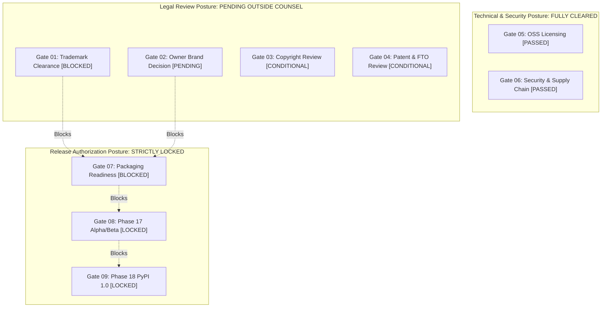

# ADAPTIVEML STAGE 16.2 — UPDATED RELEASE AUTHORIZATION SCORECARD
## Multi-Gate Governance Pipeline, Pre-Release Controls, and Stage 16.2 Authorization Matrix

**Document Identifier:** `docs/verification/stage_16_2/UPDATED_RELEASE_AUTHORIZATION_SCORECARD.md`<br>
**Distribution Package Identifier:** `aml-core`<br>
**Import Namespace:** `adaptive_ml`<br>
**Reported Version:** `0.1.0.dev0`<br>
**Git Baseline:** `master @ 67e9ef1b347ca223828a1f225e85e35a086a1f30`<br>
**Auditor / Team:** Independent Release Authorization Board & Legal Compliance Taskforce<br>
**Overall Status:** **`RELEASE STRICTLY BLOCKED — PHASES 17 & 18 LOCKED`**<br>
**Date:** 2026-11-06<br>

---

## 1. MULTI-GATE RELEASE SCORECARD

The following scorecard reflects the verified status of the nine formal release gates at the conclusion of Stage 16.2:

| Gate ID | Gate Name | Governance Scope | Stage 16 Baseline | Stage 16.2 Updated Status | Blocking Severity | Responsible Authority |
| :--- | :--- | :--- | :--- | :--- | :--- | :--- |
| **GATE-01** | **Trademark & Brand Clearance** | DEF-004 Resolution | `BLOCKED` | **`BLOCKED`** | **CRITICAL HARD BLOCK** | Outside Trademark Counsel |
| **GATE-02** | **Owner Brand Decision** | Formal ODR Execution | `BLOCKED` | **`PENDING`** | **CRITICAL HARD BLOCK** | Project Owner |
| **GATE-03** | **Copyright & Provenance** | 17 U.S.C. § 102(b) & DCO | `CONDITIONALLY READY` | **`CONDITIONALLY READY`** | **MAJOR ADVISORY** | Outside IP Counsel |
| **GATE-04** | **Patent & Prior-Art (FTO)** | Pure-CPU Block Quantization | `CONDITIONALLY READY` | **`CONDITIONALLY READY`** | **MAJOR ADVISORY** | Outside Patent Counsel |
| **GATE-05** | **OSS Licensing Compliance** | Apache 2.0 & Permissive Graph | `PASSED` | **`PASSED`** | **NONE (CLEARED)** | OSS Compliance Auditor |
| **GATE-06** | **Security & Supply Chain** | 0 CVEs, 0 Leaks, SafeTensors | `PASSED` | **`PASSED`** | **NONE (CLEARED)** | Security Lead |
| **GATE-07** | **Distribution Packaging** | Wheel & Sdist Alignment | `BLOCKED` | **`BLOCKED`** | **CRITICAL HARD BLOCK** | Release Manager |
| **GATE-08** | **Phase 17 Alpha/Beta Gate** | Controlled Distribution | `LOCKED` | **`LOCKED`** | **ABSOLUTE BLOCK** | Joint Owner & Counsel |
| **GATE-09** | **Phase 18 Production Release** | Public PyPI 1.0 Release | `LOCKED` | **`LOCKED`** | **ABSOLUTE BLOCK** | Full Release Board |

---

## 2. GOVERNANCE PIPELINE STATE DIAGRAM



---

## 3. RELEASE BOARD DETERMINATION

```
===================================================================================
                     RELEASE AUTHORIZATION SUMMARY
===================================================================================
TECHNICAL READINESS:             PRODUCTION GRADE (VERIFIED)
LEGAL CLEARANCE STATUS:          PENDING OUTSIDE COUNSEL OPINION
DEFECT DEF-004:                  OPEN — COUNSEL REVIEW REQUIRED
PHASE 17 (ALPHA/BETA):           STRICTLY LOCKED / NOT AUTHORIZED
PHASE 18 (PYPI 1.0):             STRICTLY LOCKED / NOT AUTHORIZED
OVERALL RELEASE AUTHORIZATION:   WITHHELD
===================================================================================
```
