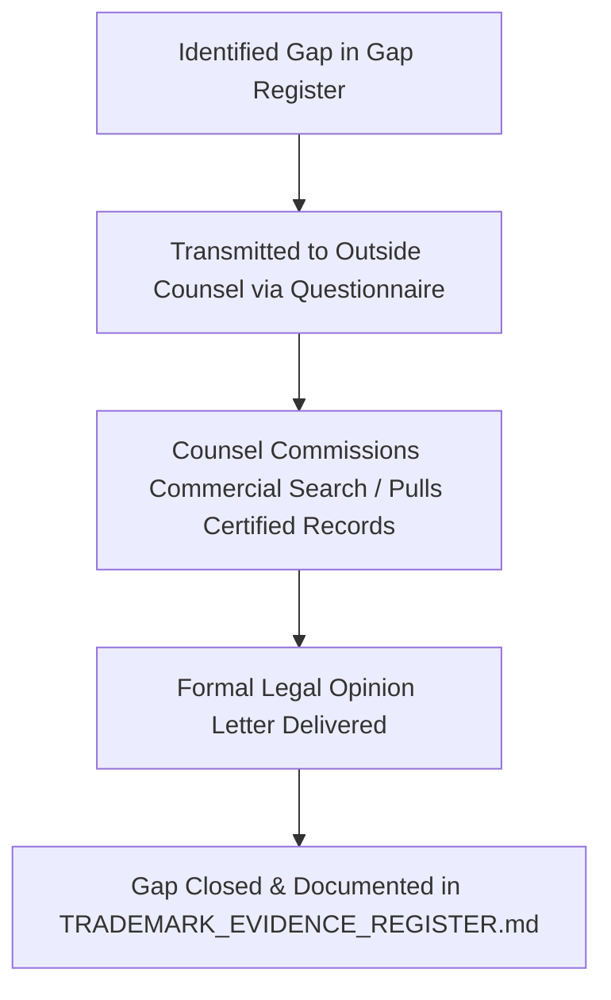

# ADAPTIVEML STAGE 16.3.1 — LEGAL EVIDENCE GAP REGISTER
## Missing Primary Records, Unresolved Evidence Limitations, and Tasks Assigned to Outside Counsel

**Document Identifier:** `docs/verification/stage_16_3_1/LEGAL_EVIDENCE_GAP_REGISTER.md` 
**Distribution Reference:** `docs/verification/stage_16_3_1/counsel_submission/LEGAL_EVIDENCE_GAP_REGISTER.md` 
**Stage:** 16.3.1 — External Counsel Engagement & Legal Evidence Submission 
**Baseline Git Commit:** `master @ 67e9ef1b347ca223828a1f225e85e35a086a1f30` 
**Audit Date:** 2026-11-06 
**Auditor:** Legal Evidence Auditor & Compliance Reviewer 

---

## 1. Executive Purpose & Gap Management

This register documents all factual claims, legal questions, and documentary records for which **primary authoritative evidence is currently absent or incomplete** in the repository.

In accordance with strict verification rules:
1. Technical auditors **shall not fabricate evidence** or assume claims are verified merely because they appeared in earlier reports.
2. Every identified gap is formally cataloged, categorized, and assigned to licensed legal counsel or an accredited trademark search firm for professional resolution.

---

## 2. Evidentiary Gap Classification & Assignment Matrix

| Gap ID | Identified Evidentiary Gap | Current Evidence Level | Why Gap Exists Locally | Risk / Impact on Project | Assigned Professional Action | Target Resolution Mechanism |
| :--- | :--- | :--- | :--- | :--- | :--- | :--- |
| **GAP-01** | **Certified USPTO Trademark Search & TSDR File Wrappers** | `SECONDARY EVIDENCE / PRELIMINARY SCAN` | Technical auditors only accessed the public web search interface; certified file wrappers and pending Intent-to-Use (ITU) records were not pulled. | Hidden pending applications or junior filings in Nice Class 09/42 could block release. | Assigned to Outside Trademark Counsel | Full multi-class commercial software clearance search (SAEGIS/Corsearch) across Class 09 and 42. |
| **GAP-02** | **Certified IP India Trademark Registry Records** | `SECONDARY EVIDENCE / PRELIMINARY SCAN` | Public IP India online search portal exhibits periodic latency and unindexed pending applications. | Common-law and statutory infringement exposure in primary development jurisdiction (India). | Assigned to Outside Trademark Counsel | Formal certified search report commissioned through Indian Trade Marks Registry / counsel agents. |
| **GAP-03** | **Datadog / Adaptive ML Acquisition & IP Assignment Terms** | `UNKNOWN PRIVATE DEAL TERMS` | Merger agreements, asset purchase schedules, and intellectual property assignments are private corporate contracts. | Unclear whether common-law trademark rights and goodwill for "Adaptive ML" formally transferred to Datadog, Inc. | Assigned to Outside Trademark Counsel | Counsel to evaluate risk under the assumption that Datadog owns all successor rights and goodwill. |
| **GAP-04** | **Formal Multi-Class Clearance Search for *ResiliML*** | `UNASSESSED (0 Searches Beyond Basic Knockout)` | Only basic PyPI index availability and quick USPTO text queries were performed. | Candidate name *ResiliML* cannot be adopted without confirming freedom to operate and absence of confusingly similar marks. | Assigned to Outside Trademark Counsel | Conduct full clearance search for *ResiliML* (and variants *Resili-*, *-ML*) in US, India, EU, and UK registries. |
| **GAP-05** | **International Trademark Scope (EUIPO, UKIPO, WIPO)** | `SECONDARY EVIDENCE / UNSEARCHED` | Local audits focused primarily on US and India; comprehensive international clearance was not conducted. | Open-source release on PyPI is globally accessible; potential exposure to foreign oppositions. | Assigned to Outside Trademark Counsel | Counsel to advise on necessity and territorial scope of foreign clearance searches. |
| **GAP-06** | **Empirical Litigation Defense Cost & Injunction Risk Modeling** | `STRUCK AS UNVERIFIED HEURISTIC` | Previous estimate (\$250,000–\$500,000) was an informal engineering estimate lacking empirical basis. | Misleads Project Owner regarding financial trade-offs of Option A vs. Option C. | Assigned to Outside Trademark Counsel | Counsel to provide objective, jurisdiction-specific litigation risk guidance and realistic exposure assessment. |
| **GAP-07** | **PEP 541 Dispute Precedent on PyPI Organization Accounts** | `INTERNAL PROJECT CLAIM` | Python Software Foundation PEP 541 name dispute precedents for open-source AI tooling have not been formally analyzed. | Unclear whether PSF would mediate or reassign conflicting namespace accounts. | Assigned to Outside Trademark Counsel / Open Source Specialist | Legal review of PSF trademark dispute policies and PEP 541 procedures. |

---

## 3. Protocol for Resolving Evidentiary Gaps

1. **Intake:** Outside counsel reviews the gaps cataloged above alongside [`COUNSEL_QUESTIONNAIRE_FINAL.md`](file:///c:/projects/AdaptiveML/docs/verification/stage_16_3_1/COUNSEL_QUESTIONNAIRE_FINAL.md).
2. **Search Commission:** Counsel commissions professional search vendors (e.g. Thomson CompuMark, Corsearch) to execute certified searches for Gaps 01, 02, 04, and 05.
3. **Legal Assessment:** Counsel addresses Gaps 03, 06, and 07 in their written opinion letter.
4. **Integration & Closure:** Upon receipt of counsel's opinion, findings are integrated into [`TRADEMARK_EVIDENCE_REGISTER.md`](file:///c:/projects/AdaptiveML/docs/verification/stage_16_3_1/TRADEMARK_EVIDENCE_REGISTER.md), closing the gaps.
