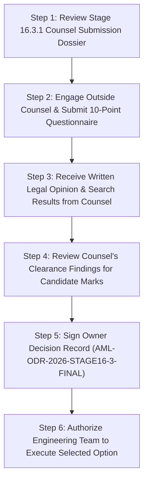

# ADAPTIVEML STAGE 16.3.1 — OWNER DECISION BRIEFING
## Executive Briefing on Strategic Remediation Options for the Project Owner

**Document Identifier:** `docs/verification/stage_16_3_1/OWNER_DECISION_BRIEFING.md`<br>
**Stage:** 16.3.1 — External Counsel Engagement & Legal Evidence Submission<br>
**Baseline Git Commit:** `master @ 67e9ef1b347ca223828a1f225e85e35a086a1f30`<br>
**Target Document for Execution:** [`docs/verification/stage_16_3/FINAL_OWNER_DECISION_RECORD.md`](file:///c:/projects/AdaptiveML/docs/verification/stage_16_3/FINAL_OWNER_DECISION_RECORD.md)<br>
**Briefing Date:** 2026-11-06<br>
**Author:** Software Architecture Taskforce, QA Lead & IP Compliance Reviewer<br>
**Audience:** The Project Owner<br>

---

## 1. Executive Purpose & Governance Boundary

This briefing is prepared exclusively for the **Project Owner** to facilitate an informed, autonomous decision regarding product branding, package naming, and trademark risk management for the software library currently titled `AdaptiveML` (`aml-core`).

> [!CAUTION]
> **GOVERNANCE BOUNDARY & DECISION AUTHORITY:**<br>
> 1. Engineering and audit teams **shall not select an option for the Project Owner**.
> 2. Engineering and audit teams **shall not sign or simulate the Owner Decision Record**.
> 3. Engineering's technical recommendation of a clean-break rebrand strategy is an **architectural assessment only**, and must **not** be treated as owner approval or legal clearance.
> 4. The Project Owner must evaluate outside legal counsel's formal written opinion before executing [`FINAL_OWNER_DECISION_RECORD.md`](file:///c:/projects/AdaptiveML/docs/verification/stage_16_3/FINAL_OWNER_DECISION_RECORD.md).

---

## 2. Objective Comparison of the Four Strategic Options

The four options available to the Project Owner are evaluated across operational, technical, legal, and economic dimensions:

```
+---------------------------------------------------------------------------------------------------------+
|                                    STRATEGIC DECISION MATRIX                                            |
+-------------------+-----------------------------------+-------------------------------------------------+
| Strategic Option  | Technical Naming Strategy         | Legal Clearance Dependency                      |
+-------------------+-----------------------------------+-------------------------------------------------+
| Option A          | Retain AdaptiveML / aml-core      | Accept residual trademark friction & defense risk|
| Option B          | Partial Rebrand (aml-core / aml)  | Counsel confirms brand insulation (Unlikely)   |
| Option C          | Full Clean-Break (e.g. ResiliML)  | Counsel searches & clears new distinctive mark  |
| Option D          | Extended Discovery / Project Hold | Freeze releases pending extended research       |
+-------------------+-----------------------------------+-------------------------------------------------+
```

---

### 2.1 Option A: Retain Existing Identity (Status Quo)
* **Naming Specification:** Product: `AdaptiveML` | PyPI: `aml-core` | Import: `adaptive_ml` | Repo: `AdaptiveML`.
* **Evidence Supporting:**
  - Technical inertia: Zero code refactoring required; 100% of documentation, tutorials, and tests remain intact.
  - "Adaptive" and "ML" are technically descriptive terms in machine learning academia.
  - PyPI package `aml-core` is available and distinct from Datadog's `adaptive-sdk`.
* **Unresolved Legal Questions:**
  - Does marketing an ML library under "AdaptiveML" expose the project to Lanham Act § 43(a) claims by Datadog (senior commercial user of *Adaptive ML*)?
  - What are the true legal defense costs and likelihood of preliminary injunction? *(Note: The previously cited figure of \$250,000–\$500,000 has been struck as an unverified internal estimate; counsel must evaluate true risk).*
* **Engineering Impact:** Zero hours; zero code changes.
* **Compatibility Impact:** 100% backward compatibility preserved.
* **Distribution Consequences:** Releases may be contested by Datadog; risk of forced emergency rebranding post-launch.
* **Dependencies:** Project Owner willingness to accept potential legal friction; counsel advice on likelihood of confusion.
* **Reversibility:** High pre-launch; very low and disruptive post-launch once external developers adopt the namespace.

---

### 2.2 Option B: Partial Rebrand (Distribution & Namespace Only)
* **Naming Specification:** Product: `AdaptiveML` | PyPI: `aml-core` (or `aml`) | Import: `aml` | Repo: `AdaptiveML`.
* **Evidence Supporting:**
  - Shortens the runtime import (`import aml as aml`).
  - Separates the runtime code string from the full words "Adaptive ML".
* **Unresolved Legal Questions:**
  - Does changing the package/namespace while retaining "AdaptiveML" on the website, documentation, and repository cure trademark liability, or does it trigger the *Asymmetric Resolution Trap*?
  - Does `import aml` collide with Microsoft Azure ML (`azureml`) or established anti-money laundering software?
* **Engineering Impact:** $\approx 3\text{--}4\text{ hours}$ to update import namespaces across 70 modules.
* **Compatibility Impact:** Breaks existing `import adaptive_ml` user scripts (requires import alias shim).
* **Distribution Consequences:** Solves package collision but fails to insulate the project brand.
* **Dependencies:** Outside counsel concurrence that public brand retention is legally defensible.
* **Reversibility:** Moderate.

---

### 2.3 Option C: Full Clean-Break Rebrand (Engineering Recommended Architecture)
* **Naming Specification:** Product: *ResiliML* (or counsel-cleared mark) | PyPI: `resiliml` | Import: `resiliml` | Repo: `ResiliML`.
* **Evidence Supporting:**
  - Completely decouples the project from *Adaptive ML, Inc.* and Datadog across all five surfaces.
  - Eliminates all consumer confusion, unfair competition, and passing-off exposure related to "AdaptiveML".
  - *ResiliML* is unallocated on PyPI; preliminary basic USPTO scan revealed zero identical registered software marks.
  - Standby AST automated refactoring scripts (`scripts/migrate_identity.py`) are built, validated in dry-run mode, and standing by.
* **Unresolved Legal Questions:**
  - *ResiliML* legal risk is **`UNASSESSED — PENDING INDEPENDENT TRADEMARK CLEARANCE`**. Counsel must conduct a multi-class clearance search to confirm freedom to operate.
  - Are there prefix/suffix collisions (*Resili-*, *-ML*) in Class 09/42?
* **Engineering Impact:** $\approx 6\text{--}8\text{ engineering hours}$ for full automated AST migration, documentation build, and test suite verification.
* **Compatibility Impact:** Clean break; acceptable prior to public 1.0 release since no public PyPI release has occurred.
* **Distribution Consequences:** Enables clean public PyPI release and unencumbered trademark registration by the project.
* **Dependencies:** Formal trademark clearance search by outside counsel confirming freedom to operate.
* **Reversibility:** Low once executed, but establishes permanent brand equity.

---

### 2.4 Option D: Extended Discovery & Project Hold
* **Naming Specification:** Status quo maintained in local sandbox; zero external distribution.
* **Evidence Supporting:** Allows comprehensive discovery of Datadog's actual trademark registration status and commercial plans.
* **Unresolved Legal Questions:** Whether waiting provides any strategic advantage or simply delays open-source release.
* **Engineering Impact:** Zero immediate engineering; project is placed in a maintenance/freeze state.
* **Compatibility Impact:** Neutral.
* **Distribution Consequences:** Controlled Alpha (Phase 17) and Public PyPI (Phase 18) remain indefinitely blocked (30–60+ days).
* **Dependencies:** Engagement of commercial brand consultants and extensive legal discovery.
* **Reversibility:** High.

---

## 3. Recommended Decision Sequence for the Project Owner

To ensure strict legal and governance compliance, the Project Owner is advised to follow this structured sequence:



1. **Step 1:** Review [`COUNSEL_SUBMISSION_DOSSIER.md`](file:///c:/projects/AdaptiveML/docs/verification/stage_16_3_1/COUNSEL_SUBMISSION_DOSSIER.md) and [`COUNSEL_QUESTIONNAIRE_FINAL.md`](file:///c:/projects/AdaptiveML/docs/verification/stage_16_3_1/COUNSEL_QUESTIONNAIRE_FINAL.md).
2. **Step 2:** Transmit the submission package to qualified external trademark counsel.
3. **Step 3:** Await counsel's formal written legal opinion and search results (tracked in [`COUNSEL_OPINION_TRACKER.md`](file:///c:/projects/AdaptiveML/docs/verification/stage_16_3_1/COUNSEL_OPINION_TRACKER.md)).
4. **Step 4:** Review counsel's advice regarding trademark risk under Option A vs. clearance for candidate marks under Option C (*ResiliML*).
5. **Step 5:** Complete and sign [`FINAL_OWNER_DECISION_RECORD.md`](file:///c:/projects/AdaptiveML/docs/verification/stage_16_3/FINAL_OWNER_DECISION_RECORD.md).
6. **Step 6:** Deliver the signed ODR to engineering to trigger release authorization and any required AST migration.
