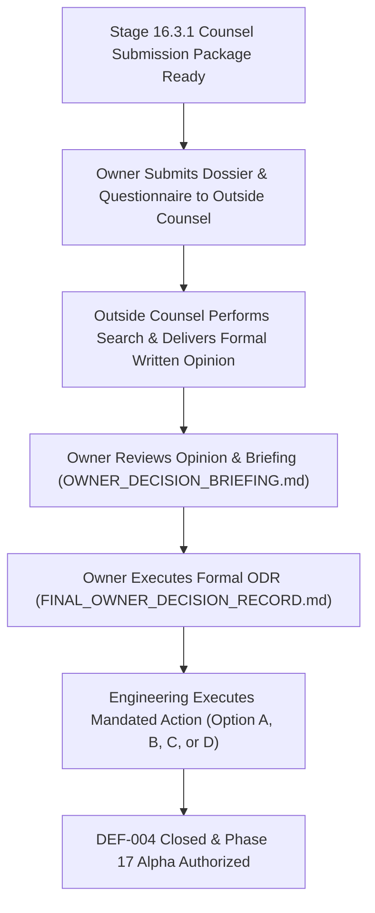

# Stage 16.3.1 Executive Summary
## External Counsel Engagement & Legal Evidence Submission

**Project:** AdaptiveML — Adaptive, Robust, Resource-Efficient Learning 
**Workspace:** `C:\projects\AdaptiveML` 
**Distribution Identifier:** `aml-core` 
**Import Namespace:** `adaptive_ml` 
**Reported Version:** `0.1.0.dev0` 
**Git Baseline:** `master @ 67e9ef1b347ca223828a1f225e85e35a086a1f30` 
**Working Tree Invariant:** 100% Preserved (0 production code lines modified, 0 commits, 0 tags, 0 remote pushes) 
**Stage 16.3.1 Verdict:** **`STAGE 16.3.1 COMPLETE — COUNSEL SUBMISSION PACKAGE PREPARED`** 
**DEF-004 Status:** **`OPEN — COUNSEL REVIEW REQUIRED`** 
**Phase 17 Verdict:** **`PHASE 17 PREPARED — DISTRIBUTION NOT AUTHORIZED`** 
**Phase 18 Public PyPI 1.0:** **`STRICTLY LOCKED`** 

---

## 1. Executive Mission & Stage Scope

Stage 16.3.1 establishes a formal, evidence-grounded legal preparation and evidence handover process for qualified external trademark and intellectual property counsel. It corrects governance inconsistencies identified in Stage 16.3, provides a rigorous classification of all factual claims, and prepares a comprehensive submission dossier for external legal review.

> [!IMPORTANT]
> **GOVERNANCE BOUNDARY & ROLE DELIMITATION:** 
> This is a **legal-preparation and evidence-management stage**. It is **not** a legal-clearance stage. 
> Technical auditors and software engineers cannot and do not render legal opinions, declare trademark clearance, or authorize release distribution. 
>
> The baseline package identity (`AdaptiveML` / `aml-core` v0.1.0.dev0 / `adaptive_ml`) is preserved strictly as a **technical baseline**. This does **not** establish legal clearance.

---

## 2. Core Governance Rules & Non-Negotiable Boundaries

Under Section 1 of the Stage 16.3.1 Master Execution Prompt, the following rules were strictly maintained throughout execution:

1. **Zero Production Code Changes:** No files in `adaptive_ml/` were modified.
2. **Zero Project Renaming:** The project codename remains `AdaptiveML`.
3. **Zero Package Metadata or Namespace Drift:** `pyproject.toml` retains `name = "aml-core"`, and runtime imports remain `import adaptive_ml`.
4. **Zero AST Migration Execution:** `scripts/migrate_identity.py` was not executed.
5. **Zero Git State Modification:** Zero commits, zero Git tags, and zero remote repository pushes.
6. **Zero PyPI / TestPyPI Publication:** No artifacts were published or uploaded.
7. **Zero External Distribution:** Alpha wheels and source distributions remain strictly internal.
8. **DEF-004 Maintained Strictly OPEN:** Defect `DEF-004` cannot be closed without signed counsel opinion.
9. **Zero Simulation of Owner Decisions:** The Owner Decision Record remains unsigned (`DRAFT`).
10. **Zero Invention of Legal Correspondence:** No external legal letters or opinions were fabricated.
11. **100% Document Preservation:** All historical verification reports from Stage 16 through Stage 16.3 and Phase 17 are preserved.
12. **Historical Stop Condition Preserved:** [`OWNER_DECISION_PENDING.md`](file:///c:/projects/AdaptiveML/docs/verification/stage_16_3/OWNER_DECISION_PENDING.md) is preserved as historical evidence.

---

## 3. Governance Inconsistencies Corrected in Stage 16.3.1

In accordance with Section 3 of the Master Execution Prompt, four governance inconsistencies from Stage 16.3 were reviewed, corrected, and documented in [`STAGE_16_3_GOVERNANCE_CORRECTIONS.md`](file:///c:/projects/AdaptiveML/docs/verification/stage_16_3_1/STAGE_16_3_GOVERNANCE_CORRECTIONS.md):

| Issue Area | Stage 16.3 Phrasing / Assessment | Stage 16.3.1 Corrected Governance Finding |
| :--- | :--- | :--- |
| **Option C Legal Risk** | Described *ResiliML* as "LOW legal risk" while also acknowledging it was not legally cleared. | Corrected to **`UNASSESSED — PENDING INDEPENDENT TRADEMARK CLEARANCE`**. Engineering recommends a clean-break strategy from a technical maintenance standpoint, but must not assign legal risk ratings to unsearched candidates. |
| **Litigation Cost Estimates** | Cited an estimate of \$250,000–\$500,000 defense cost and claimed high likelihood of preliminary injunction. | Marked formally as **`UNVERIFIED / INTERNAL PROJECT ESTIMATE`**. Struck as a decisive factual basis for rejecting Option A; referred to counsel under Question 1 and Question 6. |
| **Identity Decision Status** | `APPROVED_IDENTITY_DECISION.md` contained phrasing implying the owner approved the baseline identity. | Corrected to **`BASELINE IDENTITY PRESERVED — NO FINAL LEGAL IDENTITY APPROVAL`**. Additive clarification appended to the historical record. |
| **Stop-Condition History** | Potential risk of deleting `OWNER_DECISION_PENDING.md` upon decision. | Formally preserved as permanent historical record. Any future authorization must supersede it through a dated record rather than deletion. |

---

## 4. Master Deliverables Matrix

Thirteen authoritative deliverables were generated in `docs/verification/stage_16_3_1/`:

| Deliverable ID | Document Path | Core Purpose |
| :--- | :--- | :--- |
| **DEL-01** | [`STAGE_16_3_1_EXECUTIVE_SUMMARY.md`](file:///c:/projects/AdaptiveML/docs/verification/stage_16_3_1/STAGE_16_3_1_EXECUTIVE_SUMMARY.md) | Master executive overview and governance dashboard. |
| **DEL-02** | [`REPOSITORY_AND_EVIDENCE_INVENTORY.md`](file:///c:/projects/AdaptiveML/docs/verification/stage_16_3_1/REPOSITORY_AND_EVIDENCE_INVENTORY.md) | Exhaustive inventory and classification of repository artifacts and claims. |
| **DEL-03** | [`STAGE_16_3_GOVERNANCE_CORRECTIONS.md`](file:///c:/projects/AdaptiveML/docs/verification/stage_16_3_1/STAGE_16_3_GOVERNANCE_CORRECTIONS.md) | Formal corrections to Stage 16.3 risk labels, estimates, and identity statuses. |
| **DEL-04** | [`COUNSEL_SUBMISSION_DOSSIER.md`](file:///c:/projects/AdaptiveML/docs/verification/stage_16_3_1/COUNSEL_SUBMISSION_DOSSIER.md) | Comprehensive, 15-section factual dossier for external legal counsel review. |
| **DEL-05** | [`COUNSEL_QUESTIONNAIRE_FINAL.md`](file:///c:/projects/AdaptiveML/docs/verification/stage_16_3_1/COUNSEL_QUESTIONNAIRE_FINAL.md) | Definitive 10-point statutory legal questionnaire for outside counsel. |
| **DEL-06** | [`TRADEMARK_EVIDENCE_REGISTER.md`](file:///c:/projects/AdaptiveML/docs/verification/stage_16_3_1/TRADEMARK_EVIDENCE_REGISTER.md) | Traceable evidence register mapping claims to primary sources and limitations. |
| **DEL-07** | [`CANDIDATE_IDENTITY_INVESTIGATION_BRIEF.md`](file:///c:/projects/AdaptiveML/docs/verification/stage_16_3_1/CANDIDATE_IDENTITY_INVESTIGATION_BRIEF.md) | Technical investigation brief of prospective candidate names for counsel search. |
| **DEL-08** | [`OWNER_DECISION_BRIEFING.md`](file:///c:/projects/AdaptiveML/docs/verification/stage_16_3_1/OWNER_DECISION_BRIEFING.md) | Objective briefing on four strategic options for the Project Owner. |
| **DEL-09** | [`COUNSEL_HANDOVER_CHECKLIST.md`](file:///c:/projects/AdaptiveML/docs/verification/stage_16_3_1/COUNSEL_HANDOVER_CHECKLIST.md) | Formal handover protocol and submission checklist for counsel engagement. |
| **DEL-10** | [`COUNSEL_OPINION_TRACKER.md`](file:///c:/projects/AdaptiveML/docs/verification/stage_16_3_1/COUNSEL_OPINION_TRACKER.md) | Tracking register maintaining `COUNSEL OPINION STATUS: PENDING`. |
| **DEL-11** | [`LEGAL_EVIDENCE_GAP_REGISTER.md`](file:///c:/projects/AdaptiveML/docs/verification/stage_16_3_1/LEGAL_EVIDENCE_GAP_REGISTER.md) | Register of evidentiary gaps requiring counsel or professional search firms. |
| **DEL-12** | [`STAGE_16_3_1_INDEPENDENT_REVIEW.md`](file:///c:/projects/AdaptiveML/docs/verification/stage_16_3_1/STAGE_16_3_1_INDEPENDENT_REVIEW.md) | Independent QA audit certifying compliance with non-negotiable rules. |
| **DEL-13** | [`STAGE_16_3_1_COMPLETION_REPORT.md`](file:///c:/projects/AdaptiveML/docs/verification/stage_16_3_1/STAGE_16_3_1_COMPLETION_REPORT.md) | Master completion report and organizational sign-off. |

---

## 5. Next Steps for Project Owner

1. **Transmit Submission Package:** Submit [`COUNSEL_SUBMISSION_DOSSIER.md`](file:///c:/projects/AdaptiveML/docs/verification/stage_16_3_1/COUNSEL_SUBMISSION_DOSSIER.md) and [`COUNSEL_QUESTIONNAIRE_FINAL.md`](file:///c:/projects/AdaptiveML/docs/verification/stage_16_3_1/COUNSEL_QUESTIONNAIRE_FINAL.md) to qualified trademark counsel.
2. **Await Written Opinion:** Track engagement status in [`COUNSEL_OPINION_TRACKER.md`](file:///c:/projects/AdaptiveML/docs/verification/stage_16_3_1/COUNSEL_OPINION_TRACKER.md).
3. **Execute ODR:** Following receipt of counsel's formal advice, execute [`FINAL_OWNER_DECISION_RECORD.md`](file:///c:/projects/AdaptiveML/docs/verification/stage_16_3/FINAL_OWNER_DECISION_RECORD.md) to authorize subsequent engineering stages.
