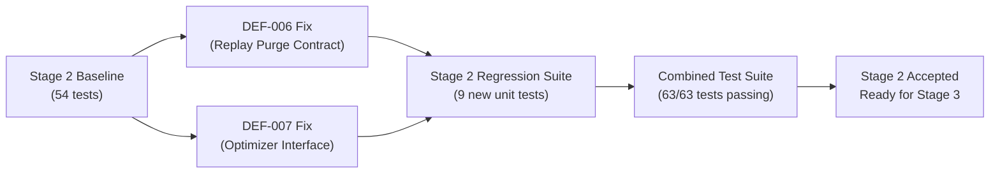

# Stage 2: Production Defect Remediation & Architecture Hardening
## Verification & Governance Report Suite

**Document Identifier:** `VERIF-STAGE-2-001` 
**Distribution Package Identifier:** `aml-core` 
**Package Version:** `0.1.0.dev0` 
**Verification Baseline:** `67e9ef1b347ca223828a1f225e85e35a086a1f30` 
**Target Defects:** DEF-006 (Replay Buffer Contract Mismatch), DEF-007 (Optimizer Interface Mismatch) 
**Status:** `PASSED / VERIFIED`

---

## 1. Scope & Objective

Stage 2 resolves two critical cross-pillar contract defects identified during the independent enterprise verification of AdaptiveML:
1. **DEF-006 (Replay Buffer Contract)**: Contractual misalignment between [`adaptive_ml/ala/classifier.py`](file:///c:/projects/AdaptiveML/adaptive_ml/ala/classifier.py) and [`adaptive_ml/ulc/controller.py`](file:///c:/projects/AdaptiveML/adaptive_ml/ulc/controller.py) where the replay buffer was held privately (`_replay_buffer`) and lacked a safe, minority-preserving selective purge contract.
2. **DEF-007 (Optimizer Interface Mismatch)**: Method call failures where ULC expected [`reset_momenta`](file:///c:/projects/AdaptiveML/adaptive_ml/rao/adamw.py) and [`scale_learning_rate`](file:///c:/projects/AdaptiveML/adaptive_ml/rao/adamw.py) on [`LowMemoryAdamW`](file:///c:/projects/AdaptiveML/adaptive_ml/rao/adamw.py), which previously implemented neither.
3. **State Machine Hardening**: Formalized finite state automaton transitions, hysteresis deadbands, cooldown timers, and safe fallback states in ULC.

---

## 2. Document Set

| Document | Content Description |
| :--- | :--- |
| [`PROTOCOL.md`](file:///c:/projects/AdaptiveML/docs/verification/stage_2/PROTOCOL.md) | Formal verification protocol, experimental methodologies, and test gates. |
| [`IMPLEMENTATION_SUMMARY.md`](file:///c:/projects/AdaptiveML/docs/verification/stage_2/IMPLEMENTATION_SUMMARY.md) | Technical description of code modifications across ALA, RAO, and ULC. |
| [`CROSS_PILLAR_CONTRACTS.md`](file:///c:/projects/AdaptiveML/docs/verification/stage_2/CROSS_PILLAR_CONTRACTS.md) | Formal interface specifications and capability protocols between the four pillars. |
| [`TEST_RESULTS.md`](file:///c:/projects/AdaptiveML/docs/verification/stage_2/TEST_RESULTS.md) | Full pytest execution logs across unit, integration, and remediation suites. |
| [`EXPERIMENT_RESULTS.md`](file:///c:/projects/AdaptiveML/docs/verification/stage_2/EXPERIMENT_RESULTS.md) | Empirical benchmark data, latencies, and retention ratios. |
| [`LIMITATIONS.md`](file:///c:/projects/AdaptiveML/docs/verification/stage_2/LIMITATIONS.md) | Known technical constraints, edge-case boundaries, and non-goals. |
| [`ACCEPTANCE_REPORT.md`](file:///c:/projects/AdaptiveML/docs/verification/stage_2/ACCEPTANCE_REPORT.md) | Formal sign-off and stage transition gate declaration. |

---

## 3. Verification Summary

- **All 54 baseline tests preserved without regression.**
- **9 new comprehensive unit tests added in [`tests/unit/test_stage2_remediation.py`](file:///c:/projects/AdaptiveML/tests/unit/test_stage2_remediation.py).**
- **Zero git commits, zero package name modifications, and DEF-004 / Phase 17 remain untouched.**
