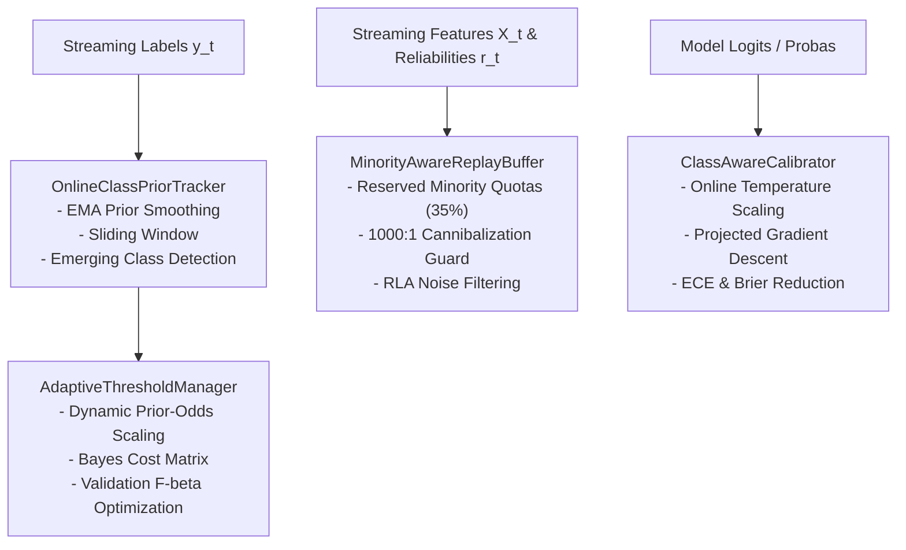

# Stage 3: Implementation Summary
## Adaptive Minority Intelligence Subsystem

**Document Identifier:** `VERIF-STAGE-3-003` 
**Distribution Package Identifier:** `aml-core` 
**Package Version:** `0.1.0.dev0` 
**Author:** Antigravity Engineering & Research Team

---

## 1. Subsystem Architecture

The `adaptive_ml.minority` package operates as an independent, modular pillar within AdaptiveML, providing streaming minority-preservation and calibration algorithms without external framework coupling.

---

## 2. Component Design & API Signatures

### 2.1 `OnlineClassPriorTracker` ([`prior.py`](file:///c:/projects/AdaptiveML/adaptive_ml/minority/prior.py))
- **Mathematical Kernel:**
  $$\hat{\pi}_c^{(t)} = (1 - \alpha) \hat{\pi}_c^{(t-1)} + \alpha \frac{n_c^{(t)} + \epsilon}{N^{(t)} + K \epsilon}$$
- **Key Methods:**
  - `update(y: np.ndarray) -> np.ndarray`: Ingests label batch, updates EMA and sliding window.
  - `register_class(new_class_id: int) -> None`: Dynamically resizes prior vectors when new class arrives.
  - `is_emerging(class_id: int) -> bool`: Identifies newly arrived or rare transitioning classes.
  - `@property imbalance_ratio -> float`: Real-time ratio $\max(\hat{\pi}) / \min(\hat{\pi})$.

### 2.2 `AdaptiveThresholdManager` ([`threshold.py`](file:///c:/projects/AdaptiveML/adaptive_ml/minority/threshold.py))
- **Mathematical Kernel:**
  $$\tau_c(t) = \text{clip}\left(\tau_0 \cdot \left(\frac{\hat{\pi}_c(t)}{\pi_0}\right)^\gamma, \tau_{\min}, \tau_{\max}\right)$$
  $$\tau^* = \frac{C_{FP} - C_{TN}}{(C_{FP} - C_{TN}) + (C_{FN} - C_{TP})}$$
- **Key Methods:**
  - `update_from_priors(priors: np.ndarray) -> np.ndarray`: Adapts decision boundaries.
  - `optimize_on_validation(val_probas, val_labels, metric="f1", beta=1.0) -> float`: Grid optimization.
  - `predict(probas: np.ndarray) -> np.ndarray`: Converts posterior probabilities to labels.
  - `rollback() -> None`: Safe recovery from detrimental threshold shifts.

### 2.3 `MinorityAwareReplayBuffer` ([`replay.py`](file:///c:/projects/AdaptiveML/adaptive_ml/minority/replay.py))
- **Dedicated Quota Reservation:** Strictly reserves `capacity * min_minority_fraction` memory slots exclusively for minority classes.
- **Cannibalization Immunity:** Arriving majority instances are confined to `capacity * (1 - min_minority_fraction)` slots and use intra-class reservoir replacement, guaranteeing that minority memories are never evicted by majority floods.
- **RLA Noise Filtering:** Samples with reliability $r < \text{min\_reliability}$ are rejected prior to buffer insertion.

### 2.4 `ClassAwareCalibrator` ([`calibration.py`](file:///c:/projects/AdaptiveML/adaptive_ml/minority/calibration.py))
- **Mathematical Kernel:**
  $$P(y = c \mid x) = \frac{\exp(z_c / T_c)}{\sum_{j=1}^K \exp(z_j / T_j)}$$
- **Optimization:** Online projected gradient descent on $\log(T_c)$ minimizing cross-entropy loss over validation windows.
- **Scoring:** Implements Expected Calibration Error (`compute_ece`) and Brier score (`compute_brier_score`).
