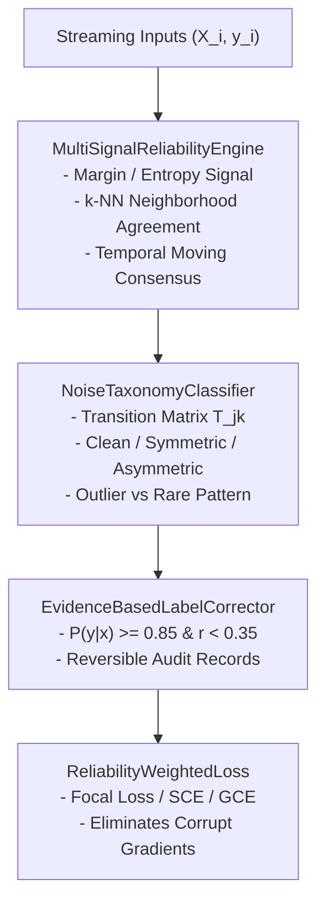

# Stage 5: Implementation Summary
## RLA 2.0 (Advanced Robust Learning Algorithms)

**Document Identifier:** `VERIF-STAGE-5-003` 
**Distribution Package Identifier:** `aml-core` 
**Package Version:** `0.1.0.dev0` 
**Author:** Antigravity Engineering & Research Team

---

## 1. Architectural Architecture

RLA 2.0 introduces deep noise diagnostics and adaptive risk mitigation:

---

## 2. Component Design & Mathematical Formulations

### 2.1 Multi-Signal Reliability Engine ([`reliability.py`](file:///c:/projects/AdaptiveML/adaptive_ml/rla/reliability.py))
- **Tri-Signal Kernel:**
  $$r_i = w_{\text{margin}} s_{\text{margin}, i} + w_{\text{neighbor}} s_{\text{neighbor}, i} + w_{\text{temporal}} s_{\text{temporal}, i}$$
  Where:
  $$s_{\text{margin}, i} = \text{clip}\left(\frac{(p_{y_i} - \max_{j \ne y_i} p_j) + 1}{2}, 0, 1\right)$$
  $$s_{\text{neighbor}, i} = \frac{1}{K} \sum_{j \in \mathcal{N}_K(x_i)} \mathbb{I}(y_j = y_i)$$

### 2.2 Noise Taxonomy & Outlier Discrimination ([`noise_classifier.py`](file:///c:/projects/AdaptiveML/adaptive_ml/rla/noise_classifier.py))
- **Empirical Transition Matrix:**
  $$\mathbf{T}_{j, k} = P(\hat{y} = k \mid y = j) = \frac{\sum_i \mathbb{I}(y_i = j \land \hat{y}_i = k)}{\sum_i \mathbb{I}(y_i = j)}$$
- **Discrimination Rule:**
  $$d_{\text{proto}}(x_i, \mu_{y_i}) = \frac{1}{D} \sum_{d=1}^D \frac{|x_{i, d} - \mu_{y_i, d}|}{\sigma_{y_i, d} + \epsilon}$$
  If $d_{\text{proto}}(x_i, \mu_{y_i}) < 2.0$ and $d_{\text{proto}}(x_i, \mu_{y_i}) \le \min_{c \ne y_i} d_{\text{proto}}(x_i, \mu_c)$, declare `PatternType.RARE_VALID_PATTERN`.

### 2.3 Enhanced Loss Portfolio ([`losses.py`](file:///c:/projects/AdaptiveML/adaptive_ml/rla/losses.py))
- **Focal Loss:**
  $$\mathcal{L}_{\text{FL}} = -\alpha (1 - p_y)^\gamma \ln(p_y)$$
  $$\frac{\partial \mathcal{L}_{\text{FL}}}{\partial z_k} = \alpha (1 - p_y)^{\gamma - 1} \left[ (1 - p_y) - \gamma p_y \ln(p_y) \right] (p_k - \mathbb{I}(k = y))$$
- **Reliability-Weighted Loss:**
  $$\mathcal{L}_{\text{RWL}} = \frac{\sum_i r_i \cdot \ell_i}{\sum_i r_i + \epsilon}, \quad \nabla_z \mathcal{L}_{\text{RWL}} = \frac{r_i}{\sum_j r_j + \epsilon} \nabla_z \ell_i$$

### 2.4 Evidence-Based Label Correction ([`label_correction.py`](file:///c:/projects/AdaptiveML/adaptive_ml/rla/label_correction.py))
- **Non-Destructive Audit:** Proposes corrected labels $\hat{y}$ only when $P(y = \hat{y} \mid x) \ge \tau_{\text{conf}}$ and $r_i < \tau_{\text{noise}}$, recording an immutable `CorrectionAuditRecord` allowing lossless rollback.
