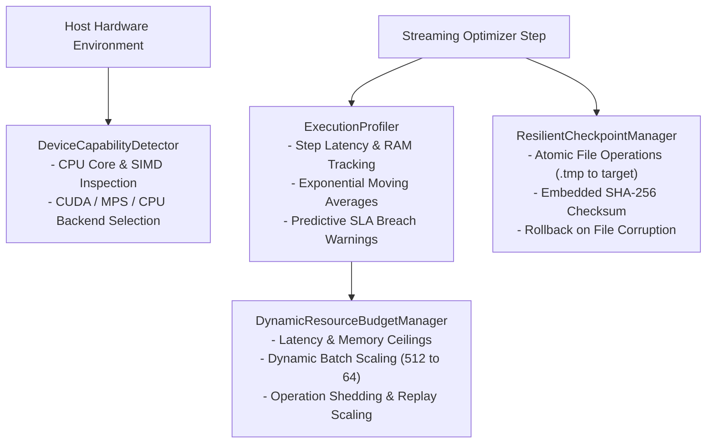

# Stage 6: Implementation Summary
## RAO 2.0 (Advanced Resource-Aware Optimization)

**Document Identifier:** `VERIF-STAGE-6-003` 
**Distribution Package Identifier:** `aml-core` 
**Package Version:** `0.1.0.dev0` 
**Author:** Antigravity Engineering & Research Team

---

## 1. Architectural Architecture

RAO 2.0 provides continuous hardware adaptation and resource guardrails:

---

## 2. Component Design & Mathematical Formulations

### 2.1 Dynamic Resource Budget Manager ([`budget.py`](file:///c:/projects/AdaptiveML/adaptive_ml/rao/budget.py))
- **Multi-Dimensional State Engine:**
  $$u_{\text{time}} = \frac{T_{\text{step}}}{T_{\max}}, \quad u_{\text{mem}} = \frac{M_{\text{process}}}{M_{\max}}, \quad u = \max(u_{\text{time}}, u_{\text{mem}})$$
  - $u < 0.80$: `BudgetState.NORMAL` (Gradual recovery: $B_{t+1} = \min(B_{\max}, 1.10 \cdot B_t)$).
  - $0.80 \le u < 1.0$: `BudgetState.PRESSURE_WARNING` ($B_{t+1} = \max(B_{\min}, 0.85 \cdot B_t)$).
  - $u \ge 1.0$: `BudgetState.CRITICAL` ($B_{t+1} = \max(B_{\min}, \lfloor B_t / 2 \rfloor)$, operation shedding active).

### 2.2 Execution Profiling & Predictive Breach Alerts ([`profiler.py`](file:///c:/projects/AdaptiveML/adaptive_ml/rao/profiler.py))
- **EMA Latency Kernel:**
  $$\bar{T}_t = (1 - \alpha) \bar{T}_{t-1} + \alpha T_t$$
- **Predictive Breach Rule:**
  $$\text{breach\_predicted} = (\bar{T}_t \cdot \gamma_{\text{safety}} \ge T_{\max})$$

### 2.3 Hardware & Accelerator Capability Detection ([`device.py`](file:///c:/projects/AdaptiveML/adaptive_ml/rao/device.py))
- Non-invasive detection of CPU machine architecture, physical and logical core counts, CUDA driver availability, and Apple MPS, recommending the optimal backend without external crashes.

### 2.4 Resilient Checkpoint Manager ([`recovery.py`](file:///c:/projects/AdaptiveML/adaptive_ml/rao/recovery.py))
- **Atomic File Replacement:** Writes checkpoint bundle to temporary file, flushes to disk via `os.fsync`, and renames atomically to prevent torn writes upon process termination.
- **SHA-256 Integrity Validation:** Embeds checksum in bundle; if newest checkpoint fails hash validation or JSON parsing, automatically rolls back to the previous verified checkpoint.
