# AdaptiveML Stage 8 — Documentation Validation & Architecture Report

**Document Identifier**: `STAGE-8-DOC-VAL-001` 
**Distribution Name**: `aml-core` 
**Namespace**: `adaptive_ml` 
**Version**: `0.1.0.dev0` 
**Status**: VALIDATED / COMPLETE 
**Date**: November 6, 2026 
**Governance**: DEF-004 Remains Open (Phase 17 & Phase 18 locked)

---

## 1. Executive Summary

This report documents the architectural audit, structural validation, and cross-reference integrity of the AdaptiveML documentation suite created and updated during Stage 8.

All documentation was reviewed for:
1. Technical accuracy against the verified Python 3.14 runtime behavior.
2. Complete coverage of all 4 pillars (ALA, RLA, RAO, ULC) and Minority Intelligence.
3. Uniform adherence to clickable forward-slash `file:///` links and KaTeX math syntax (`$...$`).
4. Strict governance compliance: explicit disclaimers regarding DEF-004, prohibition of public PyPI release, and locking of Phase 17 and Phase 18.

---

## 2. Documentation Architecture Sitemap

```mermaid
graph TD
    Docs["docs/ Root"]
    Docs --> GS["docs/getting_started/"]
    Docs --> TUT["docs/tutorials/"]
    Docs --> API["docs/api/"]
    Docs --> VER["docs/verification/stage_8/"]

    GS --> GS1["installation.md"]
    GS --> GS2["quickstart.md"]
    GS --> GS3["core_concepts.md"]
    GS --> GS4["configuration.md"]
    GS --> GS5["troubleshooting.md"]

    TUT --> T1["ala.md"]
    TUT --> T2["rla.md"]
    TUT --> T3["rao.md"]
    TUT --> T4["ulc.md"]

    API --> A0["index.md"]
    API --> A1["ala.md"]
    API --> A2["rla.md"]
    API --> A3["rao.md"]
    API --> A4["ulc.md"]
    API --> A5["minority.md"]
    API --> A6["state.md"]
    API --> A7["core.md"]

    VER --> V1["INITIAL_WORKSPACE_AUDIT.md"]
    VER --> V2["PUBLIC_API_AUDIT.md"]
    VER --> V3["API_STANDARDIZATION_REPORT.md"]
    VER --> V4["PUBLIC_SDK_DESIGN.md"]
    VER --> V5["CONFIGURATION_DESIGN.md"]
    VER --> V6["ERROR_HANDLING_AND_LIFECYCLE.md"]
    VER --> V7["INSTALLATION_AND_PACKAGING_REPORT.md"]
    VER --> V8["EXAMPLE_EXECUTION_REPORT.md"]
    VER --> V9["STATIC_QUALITY_REPORT.md"]
    VER --> V10["PYTHON_COMPATIBILITY_REPORT.md"]
    VER --> V11["DOCUMENTATION_VALIDATION_REPORT.md"]
    VER --> V12["STAGE_8_COMPLETION_REPORT.md"]
```

---

## 3. Structural Validation Checklist

| Document Path | Functional Scope | Link Check | KaTeX Math Check | Status |
| :--- | :--- | :---: | :---: | :---: |
| [`docs/getting_started/installation.md`](file:///c:/projects/AdaptiveML/docs/getting_started/installation.md) | Package installation, extras, wheels | PASSED | N/A | VALIDATED |
| [`docs/getting_started/quickstart.md`](file:///c:/projects/AdaptiveML/docs/getting_started/quickstart.md) | 5-minute end-to-end tutorial | PASSED | PASSED | VALIDATED |
| [`docs/getting_started/core_concepts.md`](file:///c:/projects/AdaptiveML/docs/getting_started/core_concepts.md) | Four-pillar theoretical foundations | PASSED | PASSED | VALIDATED |
| [`docs/getting_started/configuration.md`](file:///c:/projects/AdaptiveML/docs/getting_started/configuration.md) | Configuration dataclasses & serialization | PASSED | PASSED | VALIDATED |
| [`docs/getting_started/troubleshooting.md`](file:///c:/projects/AdaptiveML/docs/getting_started/troubleshooting.md) | Common errors, diagnostics & fixes | PASSED | PASSED | VALIDATED |
| [`docs/tutorials/ala.md`](file:///c:/projects/AdaptiveML/docs/tutorials/ala.md) | Pillar 1: Adaptive Learning | PASSED | PASSED | VALIDATED |
| [`docs/tutorials/rla.md`](file:///c:/projects/AdaptiveML/docs/tutorials/rla.md) | Pillar 2: Robust Learning | PASSED | PASSED | VALIDATED |
| [`docs/tutorials/rao.md`](file:///c:/projects/AdaptiveML/docs/tutorials/rao.md) | Pillar 3: Resource-Aware Optimization | PASSED | PASSED | VALIDATED |
| [`docs/tutorials/ulc.md`](file:///c:/projects/AdaptiveML/docs/tutorials/ulc.md) | Pillar 4: Unified Learning Controller | PASSED | PASSED | VALIDATED |
| [`docs/api/index.md`](file:///c:/projects/AdaptiveML/docs/api/index.md) | Master API reference index | PASSED | N/A | VALIDATED |
| [`docs/api/ala.md`](file:///c:/projects/AdaptiveML/docs/api/ala.md) | ALA API specifications | PASSED | PASSED | VALIDATED |
| [`docs/api/rla.md`](file:///c:/projects/AdaptiveML/docs/api/rla.md) | RLA API specifications | PASSED | PASSED | VALIDATED |
| [`docs/api/rao.md`](file:///c:/projects/AdaptiveML/docs/api/rao.md) | RAO API specifications | PASSED | PASSED | VALIDATED |
| [`docs/api/ulc.md`](file:///c:/projects/AdaptiveML/docs/api/ulc.md) | ULC API specifications | PASSED | PASSED | VALIDATED |
| [`docs/api/minority.md`](file:///c:/projects/AdaptiveML/docs/api/minority.md) | Minority Intelligence API | PASSED | PASSED | VALIDATED |
| [`docs/api/state.md`](file:///c:/projects/AdaptiveML/docs/api/state.md) | State & Checkpoints API | PASSED | N/A | VALIDATED |
| [`docs/api/core.md`](file:///c:/projects/AdaptiveML/docs/api/core.md) | Core exceptions & types API | PASSED | N/A | VALIDATED |

---

## 4. Code Snippet Verification

All code examples in the Getting Started guides and Pillar Tutorials were verified to:
1. Use exact parameter names matching the codebase (e.g. `n_features`, `n_classes`, `grace_period`, `delta`).
2. Use top-level convenience imports (`from adaptive_ml import AdaptiveClassifier, LowMemoryAdamW`).
3. Correctly use `py -3.14` runtime paradigms.
4. Execute without raising deprecation warnings or unhandled exceptions.

---

## 5. Conclusion

The Stage 8 documentation is complete, technically verified, mathematically grounded, and structurally sound.
