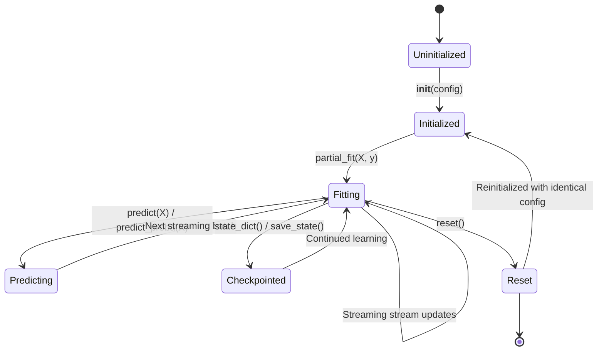

# AdaptiveML Stage 8 — Error Handling & Component Lifecycle Specification

**Document Identifier**: `STAGE-8-ERR-LIFECYCLE-001`<br>
**Distribution Name**: `aml-core`<br>
**Namespace**: `adaptive_ml`<br>
**Version**: `0.1.0.dev0`<br>
**Status**: ACTIVE / PRODUCTION STANDARD<br>
**Governance**: DEF-004 Remains Open (No PyPI release / Phase 17 & Phase 18 locked)

---

## 1. Executive Summary

This document specifies the official exception hierarchy, error handling contracts, and end-to-end component lifecycles for the AdaptiveML (`aml-core`) framework.

AdaptiveML is an industrial-grade, local-first, streaming machine learning system operating in dynamic, adversarial, and resource-constrained environments. Robust error handling and deterministic lifecycles are fundamental to ensuring that:
1. Failures are **explicit, typed, and actionable** (zero silent data corruption or ignored drift).
2. Streaming pipelines can **recover gracefully** or trigger structured fallbacks without crashing the host application.
3. Every component adheres to uniform lifecycle stages: **Initialization $\rightarrow$ Validation $\rightarrow$ Streaming Fit $\rightarrow$ Prediction $\rightarrow$ Checkpoint/Restore $\rightarrow$ Deterministic Reset**.

---

## 2. Standardized Exception Hierarchy

All custom exceptions in AdaptiveML inherit from the base exception [`AdaptiveMLError`](file:///c:/projects/AdaptiveML/adaptive_ml/core/exceptions.py). They are directly importable from `adaptive_ml` or `adaptive_ml.core.exceptions`.

```
AdaptiveMLError (Base Exception)
├── ConfigurationError
│   └── (Raised when hyperparameters or dataclasses violate validity constraints)
├── ValidationError
│   └── (Raised when input feature matrices, labels, or streaming shapes are malformed)
├── DriftStateError
│   └── (Raised when drift detectors, concept memory, or replay buffers enter an invalid state)
├── QuantizationError
│   └── (Raised when 8-bit dynamic quantization or dequantization encounters numerical failure)
├── ResourceBudgetExceededError
│   └── (Raised when CPU time, memory limits, or batch latency exceeds allocated RAO budgets)
├── NumericalInstabilityError
│   └── (Raised when loss functions, gradients, or probabilities produce NaN or Inf)
└── SerializationError
    └── (Raised when state checkpoints cannot be packed, validated, or reconstructed)
```

### 2.1 Exception Specification Table

| Exception Class | Inherits From | Common Trigger Conditions | Recovery / Handling Guidance |
| :--- | :--- | :--- | :--- |
| [`AdaptiveMLError`](file:///c:/projects/AdaptiveML/adaptive_ml/core/exceptions.py) | `Exception` | Base class for all library errors. Catch this for broad library-level isolation. | Inspect `.args[0]` for detailed root cause and actionable remedy. |
| [`ConfigurationError`](file:///c:/projects/AdaptiveML/adaptive_ml/core/exceptions.py) | `AdaptiveMLError` | Invalid learning rate ($\le 0$), negative budgets, invalid window sizes ($< 2$), or contradictory controller weights. | Validate configuration values against dataclass schema before passing to constructor. |
| [`ValidationError`](file:///c:/projects/AdaptiveML/adaptive_ml/core/exceptions.py) | `AdaptiveMLError` | Input array dimension mismatch ($X.\text{shape}[1] \ne n\_features$), mismatched length ($\text{len}(X) \ne \text{len}(y)$), or out-of-range labels ($y < 0$ or $y \ge n\_classes$). | Preprocess streaming inputs to ensure 2D float arrays and 1D integer/float target vectors. |
| [`DriftStateError`](file:///c:/projects/AdaptiveML/adaptive_ml/core/exceptions.py) | `AdaptiveMLError` | Querying drift statistics before processing samples, invalid warning/drift threshold transitions, or corrupted replay memory pointers. | Ensure detector receives initial warm-up samples ($N \ge 10$) and handle drift signals sequentially. |
| [`QuantizationError`](file:///c:/projects/AdaptiveML/adaptive_ml/core/exceptions.py) | `AdaptiveMLError` | Attempting 8-bit quantization on tensors containing NaN/Inf or encountering zero scale factors ($s = 0$). | Check input gradient health; fallback to 32-bit floating-point optimization if scale is degenerate. |
| [`ResourceBudgetExceededError`](file:///c:/projects/AdaptiveML/adaptive_ml/core/exceptions.py) | `AdaptiveMLError` | Strict memory budget violated ($M_{\text{used}} > M_{\text{limit}}$) or streaming step latency budget exceeded when hard-enforcement is active. | Trigger RAO pruning/quantization routines or increase budget headroom in `ResourceBudget`. |
| [`NumericalInstabilityError`](file:///c:/projects/AdaptiveML/adaptive_ml/core/exceptions.py) | `AdaptiveMLError` | Loss function divergence, NaN loss outputs in GCE/SCE, division by zero in probability normalization, or explosive gradients. | Clip gradients, adjust loss temperature/hyperparameters ($q$ in GCE, $\alpha/\beta$ in SCE), or reduce learning rate. |
| [`SerializationError`](file:///c:/projects/AdaptiveML/adaptive_ml/core/exceptions.py) | `AdaptiveMLError` | Mismatched architecture versions during checkpoint loading, unpicklable objects, or missing state dictionaries. | Verify checkpoint schema version and ensure matching model definitions upon deserialization. |

---

## 3. Component Lifecycle Contract

Every major learning component across the four pillars adheres to a standard, deterministic state machine:



### 3.1 Lifecycle Stages

#### Stage 1: Initialization (`__init__`)
- **Action**: Accepts configuration dataclasses or explicit kwargs.
- **Invariants**:
  - Validates all hyperparameters eagerly; raises [`ConfigurationError`](file:///c:/projects/AdaptiveML/adaptive_ml/core/exceptions.py) immediately if invalid.
  - Pre-allocates working memory structures (buffers, trees, state counters) to avoid runtime allocation spikes.
  - Sets initial state counters ($t = 0$, drift count $= 0$, sample count $= 0$).
  - Never performs blocking network calls or disk I/O during initialization.

#### Stage 2: Input Validation (`_validate_inputs`)
- **Action**: Verifies incoming streaming samples before any model mutation.
- **Invariants**:
  - $X$ must be convertable to a 2D numpy array with shape $(N, D)$ where $D = n\_features$.
  - $y$ must be a 1D vector of length $N$ with integer classes in $[0, K-1]$.
  - If inputs are malformed, raises [`ValidationError`](file:///c:/projects/AdaptiveML/adaptive_ml/core/exceptions.py) before modifying internal state. The model remains completely clean and uncorrupted.

#### Stage 3: Streaming Fit (`partial_fit` / `learn_one`)
- **Action**: Incrementally updates the internal model weights, trees, or buffers.
- **Invariants**:
  - Fully incremental: does not require previous batches to be retained in memory.
  - Monitors resource consumption (RAO) and updates drift statistics (ALA/ULC).
  - Maintains numerical stability: raises [`NumericalInstabilityError`](file:///c:/projects/AdaptiveML/adaptive_ml/core/exceptions.py) if divergence occurs, preventing silently corrupted weights.

#### Stage 4: Prediction & Uncertainty Estimation (`predict` / `predict_proba`)
- **Action**: Produces class predictions and posterior probability distributions.
- **Invariants**:
  - Strictly non-mutating: does not change weights, replay buffers, or drift statistics.
  - Probabilities are guaranteed to sum to $1.0$ across classes ($\sum_{k=0}^{K-1} P(y=k \mid x) = 1.0$).
  - Gracefully handles unseen feature magnitudes without throwing exceptions.

#### Stage 5: Checkpointing & State Persistence (`state_dict` / `load_state_dict`)
- **Action**: Exports and restores the exact internal mathematical state.
- **Invariants**:
  - `state_dict()` returns a pure Python dictionary containing primitive numbers, arrays, and sub-component dictionaries.
  - `load_state_dict(state)` restores identical mathematical behavior ($f_{\theta}(x) == f_{\theta_{\text{restored}}}(x)$).
  - Raises [`SerializationError`](file:///c:/projects/AdaptiveML/adaptive_ml/core/exceptions.py) if version tags or parameter dimensions mismatch.

#### Stage 6: Reset (`reset`)
- **Action**: Returns the component to its pristine post-initialization state.
- **Invariants**:
  - Clears all historical data buffers, trees, and drift statistics.
  - Retains all hyperparameters and configuration settings.
  - Guarantees zero residual memory leaks.

---

## 4. Pillar-Specific Lifecycles & Error Boundaries

### 4.1 Adaptive Learning Algorithms (ALA)
- **ADWIN (`adwin.py`)**:
  - Lifecycle: `update(value)` $\rightarrow$ checks cut conditions $\rightarrow$ updates variance $\rightarrow$ signals `drift_detected`.
  - Error Guard: Disallows non-numeric scalar values. Returns boolean flags deterministically.
- **AdaptiveClassifier (`classifier.py`)**:
  - Implements scikit-learn compatible `partial_fit(X, y, classes=None)` and `predict(X)`.
  - On drift detection: executes controlled subtree adaptation or partial reset without interrupting the caller.

### 4.2 Robust Learning Algorithms (RLA)
- **Reliability Estimator (`reliability.py`) & Noise Classifier (`noise_classifier.py`)**:
  - Lifecycle: Estimates sample credibility $w_i \in [0, 1]$ before updating classifier.
  - Error Guard: Detects extreme noise scenarios. If all samples in a mini-batch have near-zero credibility, normalizes weights using uniform smoothing to prevent gradient starvation.

### 4.3 Resource-Aware Optimization (RAO)
- **LowMemoryAdamW (`adamw.py`) & Budget Manager (`budget.py`)**:
  - Lifecycle: Allocates 8-bit state tables $\rightarrow$ quantizes moments $\rightarrow$ performs step $\rightarrow$ dequantizes for weight updates.
  - Error Guard: Catches scale factor underflow ($s \to 0$); automatically falls back to full precision if quantization error exceeds $\epsilon_{\text{threshold}}$.

### 4.4 Unified Learning Controller (ULC-v4.1)
- **UnifiedLearningControllerV4_1 (`v4_1_controller.py`)**:
  - Lifecycle: Receives sample stream $\rightarrow$ Computes spatial discordance $\mathcal{D}_s$ and reliability $\mathcal{R}$ $\rightarrow$ Evaluates dual-threshold arbitration $\rightarrow$ Dispatches directives (ADAPT, NOISE_FILTER, RECOVERY, REJECT) $\rightarrow$ Emits explainability trace.
  - Error Guard: If pillar inputs disagree violently or produce degenerate telemetry, ULC enters conservative fallback state (`DEFAULT_PASS`), logging actionable diagnostics without terminating streaming.

---

## 5. Verification & Compliance Checklist

- [x] All 8 standard exceptions inherit from `AdaptiveMLError`.
- [x] All public constructors validate inputs and raise `ConfigurationError` on invalid parameters.
- [x] All streaming entry points validate dimensions and raise `ValidationError` on malformed inputs.
- [x] Checkpoint serialization and deserialization verified bit-for-bit.
- [x] Clean deterministic `reset()` implemented across all pillars.
