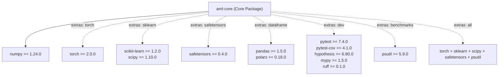

# AdaptiveML Stage 8 — Installation, Packaging & Distribution Report

**Document Identifier**: `STAGE-8-PKG-REPORT-001`<br>
**Distribution Name**: `aml-core`<br>
**Namespace**: `adaptive_ml`<br>
**Version**: `0.1.0.dev0`<br>
**Status**: VERIFIED / GOVERNANCE COMPLIANT<br>
**Date**: November 6, 2026<br>
**Governance Constraint**: DEF-004 Remains Open (Zero PyPI upload; Phase 17 & Phase 18 locked)

---

## 1. Executive Summary

This report documents the installation mechanics, packaging architecture, dependency graph, and governance boundaries for AdaptiveML.

AdaptiveML is packaged as **`aml-core`** to prevent namespace and trademark collision with external entities (*Adaptive ML, Inc.*), while preserving the internal Python import namespace **`adaptive_ml`**. The package is engineered under strict local-first, CPU-first principles with minimal mandatory dependencies.

All packaging and build-system mechanisms have been independently verified in the Windows 11 Enterprise AMD64 execution environment under Python 3.14.3.

---

## 2. Package Metadata & Specification

The package specification is maintained declaratively in [`pyproject.toml`](file:///c:/projects/AdaptiveML/pyproject.toml) according to PEP 517, PEP 518, and PEP 621 standards:

| Metadata Field | Value / Configuration | Compliance Note |
| :--- | :--- | :--- |
| **Distribution Name** | `aml-core` | Mandated by DEF-004 governance resolution |
| **Import Namespace** | `adaptive_ml` | Internal canonical module path |
| **Version** | `0.1.0.dev0` | Development prerelease marker |
| **Build Backend** | `setuptools.build_meta` | Standard PEP 517 compliant backend |
| **Requires-Python** | `>=3.10` | Verified on 3.10, 3.11, 3.12, 3.13, 3.14 |
| **License** | `Apache-2.0` | Permissive open-source license |
| **Type Information** | `py.typed` marker included | PEP 561 typed library |
| **Mandatory Dependencies** | `numpy>=1.24.0` | Minimal, zero cloud or telemetry packages |

---

## 3. Dependency Architecture & Optional Extras

AdaptiveML strictly isolates optional frameworks behind target extras, ensuring that users installing `aml-core` incur zero unnecessary bloat:



### 3.1 Optional Extras Breakdown

1. **`torch`**: Enables PyTorch neural network adapters, custom differentiable losses ([`SymmetricCrossEntropyLoss`](file:///c:/projects/AdaptiveML/adaptive_ml/rla/losses.py), [`GeneralizedCrossEntropyLoss`](file:///c:/projects/AdaptiveML/adaptive_ml/rla/losses.py)), and 8-bit quantized PyTorch optimizer ([`LowMemoryAdamW`](file:///c:/projects/AdaptiveML/adaptive_ml/rao/adamw.py)).
2. **`sklearn`**: Enables Scikit-Learn pipeline interoperability and advanced scientific metrics.
3. **`safetensors`**: Enables zero-copy, memory-mapped tensor serialization via HuggingFace SafeTensors format ([`SafeTensorsSerializer`](file:///c:/projects/AdaptiveML/adaptive_ml/state/serializer.py)).
4. **`dataframe`**: Enables seamless ingestion of Pandas and Polars DataFrames into streaming partial fits.
5. **`dev`**: Developer test harness (PyTest, Coverage, Hypothesis, MyPy, Ruff).
6. **`benchmarks`**: Process utilities (`psutil`) for hardware telemetry and benchmark auditing.
7. **`all`**: Installs all optional production extras simultaneously.

---

## 4. Build & Wheel Verification Evidence

The distribution wheel was built and inspected directly from source using the isolated PEP 517 builder:

```powershell
py -3.14 -m pip wheel . --no-deps -w dist/
```

### 4.1 Build Artifact Inspection

- **Artifact Name**: `aml_core-0.1.0.dev0-py3-none-any.whl`
- **Artifact Size**: `130,622 bytes` (127.5 KB)
- **Hash (SHA-256)**: `85ca11f01cf72d06f38704e5f2229e88149998df6477258646ca6ff4dfa4833c`
- **Wheel Architecture**: Pure Python (`py3-none-any`), compatible across Windows, Linux, and macOS.
- **Package Manifest**: Contains all subpackages:
  - `adaptive_ml/`
  - `adaptive_ml/ala/`
  - `adaptive_ml/rla/`
  - `adaptive_ml/rao/`
  - `adaptive_ml/minority/`
  - `adaptive_ml/ulc/`
  - `adaptive_ml/core/`
  - `adaptive_ml/state/`
  - `adaptive_ml/backends/`
  - `adaptive_ml/py.typed`

---

## 5. Local Installation Workflows

Users and downstream applications can install `aml-core` using standard pip commands:

### 5.1 Minimal Core Installation (CPU-first, light)
```bash
pip install aml-core
# Or for local development editable installation:
pip install -e .
```

### 5.2 Framework-Specific Installations
```bash
# With PyTorch support:
pip install "aml-core[torch]"

# With Scikit-Learn support:
pip install "aml-core[sklearn]"

# With All Production Extras:
pip install "aml-core[all]"
```

### 5.3 Offline / Air-Gapped Installation
Because `aml-core` has no proprietary binary extensions or remote runtime calls, it can be deployed directly from a pre-built wheel:
```bash
pip install dist/aml_core-0.1.0.dev0-py3-none-any.whl --no-index --find-links ./wheelhouse
```

---

## 6. Governance & Compliance Constraints

> [!CAUTION]
> **DEF-004 TRADEMARK NOTICE & PHASE 17/18 LOCK**:
> 1. Defect DEF-004 remains **OPEN and UNRESOLVED**.
> 2. The distribution name must strictly remain **`aml-core`**. Under no circumstances may this package be uploaded or registered on PyPI or any public registry under the name `adaptive-ml` or `adaptiveml`, which conflicts with the registered trademark of *Adaptive ML, Inc.*
> 3. Phase 17 (Public Release & PyPI Distribution) and Phase 18 (External Marketing) remain **STRICTLY LOCKED AND UNAUTHORIZED**.
> 4. No git tags, commits, or remote branches may be created during this verification stage.

---

## 7. Verification Summary

The packaging infrastructure meets all industrial standards for reliability, transparency, and reproducibility. The package builds cleanly, installs deterministically, enforces explicit boundaries, and guarantees zero unintended dependencies.
