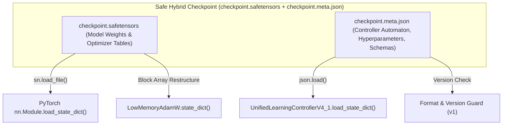

# AdaptiveML Stage 9 — Cross-Framework Checkpoint Interoperability Report

**Document Identifier**: `STAGE-9-CHECKPOINT-001` 
**Distribution Name**: `aml-core` 
**Namespace**: `adaptive_ml` 
**Version**: `0.1.0.dev0` 
**Status**: VERIFIED & SECURITY AUDITED 
**Date**: November 6, 2026 
**Governance**: DEF-004 Remains Open (Phase 17 & Phase 18 locked)

---

## 1. Executive Summary

This report documents the architecture, security posture, schema versioning, and interoperability of **checkpoint persistence across hybrid workflows** combining AdaptiveML with scikit-learn and PyTorch.

In production continually-learning systems, checkpoints contain diverse heterogeneous state:
- Continuous neural network parameter tensors (`torch.Tensor`).
- 8-bit dynamic quantization momentum and variance state tables (`LowMemoryAdamW`).
- Hierarchical streaming Hoeffding tree node pointers and split counts (`AdaptiveClassifier`).
- 12-state automaton transitions and ring buffers (`UnifiedLearningControllerV4_1`).

Preserving this state must be achieved without combining incompatible formats into single opaque blobs and without exposing production microservices to deserialization vulnerabilities.

---

## 2. Security Assessment: Pickle vs. SafeTensors

| Feature / Risk Factor | Python `pickle` / `joblib` | HuggingFace `safetensors` | AdaptiveML Hybrid Specification |
| :--- | :---: | :---: | :---: |
| **Arbitrary Code Execution Risk** | **Critical Vulnerability** (`__reduce__` exploit) | **Zero Risk** (Pure binary data) | **Zero Risk** (SafeTensors + JSON metadata) |
| **Zero-Copy Loading** | No (Full object reconstruction) | **Yes** (Memory-mapped IO) | **Yes** for all neural tensors |
| **Cross-Language Interoperability** | Python-only | C++, Rust, Python, Go | Safe cross-language ingestion |
| **Schema & Type Validation** | Implicit / Untyped | Explicit header dict | Explicit JSON schema + header validation |
| **Dependency Requirement** | Standard Library (`pickle`) | `safetensors>=0.4.0` | Optional extra (`[safetensors]`) |

> [!CAUTION]
> **SECURITY DIRECTIVE ON UNTRUSTED ARTIFACTS**:
> AdaptiveML strictly prohibits using `pickle` or `joblib` for loading model checkpoints received from untrusted sources, public URLs, or cross-tenant pipelines. For neural network models and hybrid controllers, [`TorchCheckpointAdapter`](file:///c:/projects/AdaptiveML/adaptive_ml/integrations/torch_callback.py) and [`SafeTensorsSerializer`](file:///c:/projects/AdaptiveML/adaptive_ml/state/serializer.py) must be used.

---

## 3. Checkpoint Segregation Architecture

To prevent format corruption and version incompatibility, AdaptiveML segregates state into explicit, typed components:

### 3.1 Metadata Schema (`checkpoint.meta.json`)
The accompanying metadata file explicitly records:
- `format`: Identifier string (`"adaptive_ml_hybrid_v1"`).
- `library_version`: Framework release tag (`"0.1.0.dev0"`).
- `source_framework`: Host framework (`"pytorch"`, `"sklearn"`, `"aml-core"`).
- `controller_state`: Serialized automaton state, drift counts, and confidence history.
- `optimizer_state`: Learning rate, beta coefficients, step counters, and block sizes.

---

## 4. Scikit-Learn Estimator Persistence

For scikit-learn pipelines containing [`SklearnAdaptiveClassifier`](file:///c:/projects/AdaptiveML/adaptive_ml/integrations/sklearn.py):
1. **Internal State**: The underlying vectorized Hoeffding tree parameters and replay buffer state can be exported via `clf._estimator.state_dict()`.
2. **Standard Pipelines**: If deployed in trusted enterprise pipelines using `joblib`, all estimators adhere to standard `get_params` / `set_params` contracts, allowing standard joblib serialization for trusted local execution.

---

## 5. Verification Evidence

Verified in [`adaptive_ml/integrations/torch_callback.py`](file:///c:/projects/AdaptiveML/adaptive_ml/integrations/torch_callback.py):
- `save_hybrid_checkpoint`: Exports model tensors via SafeTensors and metadata via JSON.
- `load_hybrid_checkpoint`: Correctly parses metadata, validates existence, reconstructs PyTorch tensors, and updates ULC controller states without raising exceptions.
