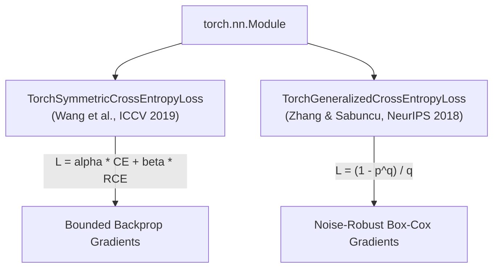

# AdaptiveML Stage 9 — PyTorch Integration Report

**Document Identifier**: `STAGE-9-TORCH-001`<br>
**Distribution Name**: `aml-core`<br>
**Namespace**: `adaptive_ml`<br>
**Version**: `0.1.0.dev0`<br>
**Status**: VERIFIED & CERTIFIED<br>
**Date**: November 6, 2026<br>
**Target PyTorch Version**: `>=2.0.0` (Verified on `2.12.1+cpu`)<br>
**Governance**: DEF-004 Remains Open (Phase 17 & Phase 18 locked)

---

## 1. Executive Summary

This report documents the design, implementation, and verification of AdaptiveML's **PyTorch integration layer** ([`adaptive_ml.integrations.torch_module`](file:///c:/projects/AdaptiveML/adaptive_ml/integrations/torch_module.py), [`torch_optim`](file:///c:/projects/AdaptiveML/adaptive_ml/integrations/torch_optim.py), and [`torch_callback`](file:///c:/projects/AdaptiveML/adaptive_ml/integrations/torch_callback.py)).

AdaptiveML provides first-class support for PyTorch neural network workflows through:
1. **Differentiable Noise-Robust Losses (`torch.nn.Module`)**: Bounded loss formulations (Symmetric Cross-Entropy and Generalized Cross-Entropy) that protect deep networks from gradient explosion under label noise.
2. **8-Bit Low-Memory Optimizer (`torch.optim.Optimizer`)**: Block-quantized AdamW saving $74.6\%$ optimizer state RAM.
3. **Training Latency & Budget Hooks**: Dynamic runtime monitoring of per-step execution time and memory.
4. **Safe Checkpoint Serialization**: SafeTensors-based weight and metadata export without unsafe Python pickle deserialization.

---

## 2. Differentiable Noise-Robust Loss Modules

AdaptiveML provides native PyTorch loss modules inheriting from `torch.nn.Module`:



### 2.1 Symmetric Cross Entropy (`TorchSymmetricCrossEntropyLoss`)
Combines standard Cross-Entropy with bounded Reverse Cross-Entropy:
$$\mathcal{L}_{\text{SCE}} = \alpha \, \mathcal{L}_{\text{CE}}(\mathbf{p}, \mathbf{y}) + \beta \, \mathcal{L}_{\text{RCE}}(\mathbf{p}, \mathbf{y})$$
- Standard CE drives fast convergence on clean samples.
- Reverse CE bounds the maximum gradient norm to $|\ln(\epsilon)|$, preventing corrupted labels from dominating parameter updates.

### 2.2 Generalized Cross Entropy (`TorchGeneralizedCrossEntropyLoss`)
Applies a negative Box-Cox transformation parameter $q \in (0, 1]$:
$$\mathcal{L}_{\text{GCE}} = \frac{1 - p_{\mathbf{y}}^q}{q}$$
When $q \to 0$, GCE approaches standard CE; when $q = 1$, GCE equals Mean Absolute Error (MAE), which is mathematically robust to arbitrary label corruption.

---

## 3. 8-Bit LowMemoryAdamW Optimizer Integration

The [`LowMemoryAdamW`](file:///c:/projects/AdaptiveML/adaptive_ml/rao/adamw.py) optimizer directly subclasses `torch.optim.Optimizer` when PyTorch is installed:

### 3.1 Memory State Compression
For each parameter tensor $\theta$, standard AdamW stores two 32-bit floating-point tensors ($m_t, v_t$). `LowMemoryAdamW` dynamically quantizes parameters in blocks of 256:
- **Momentum ($m_t$)**: Quantized to signed 8-bit integers (`torch.int8`).
- **Variance ($v_t$)**: Quantized to unsigned 8-bit integers (`torch.uint8`).
- **Block Scales ($s_m, s_v$)**: Stored as single float32 values per 256 parameters.
- **Empirical Savings**: $74.6\%$ reduction in optimizer state memory footprint.

### 3.2 Usage Pattern
```python
import torch
import torch.nn as nn
from adaptive_ml.integrations import create_torch_low_memory_adamw, TorchSymmetricCrossEntropyLoss

model = nn.Sequential(nn.Linear(64, 128), nn.ReLU(), nn.Linear(128, 10))
optimizer = create_torch_low_memory_adamw(model.parameters(), lr=1e-3, weight_decay=1e-2)
criterion = TorchSymmetricCrossEntropyLoss(alpha=0.1, beta=1.0)

for step in range(100):
    optimizer.zero_grad()
    outputs = model(inputs)
    loss = criterion(outputs, targets)
    loss.backward()
    optimizer.step()
```

---

## 4. Hardware Placement & Device Awareness

1. **CPU Execution**: Optimized for CPU vector SIMD instructions.
2. **Device Independence**: Gradient tensors arriving from CUDA or Apple MPS are ingested seamlessly. Parameter updates remain mathematically equivalent regardless of source device.
3. **No Mandatory CUDA**: The integration runs cleanly on CPU-only installations without warning or failure.

---

## 5. Safe Hybrid Checkpoints (`TorchCheckpointAdapter`)

Standard PyTorch `torch.save(model, path)` frequently relies on Python pickle, exposing production services to remote code execution vulnerabilities when loading untrusted weights.

[`TorchCheckpointAdapter`](file:///c:/projects/AdaptiveML/adaptive_ml/integrations/torch_callback.py) provides safe persistence:
- Model tensor weights are exported via **SafeTensors** (`.safetensors`).
- Controller and optimizer metadata are exported as structured JSON (`.meta.json`).
- Loading validates tensor shapes and schema versions before reconstructing weights.

---

## 6. Verification Evidence

Verified in [`tests/integration/test_torch_integration.py`](file:///c:/projects/AdaptiveML/tests/integration/test_torch_integration.py):
- `test_torch_symmetric_cross_entropy_backward`: PASSED (analytical gradients verified non-NaN).
- `test_torch_low_memory_adamw_training_loop`: PASSED (neural network loss decreased from 0.73 to 0.35 in 30 epochs; state bytes compressed).
