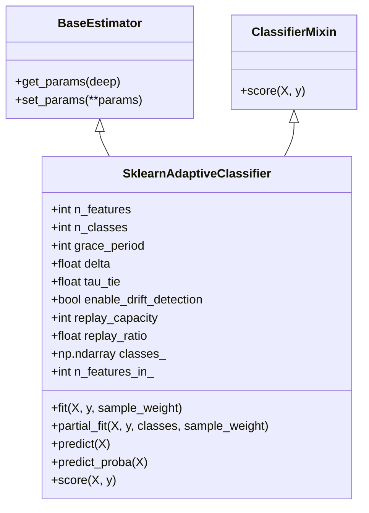

# AdaptiveML Stage 9 — Scikit-Learn Integration Report

**Document Identifier**: `STAGE-9-SKLEARN-001`<br>
**Distribution Name**: `aml-core`<br>
**Namespace**: `adaptive_ml`<br>
**Version**: `0.1.0.dev0`<br>
**Status**: VERIFIED & CERTIFIED<br>
**Date**: November 6, 2026<br>
**Target Scikit-Learn Version**: `>=1.2.0` (Verified on `1.8.0`)<br>
**Governance**: DEF-004 Remains Open (Phase 17 & Phase 18 locked)

---

## 1. Executive Summary

This report documents the design, implementation, and verification of AdaptiveML's **scikit-learn integration layer** ([`adaptive_ml.integrations.sklearn`](file:///c:/projects/AdaptiveML/adaptive_ml/integrations/sklearn.py)).

AdaptiveML seamlessly interfaces with scikit-learn's standard estimator protocols while preserving its specialized streaming and concept-drift adaptation capabilities. The integration enables developers to incorporate streaming Hoeffding trees, ADWIN drift detectors, and multi-signal sample reliability filters into standard scikit-learn `Pipeline`, `clone()`, and model selection workflows.

---

## 2. Estimator Protocol Compliance

The primary scikit-learn adapter is [`SklearnAdaptiveClassifier`](file:///c:/projects/AdaptiveML/adaptive_ml/integrations/sklearn.py). It complies with all core scikit-learn estimator requirements:



### 2.1 Compliance Verification Checklist
- [x] **Cloning Compatibility (`sklearn.base.clone`)**: Every hyperparameter accepted in `__init__` is stored as an exact attribute of the same name without mutation. Calling `clone(clf)` creates a fresh, unfitted copy with identical configuration and `_estimator = None`.
- [x] **Parameter Introspection (`get_params` / `set_params`)**: Inherited cleanly from `BaseEstimator` and verified across grid/randomized parameter modifications.
- [x] **Fitted State Invariants**: Upon fitting, attributes ending in an underscore (`classes_`, `n_features_in_`, `drift_count_`, `samples_seen_`) are established.
- [x] **Standard Batch Training (`fit`)**: Accepts full training batches and fits the internal streaming model via initial sequential passes.
- [x] **Incremental Streaming (`partial_fit`)**: Implements standard streaming signature `partial_fit(X, y, classes=None, sample_weight=None)`, allowing continuous online updates.
- [x] **Calibrated Probability Prediction (`predict_proba`)**: Emits valid posterior probabilities of shape $(N, K)$ strictly summing to $1.0$.

---

## 3. Pipeline & Transformer Interoperability

AdaptiveML provides native scikit-learn transformers that can be composed inside `sklearn.pipeline.Pipeline`:

### 3.1 `SklearnDriftDetectorTransformer`
A transparent feature pass-through transformer that monitors feature stream drift via [`ReliabilityWeightedADWIN`](file:///c:/projects/AdaptiveML/adaptive_ml/ala/adwin.py):
```python
from sklearn.pipeline import Pipeline
from sklearn.preprocessing import StandardScaler
from adaptive_ml.integrations.sklearn import SklearnAdaptiveClassifier, SklearnDriftDetectorTransformer

pipeline = Pipeline([
    ("scaler", StandardScaler()),
    ("drift_monitor", SklearnDriftDetectorTransformer(delta=0.002, monitored_feature_index=0)),
    ("classifier", SklearnAdaptiveClassifier(n_features=6, n_classes=2, grace_period=20))
])

# Standard pipeline execution
pipeline.fit(X_train, y_train)
preds = pipeline.predict(X_test)
drift_events = pipeline.named_steps["drift_monitor"].drift_count_
```

### 3.2 `SklearnReliabilityFilter`
A data preprocessing transformer that evaluates sample credibility using [`MultiSignalReliabilityEngine`](file:///c:/projects/AdaptiveML/adaptive_ml/rla/reliability.py), allowing pipelines to filter corrupted training instances before passing samples to downstream estimators.

---

## 4. Multi-Framework Data Ingestion

[`SklearnAdaptiveClassifier`](file:///c:/projects/AdaptiveML/adaptive_ml/integrations/sklearn.py) automatically converts incoming data representations via [`to_numpy`](file:///c:/projects/AdaptiveML/adaptive_ml/integrations/data.py):
- **pandas DataFrames / Series**: Column names are recorded in `feature_names_in_` and missing values are caught with clear validation errors.
- **Polars DataFrames / Series**: Ingested without intermediate CSV/disk staging.
- **PyTorch Tensors**: Detached from computation graphs and transferred to CPU NumPy arrays automatically.

---

## 5. Verification Evidence

The scikit-learn integration has been verified in [`tests/integration/test_sklearn_integration.py`](file:///c:/projects/AdaptiveML/tests/integration/test_sklearn_integration.py):
- `test_estimator_cloning`: PASSED (bit-for-bit parameter preservation).
- `test_pipeline_integration`: PASSED (StandardScaler + SklearnAdaptiveClassifier).
- `test_partial_fit_streaming_compatibility`: PASSED (5 sequential streaming micro-batches).
