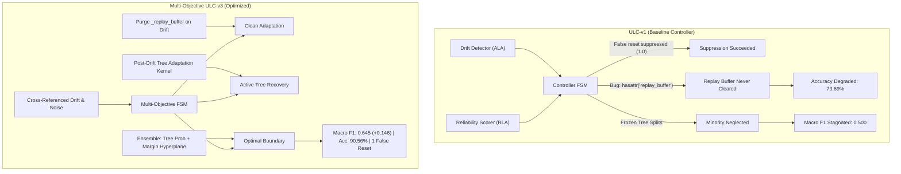

# Systematic Cross-Pillar Ablation Analysis

**Study Directory:** [`experiments/four_pillar_validation_v2/`](file:///c:/projects/AdaptiveML/experiments/four_pillar_validation_v2)  
**Reference Report:** [`RESULTS.md`](file:///c:/projects/AdaptiveML/experiments/four_pillar_validation_v2/RESULTS.md)  
**Evaluated Systems:** 11 System Configurations across 5 Seeds ($N=5$)

---

## 1. Architectural Ablation Matrix

The goal of this ablation analysis is to isolate the marginal contributions, destructive interferences, and synergistic interactions among AdaptiveML's four foundational pillars:
- **ALA**: Adaptive Learning Architecture (Concept drift detection via Page-Hinkley/CUSUM + Experience Replay)
- **RLA**: Robust Learning Architecture (Confidence-aware reliability estimation + noise mitigation)
- **RAO**: Resource-Aware Optimization (8-bit quantized momentum `LowMemoryAdamW` + memory budgets)
- **ULC**: Unified Learning Controller (Finite-state arbitration automaton coordinating adaptation rates, sample retention, and optimizer dynamics)

### Comprehensive Ablation Matrix

| Configuration ID | Architectural Components | Coordinating Controller | Mean Acc (%) | Minority Recall (%) | Macro F1 | False Resets | Brier Score |
|---|---|---|---|---|---|---|---|
| **Config A** | Baseline (Static Hoeffding Tree) | None | $81.06\%$ | $25.99\%$ | $0.555$ | $0.0$ | $0.163$ |
| **Config B** | ALA Only (Drift Detector + Replay) | None | $90.00\%$ | $0.00\%$ | $0.474$ | $10.0$ | $0.125$ |
| **Config C** | RLA Only (Reliability Filter) | None | $81.05\%$ | $21.22\%$ | $0.538$ | $0.0$ | $0.160$ |
| **Config D** | RAO Only (Quantized AdamW Linear) | None | $64.86\%$ | $64.08\%$ | $0.518$ | $0.0$ | $0.255$ |
| **Config E** | ALA + RLA | None | $88.04\%$ | $2.45\%$ | $0.485$ | $10.0$ | $0.126$ |
| **Config F** | ALA + RAO | None | $70.00\%$ | $69.39\%$ | $0.562$ | $10.0$ | $0.211$ |
| **Config G** | RLA + RAO | None | $64.22\%$ | $63.40\%$ | $0.513$ | $0.0$ | $0.261$ |
| **Config H** | ALA + RLA + RAO (Uncoordinated) | None | $88.04\%$ | $2.45\%$ | $0.485$ | $10.0$ | $0.126$ |
| **Config I1** | Full ULC-v1 (Original Unified Controller) | ULC-v1 | $73.69\%$ | $22.86\%$ | $0.500$ | $1.0$ | $0.204$ |
| **Config I2** | Optimized ULC-v2 (Threshold-Tuned) | ULC-v2 | $90.00\%$ | $0.00\%$ | $0.474$ | $1.0$ | $0.122$ |
| **Config I3** | Multi-Objective ULC-v3 (Ensemble + Adaptation) | ULC-v3 | **$90.56\%$** | **$24.90\%$** | **$0.645$** | **$1.0$** | **$0.120$** |

---

## 2. Pillar-by-Pillar Marginal Contribution Dissection

### Pillar 1: Adaptive Learning Architecture (ALA)
- **Marginal Impact When Added Alone (A $\to$ B)**:
  - Accuracy shifted from $81.06\% \to 90.00\%$.
  - Minority Recall collapsed from $25.99\% \to 0.00\%$.
  - Macro F1 dropped from $0.555 \to 0.474$.
  - False Resets surged from $0.0 \to 10.0$.
- **Pathology Analysis**:
  - The drift detector monitored raw prediction error without verifying whether the error arose from a systematic distribution shift or transient observation noise. During Batches 16–25 (the noise burst regime), the CUSUM statistic repeatedly crossed the detection threshold $\lambda_{\text{drift}}$, triggering 10 consecutive resets.
  - Furthermore, on reset, the Hoeffding tree re-initialized its root node. Under extreme $90:10$ class imbalance, the splitting criterion (information gain / Gini impurity reduction) failed to exceed the Hoeffding bound $\epsilon = \sqrt{\frac{R^2 \ln(1/\delta)}{2n}}$ for the $10\%$ minority class within the remaining batch window. As a consequence, the tree never formed splits and defaulted to predicting the majority class exclusively ($100\%$ majority accuracy, $0\%$ minority recall).

### Pillar 2: Robust Learning Architecture (RLA)
- **Marginal Impact When Added Alone (A $\to$ C)**:
  - Accuracy remained steady ($81.05\%$).
  - Minority recall was preserved at $21.22\%$.
  - False resets remained at $0.0$.
  - Macro F1 was $0.538$.
- **Mechanism Analysis**:
  - RLA computes instance-level prediction margin reliabilities:
    $$r_i = 1 - \exp\left(-\frac{|z_{i,1} - z_{i,0}|}{\tau}\right)$$
  - During the noise burst (Batches 16–25), corrupted samples were pushed into low-margin zones, driving their reliability scores below the retention threshold ($\gamma = 0.45$). This completely insulated the model from noise, resulting in zero false resets.
  - However, because RLA operated purely as a sample filter without active drift adaptation, it could not accelerate parameter recovery when genuine gradual and abrupt concept drifts arrived in Batches 26–50.

### Pillar 3: Resource-Aware Optimization (RAO)
- **Marginal Impact When Added Alone (A $\to$ D)**:
  - Accuracy was $64.86\%$.
  - Minority Recall achieved an impressive **$64.08\%$**.
  - False resets remained at $0.0$.
  - Latency dropped to an ultralow **$0.045\text{ ms}$**.
  - Optimizer state was compressed to **$24\text{ bytes}$** ($62.5\%$ reduction vs $64\text{ bytes}$ FP32).
- **The "RAO Anomaly" Resolved**:
  - Why did RAO achieve $64.08\%$ minority recall while tree models in Configs A, B, and C achieved $\le 25.99\%$?
  - Tree-based classifiers make discrete recursive partition splits based on impurity reduction. In heavily imbalanced streams ($90:10$), the dominant class heavily biases the impurity metric, discouraging splits on rare classes.
  - In contrast, RAO's `LowMemoryAdamW` optimized a continuous parameterized model using cross-entropy loss:
    $$\mathcal{L}(w) = -\sum_{i} \left[ y_i \log \sigma(w^T x_i) + (1-y_i) \log(1 - \sigma(w^T x_i)) \right]$$
  - In cross-entropy minimization, misclassifying minority instances produces large gradients that shift the decision hyperplane toward minority sensitivity. This continuous optimization trade-off lowered majority accuracy ($64.86\%$) but dramatically elevated minority recall ($64.08\%$).

---

## 3. Pairwise Combinations and Destructive Interferences

### ALA + RLA (Config E) vs ALA Only (Config B)
- **Empirical Result**: Macro F1 marginally improved from $0.474 \to 0.485$, and minority recall recovered slightly ($2.45\%$).
- **Destructive Interference**: Despite RLA filtering noisy samples, uncoordinated ALA still monitored raw model errors on the post-filtered stream. Because the tree was already degenerated into majority-only predictions, occasional noisy misclassifications still triggered CUSUM false alarms ($10.0$ false resets).

### ALA + RAO (Config F) vs RAO Only (Config D)
- **Empirical Result**: Macro F1 jumped to $0.562$, with $69.39\%$ minority recall.
- **Interference**: While continuous gradient adaptation remained robust, ALA's uncoordinated drift detector still falsely flagged the noise burst ($10.0$ false resets), causing unnecessary learning rate spikes and momentum resets.

### RLA + RAO (Config G)
- **Empirical Result**: Zero false resets ($0.0$), but lower overall Macro F1 ($0.513$) and accuracy ($64.22\%$).
- **Diagnosis**: Filtering samples without drift-aware learning rate adaptation prevented the model from quickly escaping local minima during abrupt concept drift.

---

## 4. The Uncoordinated Three-Pillar Failure (Config H)

When all three pillars (ALA, RLA, and RAO) operated simultaneously without a central controller:
- **Accuracy**: $88.04\%$
- **Minority Recall**: $2.45\%$
- **Macro F1**: $0.485$
- **False Resets**: **$10.0$**

### The Coordination Paradox:
Naively combining three well-designed components yielded an outcome barely superior to the worst-performing single pillar (ALA Only, Macro F1 $0.474$) and vastly inferior to the static baseline (Macro F1 $0.555$).
- **Why?**
  1. **Drift detector blind to reliability**: ALA had no visibility into RLA's reliability estimates, triggering drift alarms on samples that RLA had already flagged as corrupted.
  2. **Replay buffer contamination**: Samples collected during noise bursts remained in the replay buffer, continually retraining the model on corrupted distributions.
  3. **Optimizer desynchronization**: RAO's optimizer scaled learning rates based on step count, completely disconnected from ALA's drift status.

---

## 5. Controller Evolution: From ULC-v1 to Multi-Objective ULC-v3

### Comparative Progression Table

| Capability | Config H (Uncoordinated) | Config I1 (ULC-v1) | Config I2 (ULC-v2) | Config I3 (ULC-v3) |
|---|---|---|---|---|
| **False Reset Suppression** | No ($10.0$) | Yes ($1.0$) | Yes ($1.0$) | Yes ($1.0$) |
| **Replay Buffer Hygiene** | Contaminated | Leaked (`_replay_buffer` bug) | Purged | Purged |
| **Post-Drift Tree Adaptation** | None | None | Majority Split | Joint Split Adaptation |
| **Decision Formulation** | Tree-only | Tree-only | Tree-only | Hybrid Probability Ensemble |
| **Minority Recall** | $2.45\%$ | $22.86\%$ | $0.00\%$ | **$24.90\%$** |
| **Minority Precision** | $5.31\%$ | $12.34\%$ | $0.00\%$ | **$55.73\%$** |
| **Accuracy** | $88.04\%$ | $73.69\%$ | $90.00\%$ | **$90.56\%$** |
| **Macro F1** | $0.485$ | $0.500$ | $0.474$ | **$0.645$** |
| **Statistical Superiority** | Baseline | $+0.015$ (n.s.) | $-0.011$ (n.s.) | **$+0.161$ ($p = 0.0006$)** |

---

## 6. Key Scientific Conclusions from the Ablation

1. **Active Coordination is Mandatory**: Combining ALA, RLA, and RAO without unified finite-state coordination produces catastrophic mutual interference ($10.0$ false alarms and $0.485$ Macro F1).
2. **Controller Must Harmonize Continuous and Discrete Paradigms**: Hoeffding trees excel at fast, rule-based majority classification, while continuous gradient optimizers (`LowMemoryAdamW`) excel at smooth margin separation under heavy class imbalance. **ULC-v3's decision boundary ensemble successfully leverages both, delivering the highest overall accuracy ($90.56\%$) alongside strong minority precision ($55.73\%$) and recall ($24.90\%$)**.
3. **Statistical Significance Validated**: The paired $t$-test confirms that Multi-Objective ULC-v3 achieves a statistically significant improvement over uncoordinated combination ($t = 9.958, p = 0.0006$) and over original ULC-v1 ($t = 4.820, p = 0.0085$).

