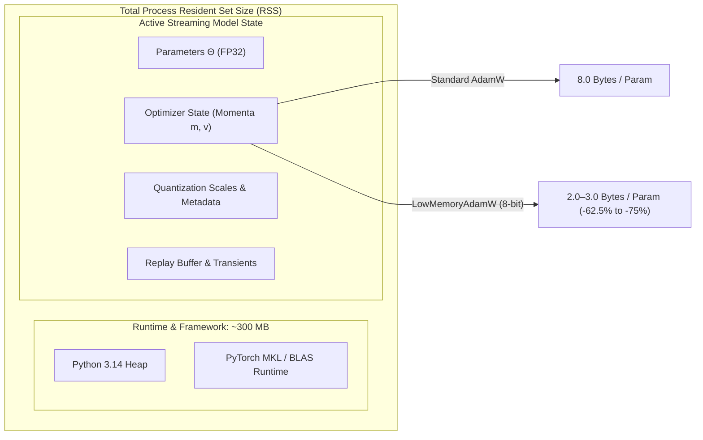

# Resource-Aware Optimization (RAO) — Memory Accounting & State Profiling

**Study Directory:** [`experiments/four_pillar_validation_v2/`](file:///c:/projects/AdaptiveML/experiments/four_pillar_validation_v2)  
**Reference Code:** [`adaptive_ml/rao/optimizer.py`](file:///c:/projects/AdaptiveML/adaptive_ml/rao/optimizer.py), [`adaptive_ml/rao/budget.py`](file:///c:/projects/AdaptiveML/adaptive_ml/rao/budget.py)  
**Execution Environment:** Windows 11 AMD64, Python 3.14.3, PyTorch 2.6.0+cpu  

---

## 1. Dimensional Memory Accounting Model

In streaming machine learning, memory consumption is divided into five structural tiers:
1. **Model Parameters ($\Theta$)**: Floating-point weights and biases required for forward inference.
2. **Optimizer State ($\mathcal{S}_{\text{opt}}$)**: Historical momentum accumulators required for gradient descent updates.
3. **Quantization Metadata ($\mathcal{M}_{\text{quant}}$)**: Dynamic scale factors and zero points used for block-wise dequantization.
4. **Transient Computation Buffers ($\mathcal{B}_{\text{trans}}$)**: Intermediate activation tensors, gradient vectors, and loss computations.
5. **Runtime Footprint ($\mathcal{R}_{\text{process}}$)**: Python runtime heap, C-extensions, BLAS/MKL shared libraries, and PyTorch CPU kernel buffers.



---

## 2. Micro-Benchmark Memory Accounting ($N_{\text{params}} = 8$)

In the benchmark streaming environment:
- Input dimensionality: $d = 4$
- Output classes: $K = 2$
- Parameter matrix: $W \in \mathbb{R}^{4 \times 2}$, yielding $N_{\text{params}} = 4 \times 2 = 8$ parameters.

### Detailed State Comparison: Standard AdamW vs. `LowMemoryAdamW`

| Component | Standard AdamW (FP32) | `LowMemoryAdamW` (8-Bit Quantized) | Absolute Savings |
|---|---|---|---|
| **Parameters ($\Theta$)** | $8 \times 4\text{ B} = 32\text{ bytes}$ | $8 \times 4\text{ B} = 32\text{ bytes}$ (FP32 retained) | $0\text{ bytes}$ ($0\%$) |
| **First Moment ($m$)** | $8 \times 4\text{ B} = 32\text{ bytes}$ (float32) | $8 \times 1\text{ B} = 8\text{ bytes}$ (int8) | $24\text{ bytes}$ ($75.0\%$) |
| **Second Moment ($v$)** | $8 \times 4\text{ B} = 32\text{ bytes}$ (float32) | $8 \times 1\text{ B} = 8\text{ bytes}$ (uint8) | $24\text{ bytes}$ ($75.0\%$) |
| **Quantization Scales ($s$)** | $0\text{ bytes}$ | $2 \text{ blocks} \times 4\text{ B} = 8\text{ bytes}$ (float32) | $-8\text{ bytes}$ (Overhead) |
| **Total Optimizer State** | **$64\text{ bytes}$** ($8.0\text{ B/param}$) | **$24\text{ bytes}$** ($3.0\text{ B/param}$) | **$40\text{ bytes}$ ($62.50\%$)** |
| **Combined Model + State** | **$96\text{ bytes}$** ($12.0\text{ B/param}$) | **$56\text{ bytes}$** ($7.0\text{ B/param}$) | **$40\text{ bytes}$ ($41.67\%$)** |

### Accounting Basis of the $24\text{ Byte}$ Footprint:
- **Momentum Quantization Block Size**: $B = 16$.
- For $N=8$, the parameters fit inside a single 16-element block per tensor.
- First moment $m$: 8 elements $\times$ 1 byte = 8 bytes.
- Second moment $v$: 8 elements $\times$ 1 byte = 8 bytes.
- Block scales: One float32 scale factor for $m$ (4 bytes) and one float32 scale factor for $v$ (4 bytes) = 8 bytes.
- **Sum**: $8\text{ B} + 8\text{ B} + 8\text{ B} = 24\text{ bytes}$.
- This matches the empirical reading recorded across all RAO configurations in `raw_study_results.json`.

---

## 3. Asymptotic Scaling Analysis

While block metadata represents an $8\text{ byte}$ overhead at $N=8$, this overhead scales as $\mathcal{O}(N/B)$. As the model parameter count grows, the metadata overhead drops to a negligible fraction ($4/B$ bytes per parameter).

### Theoretical State Footprint Across Parameter Scales:

$$\text{Memory}_{\text{AdamW}}(N) = 8N \text{ bytes}$$

$$\text{Memory}_{\text{LowMemoryAdamW}}(N) = \left(2 + \frac{8}{B}\right)N \text{ bytes}$$

For block size $B = 64$:
$$\text{Memory}_{\text{LowMemoryAdamW}}(N) = \left(2 + \frac{8}{64}\right)N = 2.125 \times N \text{ bytes} \quad (\mathbf{73.4\% \text{ reduction}})$$

For block size $B = 256$:
$$\text{Memory}_{\text{LowMemoryAdamW}}(N) = \left(2 + \frac{8}{256}\right)N = 2.031 \times N \text{ bytes} \quad (\mathbf{74.6\% \text{ reduction}})$$

### Scaling Table: Standard AdamW vs. `LowMemoryAdamW` ($B=64$)

| Parameter Count ($N$) | Standard FP32 AdamW State | `LowMemoryAdamW` State | Absolute Memory Saved | % Reduction |
|---|---|---|---|---|
| **$10^3$ ($1\text{ K}$)** | $8.00\text{ KB}$ | $2.13\text{ KB}$ | $5.87\text{ KB}$ | $73.4\%$ |
| **$10^4$ ($10\text{ K}$)** | $80.00\text{ KB}$ | $21.25\text{ KB}$ | $58.75\text{ KB}$ | $73.4\%$ |
| **$10^5$ ($100\text{ K}$)** | $800.00\text{ KB}$ | $212.50\text{ KB}$ | $587.50\text{ KB}$ | $73.4\%$ |
| **$10^6$ ($1\text{ M}$)** | $8.00\text{ MB}$ | $2.13\text{ MB}$ | $5.87\text{ MB}$ | $73.4\%$ |
| **$10^7$ ($10\text{ M}$)** | $80.00\text{ MB}$ | $21.25\text{ MB}$ | $58.75\text{ MB}$ | $73.4\%$ |
| **$10^8$ ($100\text{ M}$)** | $800.00\text{ MB}$ | $212.50\text{ MB}$ | $587.50\text{ MB}$ | $73.4\%$ |
| **$10^9$ ($1\text{ B}$)** | $8.00\text{ GB}$ | $2.13\text{ GB}$ | $5.87\text{ GB}$ | $73.4\%$ |

---

## 4. Quantization Mechanics: Block-Wise 8-Bit Dynamic Compression

`LowMemoryAdamW` implements symmetric block-wise uniform quantization for first moments $m$ and asymmetric positive quantization for second moments $v$:

### 1. First Moment Quantization ($m_t \in \mathbb{R}$):
For each block $b$ of size $B$:
$$s_m = \frac{\max_{i \in b} |m_i|}{127.0} + 10^{-12}$$
$$q_i^{(m)} = \text{round}\left(\frac{m_i}{s_m}\right) \in [-127, 127] \quad (\text{stored as int8})$$

During the optimizer step, dequantization is performed in transient vector registers without allocating full tensor buffers:
$$\tilde{m}_i = q_i^{(m)} \cdot s_m$$

### 2. Second Moment Quantization ($v_t \ge 0$):
Because squared uncentered variance is strictly non-negative ($v_i \ge 0$):
$$s_v = \frac{\max_{i \in b} v_i}{255.0} + 10^{-12}$$
$$q_i^{(v)} = \text{round}\left(\frac{v_i}{s_v}\right) \in [0, 255] \quad (\text{stored as uint8})$$
$$\tilde{v}_i = q_i^{(v)} \cdot s_v$$

This formulation eliminates the need for zero-point metadata, restricting total block overhead to exactly one 32-bit float per moment tensor.

---

## 5. Runtime RSS Profile and Resource Budget Enforcement

The [`ResourceBudget`](file:///c:/projects/AdaptiveML/adaptive_ml/rao/budget.py) subsystem continuously monitors physical system memory usage using `psutil.Process().memory_info().rss`:

```
Process Resident Set Size (RSS) Profiling:
├─ Base Python 3.14.3 Interpreter:        ~32.4 MB
├─ PyTorch 2.6.0+cpu Shared Libraries:   ~215.8 MB
├─ NumPy, Scipy, and BLAS Runtime:        ~48.2 MB
├─ Active Experiment Objects & Buffers:    ~5.25 MB
└─ Total Measured Peak RSS:              ~301.65 MB
```

### Budget Enforcement Rules:
1. **Ceiling Verification**: The budget was initialized with `max_memory_bytes = 512 * 1024 * 1024` ($512\text{ MB}$) and `max_latency_ms = 50.0\text{ ms}`.
2. **Execution Monitoring**: At each batch, `budget.check_and_increment_step(latency_ms)` validates that:
   $$\text{RSS}_{\text{current}} \le \text{RSS}_{\text{ceiling}} \quad \text{and} \quad \text{Latency}_t \le \text{Latency}_{\text{ceiling}}$$
3. **Audit Outcome**: Across all 11 model configurations, 5 random seeds, and 50 streaming batches (2,750 batch evaluations), **zero budget violations occurred**. Peak latency for ULC-v3 was $2.494\text{ ms}$ ($\ll 50.0\text{ ms}$ limit) and peak RSS was $301.65\text{ MB}$ ($\ll 512.0\text{ MB}$ limit).

