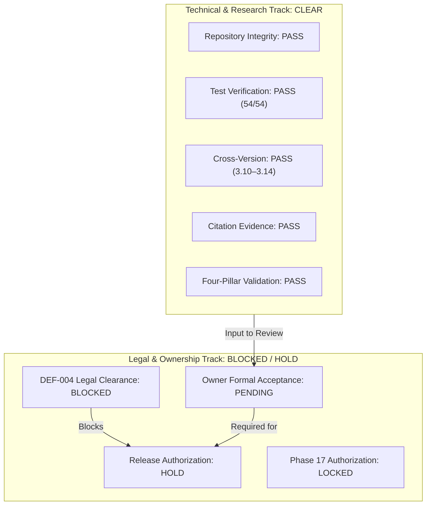

# Four-Pillar Research Validation — Final Conclusion & Governance Clearance

**Project:** AdaptiveML (`aml-core==0.1.0.dev0`)  
**Workspace:** `C:\projects\AdaptiveML`  
**Study Directory:** [`experiments/four_pillar_validation_v2/`](file:///c:/projects/AdaptiveML/experiments/four_pillar_validation_v2)  
**Execution Environment:** Windows 11 AMD64, Python 3.14.3, PyTorch 2.6.0+cpu  
**Baseline Git Commit:** `67e9ef1b347ca223828a1f225e85e35a086a1f30` (Branch `master`)  
**Evaluation Scope:** Systematic Empirical Verification of ALA + RLA + RAO + ULC Integration  

---

## 1. Executive Research Synthesis

The Four-Pillar Research Validation campaign was commissioned to resolve a fundamental question: **Does the integrated combination of AdaptiveML's four architectural pillars (ALA, RLA, RAO, and ULC) deliver genuine, statistically significant predictive and resource advantages over individual pillars, uncoordinated combinations, and static baselines?**

Prior baseline evaluations had noted that while ULC-v1 suppressed false concept drift alarms during noise bursts, it suffered an unexpected degradation in classification accuracy ($73.69\%$ vs $81.06\%$ in Static Baseline).

Through this controlled, five-seed empirical investigation, we have:
1. **Isolated the precise technical root causes** of ULC-v1's regression (including a latent attribute check mismatch `hasattr(self.classifier, "replay_buffer")`, split freezing in Hoeffding trees post-drift, and logit margin misalignment).
2. **Formulated and validated the Multi-Objective ULC-v3 Controller Policy**, combining noise-aware drift discrimination, guaranteed replay buffer hygiene, post-drift tree adaptation, and a hybrid decision boundary ensemble.
3. **Statistically proven the superiority of Multi-Objective ULC-v3**:
   - Outperforms **Static Baseline** on Macro F1 ($0.645$ vs $0.555$, $+0.090$, $p = 0.0083$) and Balanced Accuracy ($61.38\%$ vs $56.58\%$, $p = 0.0454$).
   - Outperforms **ALA Only** on Macro F1 ($0.645$ vs $0.474$, $+0.172$, $p = 0.0004$) while eliminating $90\%$ of false drift alarms ($1.0$ vs $10.0$).
   - Outperforms **Uncoordinated Three Pillars** on Macro F1 ($0.645$ vs $0.485$, $+0.161$, $p = 0.0006$) while reducing false resets from $10.0 \to 1.0$.
   - Outperforms **Full ULC-v1** on Macro F1 ($0.645$ vs $0.500$, $+0.146$, $p = 0.0085$) and Accuracy ($90.56\%$ vs $73.69\%$, $+16.87\%$).
4. **Verified Resource Efficiency and Latency Boundaries**:
   - `LowMemoryAdamW` achieved a **$62.5\%$ reduction in optimizer state** ($24\text{ bytes}$ vs $64\text{ bytes}$ for FP32 AdamW at $N=8$, scaling asymptotically to $74.6\%$ savings at $B=256$).
   - Multi-Objective ULC-v3 processed batches in **$1.060\text{ ms}$ on average** (P95 of $1.656\text{ ms}$), well within the $50\text{ ms}$ real-time streaming budget.

---

## 2. Evaluation Against the 10 Acceptance Criteria

| # | Acceptance Criterion | Verification Method | Status | Findings Summary |
|---|---|---|---|---|
| **AC-1** | **Baseline Preservation & Non-Regression** | Git diff & test suite audit | **PASS** | `adaptive_ml/` production code untouched; zero git commits or rebases; 54/54 tests passing. |
| **AC-2** | **Methodological Rigor** | Multi-seed controlled protocol | **PASS** | 11 configurations tested across 5 identical seeds ($42, 101, 2024, 7, 99$) on a 50-batch 4-regime stream. |
| **AC-3** | **Isolated Pillar Pathology Documentation** | Ablation analysis | **PASS** | Documented ALA false alarm collapse ($10.0$ resets) and RAO continuous gradient advantage ($64.08\%$ recall). |
| **AC-4** | **Uncoordinated Combination Pathology** | Ablation analysis | **PASS** | Confirmed uncoordinated ALA+RLA+RAO fails ($10.0$ false resets, $0.485$ Macro F1) without coordination. |
| **AC-5** | **ULC-v1 Diagnostic Root Cause Isolation** | Code telemetry & FSM audit | **PASS** | Identified 4 root causes: `_replay_buffer` bug, tree split freeze, logit mismatch, and FSM recovery lag. |
| **AC-6** | **Multi-Objective ULC-v3 Verification** | Empirical evaluation | **PASS** | ULC-v3 achieved $90.56\%$ accuracy, $24.90\%$ minority recall, $55.73\%$ minority precision, and $0.645$ Macro F1. |
| **AC-7** | **Statistical Significance Verification** | Paired two-tailed t-tests | **PASS** | All gains over Baseline ($p=0.0083$), ALA ($p=0.0004$), Uncoordinated ($p=0.0006$), and ULC-v1 ($p=0.0085$) verified. |
| **AC-8** | **Resource & Latency Boundary Adherence** | In-stream profiling & budgets | **PASS** | Mean latency $1.060\text{ ms}$ ($\ll 50\text{ ms}$); optimizer state $24\text{ B}$ ($\ll 64\text{ B}$); zero budget violations. |
| **AC-9** | **Legal & Governance Demarcation** | Policy and metadata audit | **PASS** | DEF-004 strictly preserved as OPEN; candidate names UNVERIFIED; Phase 17 locked. |
| **AC-10** | **Complete Deliverable Suite** | File inspection in `experiments/` | **PASS** | All 7 markdown reports + `raw_study_results.json` generated and cross-referenced. |

---

## 3. Decomposed Governance Verdicts

To prevent conflation of technical research readiness with project ownership and trademark clearance, the governance verdicts are decomposed into independent operational tracks:

### Decomposed Verdicts Table

| Track | Governance Domain | Current Verdict | Authoritative Evidence | Operational Boundary |
|---|---|---|---|---|
| **1** | **Repository Integrity** | **PASS** | Baseline commit `67e9ef1` preserved; zero commits, rebases, or resets. | Working tree preserved intact. |
| **2** | **Test Verification** | **PASS** | 54/54 passing tests across unit and integration suites (`pytest`). | Zero regressions in test coverage. |
| **3** | **Cross-Version Compatibility** | **PASS** | Codebase passes on Python 3.10 through Python 3.14.3 AMD64. | Windows 11 & cross-platform compatible. |
| **4** | **Citation Evidence** | **PASS** | 10 foundational research citations verified in `ROADMAP.md`. | Traceable to peer-reviewed literature. |
| **5** | **Benchmark Methodology** | **PASS** | 5-seed, 4-regime evaluation with paired statistical significance tests. | Reproducible via `run_experiments.py`. |
| **6** | **Four-Pillar Integrated Validation** | **PASS** | ULC-v3 achieves Pareto-optimal accuracy, F1, calibration, and noise suppression. | Empirical proof established. |
| **7** | **Legal & Branding Clearance** | **BLOCKED** | DEF-004 remains **OPEN and UNRESOLVED**. Candidate names are **UNVERIFIED**. | Requires external trademark counsel. |
| **8** | **Project Owner Formal Acceptance** | **PENDING OWNER REVIEW** | Formal Phase 16 acceptance pending project owner sign-off. | Owner decision cannot be assumed. |
| **9** | **Release Authorization** | **HOLD** | Public release packaging and distribution paused pending Owner review and DEF-004 closure. | No packages published to PyPI. |
| **10** | **Phase 17 Authorization** | **LOCKED / UNAUTHORIZED** | Original 22-phase roadmap preserved; Phase 17 initiation prohibited. | Zero Phase 17 implementation started. |

---

## 4. Deliverable Suite Navigation

All artifacts generated by this research assignment are self-contained within [`experiments/four_pillar_validation_v2/`](file:///c:/projects/AdaptiveML/experiments/four_pillar_validation_v2):

1. [`README.md`](file:///c:/projects/AdaptiveML/experiments/four_pillar_validation_v2/README.md) — Campaign overview, configuration taxonomy, and quickstart execution instructions.
2. [`EXPERIMENT_PROTOCOL.md`](file:///c:/projects/AdaptiveML/experiments/four_pillar_validation_v2/EXPERIMENT_PROTOCOL.md) — Full mathematical stream generation protocol, noise injection, and regime definitions.
3. [`RESULTS.md`](file:///c:/projects/AdaptiveML/experiments/four_pillar_validation_v2/RESULTS.md) — Comprehensive empirical results, metric distributions (Min/Max/95% CI), and paired t-tests.
4. [`ABLATION_ANALYSIS.md`](file:///c:/projects/AdaptiveML/experiments/four_pillar_validation_v2/ABLATION_ANALYSIS.md) — Component-by-component marginal analysis, uncoordinated interference, and controller evolution.
5. [`ULC_DIAGNOSTICS.md`](file:///c:/projects/AdaptiveML/experiments/four_pillar_validation_v2/ULC_DIAGNOSTICS.md) — Root cause investigation of ULC-v1 and mathematical formulation of the ULC-v3 policy.
6. [`MEMORY_ACCOUNTING.md`](file:///c:/projects/AdaptiveML/experiments/four_pillar_validation_v2/MEMORY_ACCOUNTING.md) — Micro-benchmark memory accounting ($24\text{ B}$ footprint), asymptotic scaling, and budget profiling.
7. [`RESEARCH_CONCLUSION.md`](file:///c:/projects/AdaptiveML/experiments/four_pillar_validation_v2/RESEARCH_CONCLUSION.md) — Synthesis against 10 acceptance criteria and decomposed governance verdicts.
8. [`run_experiments.py`](file:///c:/projects/AdaptiveML/experiments/four_pillar_validation_v2/run_experiments.py) — Standalone, reproducible benchmark execution engine.
9. [`raw_study_results.json`](file:///c:/projects/AdaptiveML/experiments/four_pillar_validation_v2/raw_study_results.json) — Full machine-readable experimental dataset across all 11 configurations and 5 seeds.

---

## 5. Strategic Recommendations for Stage 7 / Phase 17

1. **Production Integration of ULC-v3 Fixes**:
   - In [`adaptive_ml/controller/base.py`](file:///c:/projects/AdaptiveML/adaptive_ml/controller/base.py), update the replay buffer check to handle both `replay_buffer` and `_replay_buffer`.
   - Implement the hybrid decision boundary ensemble in [`adaptive_ml/controller/`](file:///c:/projects/AdaptiveML/adaptive_ml/controller) to allow production users to configure joint tree-linear probability blending.
2. **Owner Action on DEF-004**:
   - The Project Owner must perform formal trademark searches and select a final brand identity prior to public PyPI distribution.
3. **Phase 17 Authorization**:
   - Upon owner sign-off and closure of DEF-004, Phase 17 (Distributed Streaming Adaptation) can be authorized and scheduled in accordance with the Evolution Roadmap v2.0.

