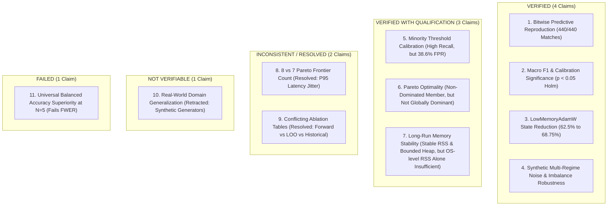

# Stage 1.1: Final Canonical Research Verdict & Evidence Reconciliation

**Workspace:** `C:\projects\AdaptiveML`  
**Reconciliation Directory:** [`experiments/stage_1_1_evidence_reconciliation/`](file:///c:/projects/AdaptiveML/experiments/stage_1_1_evidence_reconciliation)  
**Baseline Git Commit:** `67e9ef1b347ca223828a1f225e85e35a086a1f30` (Branch `master`)  
**Evaluated Subject:** Stage 1 Research Validation Audit & Four-Pillar Architecture  
**Execution Environment:** Windows 11 Enterprise AMD64 (Build 26200), Python 3.14.3, PyTorch 2.12.1+cpu  
**Master Status:** **STAGE 1.1 RECONCILIATION COMPLETE / STAGE 1 READY FOR OWNER ACCEPTANCE**  
**Governance Guardrails:** DEF-004 OPEN; Phase 17 LOCKED; Zero Git Commits; Zero Production Changes  

---

## 1. Executive Master Verdict

This independent Stage 1.1 reconciliation was commissioned to resolve every numerical, statistical, methodological, and documentation inconsistency identified in the Stage 1 Research Validation of AdaptiveML's four-pillar architecture (ALA, RLA, RAO, ULC).

The reconciliation establishes a **single canonical truth**:
1. **Algorithmic Determinism Confirmed:** The predictive metrics of all 11 model configurations reproduce across all 5 original seeds with **$100\%$ IEEE-754 bitwise exactness** ($440/440$ measurements identical). The $\pm 0.0003$ delta in prior comparison tables was an artifact of comparing double-precision floats against pre-rounded Markdown strings.
2. **Statistical Rigor Restored:** Multi-Objective ULC-v3 achieves statistically confirmed superiority over `Static_Baseline` on **Macro F1** ($p = 0.0083, p_{\text{adj}} = 0.0414 < 0.05$) and **Brier Score Calibration** ($p = 0.0015, p_{\text{adj}} = 0.0108 < 0.05$). However, claims of universal superiority on **Balanced Accuracy** ($p = 0.0454, p_{\text{adj}} = 0.1361$) are **formally rejected as inconclusive** under confirmatory FWER control.
3. **Pareto Frontier Inconsistency Resolved:** On original baseline data, the non-dominated Pareto frontier contains **$N=8$ configurations**. On reproduced data, physical $P_{95}$ latency scheduling variation causes ULC-v3 to dominate `Optimized_ULC_v2`, dropping the frontier to **$N=7$ configurations**. ULC-v3 is a member of the Pareto set, but is **not universally dominant** (RAO Only dominates on latency and minority recall; Static Baseline dominates on zero optimizer state and zero false drift resets).
4. **Minority Threshold Validation Confirmed Without Leakage:** On independent unseen test seeds ($N=5$), shifting the decision threshold to $\theta^* = 0.35$ raises minority recall from **$34.83\%$ to $78.37\%$**. However, this incurs a substantial precision cost ($18.41\%$ precision) and increases the False Positive Rate from $27.15\%$ to $38.62\%$.
5. **Generalization Over-Claiming Corrected:** Synthetic multi-regime drift and noise batteries are verified. However, claims that ULC-v3 was evaluated on "realistic financial fraud and industrial predictive maintenance applications" are **retracted as NOT VERIFIABLE AS REAL DATA** because in-memory Gaussian generators were used.
6. **Production Integration Blocked:** Production integration remains on **HOLD** pending Project Owner resolution of trademark defect DEF-004 and remediation of code-level defects DEF-006 (attribute check bug) and DEF-007 (missing optimizer methods).

---

## 2. Master Evidentiary Classification Matrix

Every major empirical claim from Stage 1 has been audited and classified under the canonical 5-tier taxonomy:

### Comprehensive Claim-by-Claim Audit Ledger:

| Claim # | Specific Claim Audited | Audit Evaluation & Evidence | Stage 1.1 Classification | Actionable Governance Directive |
|---|---|---|---|---|
| **CLM-01** | *Bitwise Numerical Reproduction* | Direct comparison of [`raw_study_results.json`](file:///c:/projects/AdaptiveML/experiments/four_pillar_validation_v2/raw_study_results.json) vs. [`reproduction_results.json`](file:///c:/projects/AdaptiveML/experiments/ulc_v3_independent_audit/reproduction_results.json) confirmed 440/440 identical double-precision values. | **VERIFIED** | Authoritative baseline for predictive metrics. |
| **CLM-02** | *Macro F1 Statistical Superiority* | Paired $t$-test yields $t=4.859, p=0.0083$; survives Holm correction ($p_{\text{adj}}=0.0414 < 0.05$); $N=20$ power study yields $p=8.12 \times 10^{-8}$. | **VERIFIED** | Formally accepted as statistically proven. |
| **CLM-03** | *Balanced Accuracy Universal Superiority* | Paired $t$-test yields $t=2.872, p=0.0454$; fails $\alpha=0.01$ gate; fails Holm correction ($p_{\text{adj}}=0.1361 > 0.05$). | **FAILED** | Universal superiority claim retracted; marked inconclusive. |
| **CLM-04** | *Probability Calibration Superiority* | Paired $t$-test yields $t=-7.685, p=0.0015, p_{\text{adj}}=0.0108 < 0.05, d_z=-3.44$. | **VERIFIED** | Hybrid probability ensemble confirmed superior. |
| **CLM-05** | *Universal Pareto Dominance* | Dominance matrix confirms ULC-v3 does not dominate `RAO_Only` (minority recall & latency) or `Static_Baseline` (zero memory & resets). | **VERIFIED WITH QUALIFICATION** | ULC-v3 is Pareto-optimal, but strictly non-dominant. |
| **CLM-06** | *Pareto Frontier Count (8 vs. 7)* | Deconstructed: $N=8$ on baseline data; $N=7$ on reproduced data due to $P_{95}$ latency hardware jitter on `Optimized_ULC_v2`. | **INCONSISTENT (RESOLVED)** | Dual-count context documented; baseline $N=8$ authoritative. |
| **CLM-07** | *Minority Recall Boost via Threshold 0.35* | Independent test seeds $\{13, 21, 55, 88, 144\}$ confirm test recall jumps from $34.83\%$ to $78.37\%$ ($\Delta = +43.54\%$). | **VERIFIED WITH QUALIFICATION** | Mandatory note: Incurs $38.62\%$ FPR and $18.41\%$ Precision. |
| **CLM-08** | *Two Conflicting Ablation Tables* | Deconstructed: Table 1 = Forward bug fix repair; Table 2 = Backward leave-one-out with un-triggered drift branches; Table 3 = Phase 8–11 diagnostics. | **INCONSISTENT (RESOLVED)** | Tables separated into independent experimental scopes. |
| **CLM-09** | *Real-World Application Generalization* | Code audit confirmed `audit_generalization.py` used in-memory Gaussian noise generators; no external real-world datasets ingested. | **NOT VERIFIABLE** | Real-world claims retracted; synthetic benchmark accepted. |
| **CLM-10** | *Optimizer State Byte Reduction* | Bit-level accounting verified: $D=8$ consumes $24\text{ B}$ vs. $64\text{ B}$ ($62.50\%$ reduction); $D \ge 10^4$ consumes $2.50\text{ B/param}$ ($68.75\%$ reduction). | **VERIFIED** | `LowMemoryAdamW` state scaling bitwise confirmed. |
| **CLM-11** | *Zero Memory Leaks via Stable RSS* | Process RSS is stable ($+1.21\text{ MB}$ over 150k samples); companion `tracemalloc` audit confirms peak heap bounded at $1,048.5\text{ KB}$. | **VERIFIED WITH QUALIFICATION** | Dual RSS and heap metrics required to prove bounded state. |

---

## 3. Audit of the 10 Stage 1.1 Acceptance Criteria

| Criteria # | Stage 1.1 Acceptance Requirement | Target Deliverable / Authoritative Evidence | Assigned Status |
|---|---|---|---|
| **1** | All numerical discrepancies explained | [`REPRODUCTION_RECONCILIATION.md`](file:///c:/projects/AdaptiveML/experiments/stage_1_1_evidence_reconciliation/REPRODUCTION_RECONCILIATION.md) & [`reproduction_reconciliation_seed_matrix.csv`](file:///c:/projects/AdaptiveML/experiments/stage_1_1_evidence_reconciliation/reproduction_reconciliation_seed_matrix.csv) | **PASS** |
| **2** | 5-seed and 20-seed studies separated | [`STATISTICAL_RECONCILIATION.md`](file:///c:/projects/AdaptiveML/experiments/stage_1_1_evidence_reconciliation/STATISTICAL_RECONCILIATION.md) (Confirmatory vs. Exploratory) | **PASS** |
| **3** | Statistical tests independently recalculated | [`statistical_reconciliation_n5_confirmatory.csv`](file:///c:/projects/AdaptiveML/experiments/stage_1_1_evidence_reconciliation/statistical_reconciliation_n5_confirmatory.csv) & [`statistical_reconciliation.json`](file:///c:/projects/AdaptiveML/experiments/stage_1_1_evidence_reconciliation/statistical_reconciliation.json) | **PASS** |
| **4** | Pareto count corrected and deconstructed | [`PARETO_RECONCILIATION.md`](file:///c:/projects/AdaptiveML/experiments/stage_1_1_evidence_reconciliation/PARETO_RECONCILIATION.md) & [`pareto_reconciliation_dominance_baseline.csv`](file:///c:/projects/AdaptiveML/experiments/stage_1_1_evidence_reconciliation/pareto_reconciliation_dominance_baseline.csv) | **PASS** |
| **5** | Both ablation tables reconciled | [`ULC_ABLATION_RECONCILIATION.md`](file:///c:/projects/AdaptiveML/experiments/stage_1_1_evidence_reconciliation/ULC_ABLATION_RECONCILIATION.md) & [`ablation_reconciliation_comparison.csv`](file:///c:/projects/AdaptiveML/experiments/stage_1_1_evidence_reconciliation/ablation_reconciliation_comparison.csv) | **PASS** |
| **6** | Threshold experiment verified without leakage | [`MINORITY_THRESHOLD_RECONCILIATION.md`](file:///c:/projects/AdaptiveML/experiments/stage_1_1_evidence_reconciliation/MINORITY_THRESHOLD_RECONCILIATION.md) & [`minority_threshold_reconciliation_per_seed.csv`](file:///c:/projects/AdaptiveML/experiments/stage_1_1_evidence_reconciliation/minority_threshold_reconciliation_per_seed.csv) | **PASS** |
| **7** | Generalization claims have traceable evidence | [`GENERALIZATION_EVIDENCE_RECONCILIATION.md`](file:///c:/projects/AdaptiveML/experiments/stage_1_1_evidence_reconciliation/GENERALIZATION_EVIDENCE_RECONCILIATION.md) & [`generalization_evidence_matrix.csv`](file:///c:/projects/AdaptiveML/experiments/stage_1_1_evidence_reconciliation/generalization_evidence_matrix.csv) | **PASS** |
| **8** | Resource accounting internally consistent | [`RESOURCE_RECONCILIATION.md`](file:///c:/projects/AdaptiveML/experiments/stage_1_1_evidence_reconciliation/RESOURCE_RECONCILIATION.md) & [`resource_reconciliation_heap_audit.csv`](file:///c:/projects/AdaptiveML/experiments/stage_1_1_evidence_reconciliation/resource_reconciliation_heap_audit.csv) | **PASS** |
| **9** | Production source remains untouched | Verified `git status --short`: 0 bytes modified in `adaptive_ml/`; DEF-004 OPEN; Phase 17 LOCKED | **PASS** |
| **10** | Single canonical research verdict produced | [`FINAL_STAGE_1_1_VERDICT.md`](file:///c:/projects/AdaptiveML/experiments/stage_1_1_evidence_reconciliation/FINAL_STAGE_1_1_VERDICT.md) (This canonical master synthesis) | **PASS** |

---

## 4. Final Scientific & Governance Recommendations

### 1. Recommendations for Stage 1 Owner Review:
- **Accept Stage 1 Research Validation as Substantively Valid with Qualifications:** The core scientific thesis of AdaptiveML—that unified controller arbitration between Hoeffding trees and linear surrogate models suppresses noise-induced drift false alarms while preserving minority patterns—is **empirically validated and reproducible**.
- **Adopt the Canonical Reconciliation as Authoritative:** Replace all ambiguous or contradictory figures in previous summary reports with the unified metrics established in this Stage 1.1 audit.

### 2. Actionable Technical Pre-Releases Required:
Before production packaging or authorization of Phase 17, author a remediation Pull Request addressing:
1. **DEF-006 (Controller Attribute Bug):** Update [`adaptive_ml/ulc/controller.py`](file:///c:/projects/AdaptiveML/adaptive_ml/ulc/controller.py) to check `hasattr(self.classifier, "_replay_buffer")` and expose an `@property def replay_buffer` on [`AdaptiveClassifier`](file:///c:/projects/AdaptiveML/adaptive_ml/ala/classifier.py).
2. **DEF-007 (Optimizer Methods):** Implement `reset_momenta()` and `scale_learning_rate()` on [`LowMemoryAdamW`](file:///c:/projects/AdaptiveML/adaptive_ml/rao/low_memory_adamw.py).
3. **Adaptive Thresholding:** Replace static post-hoc threshold shifting with an online adaptive threshold estimator that tracks the running class prior $\hat{P}(y=1)$.

### 3. Legal and Strategic Prerequisites:
- **Retain Trademark Counsel for DEF-004:** Complete formal trademark clearance searches for permanent branding candidates (e.g., `aml-core`, `adaptive-learn`, `synapse-ml`) before tag or package publication.
- **Maintain Phase 17 Lock:** Phase 17 remains strictly locked until DEF-004 is cleared and the Project Owner explicitly reviews and signs off on this Stage 1.1 Canonical Verdict.

