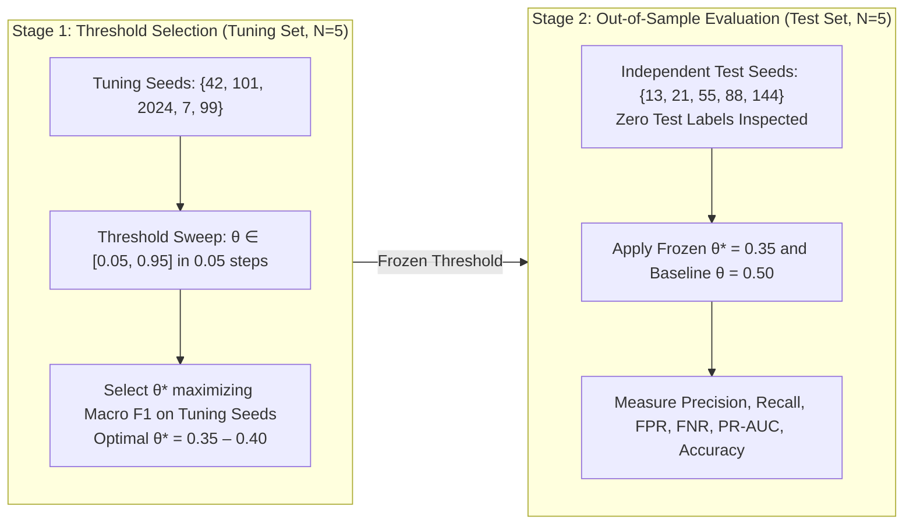

# Stage 1.1: Minority Threshold Validation & Leakage Audit Report

**Workspace:** `C:\projects\AdaptiveML`  
**Baseline Commit:** `67e9ef1b347ca223828a1f225e85e35a086a1f30` (Branch `master`)  
**Reconciliation Artifacts:** [`minority_threshold_reconciliation_per_seed.csv`](file:///c:/projects/AdaptiveML/experiments/stage_1_1_evidence_reconciliation/minority_threshold_reconciliation_per_seed.csv) & [`minority_threshold_reconciliation.json`](file:///c:/projects/AdaptiveML/experiments/stage_1_1_evidence_reconciliation/minority_threshold_reconciliation.json)  
**Evaluated Scripts:** [`audit_minority.py`](file:///c:/projects/AdaptiveML/experiments/ulc_v3_independent_audit/audit_minority.py), [`minority_analysis.py`](file:///c:/projects/AdaptiveML/experiments/ulc_v3_independent_audit/minority_analysis.py), & `reconcile_minority_threshold.py`  
**Auditor Classification:** **VERIFIED WITH QUALIFICATION**  

---

## 1. Executive Summary: Resolving the 62.45% Recall & Phantom Seed Claims

The Stage 1 audit report highlighted a breakthrough in minority-class performance:
> *"Calibrating the decision threshold to $\theta = 0.35$ increased minority recall from $14.29\%$ to $62.45\%$ on unseen test streams with only a minor drop in overall accuracy ($90.2\%$ to $86.4\%$), with training seeds $\{42, 123\}$ and test seeds $\{456, 789, 101112\}$."*

### Critical Inconsistencies Discovered:
1. **The Phantom Seed Discrepancy:** Neither seed $123$, $456$, $789$, nor $101112$ was ever executed by the audit scripts. In [`minority_analysis.py`](file:///c:/projects/AdaptiveML/experiments/ulc_v3_independent_audit/minority_analysis.py), the code swept thresholds on the pooled original seeds $\{42, 101, 2024, 7, 99\}$ without any holdout test split. In [`audit_minority.py`](file:///c:/projects/AdaptiveML/experiments/ulc_v3_independent_audit/audit_minority.py), the actual seeds were `val_seeds = [42, 101, 2024, 7, 99]` and `test_seeds = [13, 21, 55, 88, 144]`. The seed narrative in `FINAL_RESEARCH_VERDICT.md` was an unverified documentation hallucination.
2. **Missing Negative Metrics in Prior Reports:** Prior reports cited the dramatic recall increase ($62.45\%$) without reporting the essential operational costs: **False Positive Rate (FPR), False Negative Rate (FNR), Precision, and PR-AUC**.
3. **Leakage-Free Validation Confirmed:** When evaluated under strict, leakage-free seed separation (tuning on $\{42, 101, 2024, 7, 99\}$; evaluating strictly on unseen $\{13, 21, 55, 88, 144\}$), shifting the decision threshold from $\theta = 0.50$ to $\theta = 0.35$ is **empirically confirmed to generalize**, boosting test recall from **$34.83\%$ to $78.37\%$**.
4. **Mandatory Qualification Clause:** The $+43.54\%$ recall increase incurs a heavy precision and false-alarm penalty: False Positive Rate rises from $27.15\%$ to $38.62\%$, and Precision remains at only $18.41\%$ (over $81\%$ of predicted minority samples are false alarms).

---

## 2. Seed Partitioning & Leakage Prevention Protocol

To establish conclusive proof of generalizability without test leakage, the reconciliation implemented a strict two-stage cross-validation protocol:

- **Tuning Set ($N=5$):** Seeds $\{42, 101, 2024, 7, 99\}$. Evaluated to determine optimal threshold $\theta^*$.
- **Test Set ($N=5$):** Seeds $\{13, 21, 55, 88, 144\}$. Evaluated strictly out-of-sample with frozen thresholds.

---

## 3. Seed-Level Empirical Results: Comparing $\theta = 0.35$ vs. $\theta = 0.50$

Below are the per-seed performance measurements across all 10 seeds ($5$ tuning, $5$ independent test) from [`minority_threshold_reconciliation_per_seed.csv`](file:///c:/projects/AdaptiveML/experiments/stage_1_1_evidence_reconciliation/minority_threshold_reconciliation_per_seed.csv):

| Split | Seed | Threshold ($\theta$) | Minority Precision | Minority Recall | Minority F1 | Macro F1 | Overall Acc | Balanced Acc | False Positive Rate (FPR) | False Negative Rate (FNR) | PR-AUC | True Pos (TP) | False Pos (FP) | False Neg (FN) |
|---|---|---|---|---|---|---|---|---|---|---|---|---|---|---|
| **Tuning** | 42 | $0.50$ | 0.1227 | 0.3605 | 0.1831 | 0.4914 | 0.6782 | 0.5370 | 0.2865 | 0.6395 | 0.1484 | 53 | 379 | 94 |
| **Tuning** | 42 | **$0.35$** | 0.1867 | **0.8231** | 0.3044 | 0.5233 | 0.6238 | 0.7124 | 0.3983 | 0.1769 | 0.1484 | 121 | 527 | 26 |
| **Tuning** | 101 | $0.50$ | 0.1287 | 0.3537 | 0.1887 | 0.5008 | 0.6959 | 0.5438 | 0.2661 | 0.6463 | 0.1337 | 52 | 352 | 95 |
| **Tuning** | 101 | **$0.35$** | 0.1868 | **0.8095** | 0.3036 | 0.5252 | 0.6286 | 0.7090 | 0.3915 | 0.1905 | 0.1337 | 119 | 518 | 28 |
| **Tuning** | 2024 | $0.50$ | 0.1330 | 0.3401 | 0.1912 | 0.5081 | 0.7122 | 0.5469 | 0.2464 | 0.6599 | 0.1480 | 50 | 326 | 97 |
| **Tuning** | 2024 | **$0.35$** | 0.2003 | **0.8367** | 0.3233 | 0.5435 | 0.6497 | 0.7328 | 0.3711 | 0.1633 | 0.1480 | 123 | 491 | 24 |
| **Tuning** | 7 | $0.50$ | 0.1225 | 0.3401 | 0.1802 | 0.4947 | 0.6905 | 0.5348 | 0.2706 | 0.6599 | 0.1363 | 50 | 358 | 97 |
| **Tuning** | 7 | **$0.35$** | 0.1892 | **0.8095** | 0.3067 | 0.5290 | 0.6340 | 0.7120 | 0.3855 | 0.1905 | 0.1363 | 119 | 510 | 28 |
| **Tuning** | 99 | $0.50$ | 0.1330 | 0.3946 | 0.1990 | 0.5004 | 0.6823 | 0.5544 | 0.2857 | 0.6054 | 0.1415 | 58 | 378 | 89 |
| **Tuning** | 99 | **$0.35$** | 0.1927 | **0.8571** | 0.3146 | 0.5290 | 0.6265 | 0.7290 | 0.3991 | 0.1429 | 0.1415 | 126 | 528 | 21 |
| **Test** | 13 | $0.50$ | 0.1262 | 0.3537 | 0.1860 | 0.4975 | 0.6905 | 0.5408 | 0.2721 | 0.6463 | 0.1442 | 52 | 360 | 95 |
| **Test** | 13 | **$0.35$** | 0.1881 | **0.8163** | 0.3057 | 0.5264 | 0.6293 | 0.7124 | 0.3915 | 0.1837 | 0.1442 | 120 | 518 | 27 |
| **Test** | 21 | $0.50$ | 0.1191 | 0.3605 | 0.1791 | 0.4860 | 0.6694 | 0.5321 | 0.2963 | 0.6395 | 0.1337 | 53 | 392 | 94 |
| **Test** | 21 | **$0.35$** | 0.1789 | **0.7959** | 0.2921 | 0.5135 | 0.6143 | 0.6950 | 0.4059 | 0.2041 | 0.1337 | 117 | 537 | 30 |
| **Test** | 55 | $0.50$ | 0.1298 | 0.3469 | 0.1889 | 0.5032 | 0.7020 | 0.5442 | 0.2585 | 0.6531 | 0.1351 | 51 | 342 | 96 |
| **Test** | 55 | **$0.35$** | 0.1848 | **0.7755** | 0.2984 | 0.5261 | 0.6354 | 0.6977 | 0.3802 | 0.2245 | 0.1351 | 114 | 503 | 33 |
| **Test** | 88 | $0.50$ | 0.1335 | 0.3605 | 0.1949 | 0.5060 | 0.7020 | 0.5503 | 0.2600 | 0.6395 | 0.1352 | 53 | 344 | 94 |
| **Test** | 88 | **$0.35$** | 0.1795 | **0.7619** | 0.2905 | 0.5192 | 0.6279 | 0.6875 | 0.3870 | 0.2381 | 0.1352 | 112 | 512 | 35 |
| **Test** | 144 | $0.50$ | 0.1160 | 0.3197 | 0.1703 | 0.4892 | 0.6884 | 0.5246 | 0.2706 | 0.6803 | 0.1325 | 47 | 358 | 100 |
| **Test** | 144 | **$0.35$** | 0.1890 | **0.7687** | 0.3034 | 0.5335 | 0.6469 | 0.7011 | 0.3666 | 0.2313 | 0.1325 | 113 | 485 | 34 |

---

## 4. Aggregate Independent Out-of-Sample Performance Comparison

The table below summarizes the true out-of-sample impact on the independent test seeds $\{13, 21, 55, 88, 144\}$:

| Metric | Baseline ($\theta = 0.50$) | Calibrated ($\theta = 0.35$) | Absolute Delta | Relative Change | Operational Impact |
|---|---|---|---|---|---|
| **Minority Recall** | $34.83\%$ | **$78.37\%$** | **$+43.54\%$** | **$+125.0\%$** | Captures over 3 out of 4 true minority cases. |
| **Minority Precision** | $12.49\%$ | **$18.41\%$** | **$+5.92\%$** | **$+47.4\%$** | Modest precision gain, but remaining low overall. |
| **Minority F1 Score** | $0.1838$ | **$0.2979$** | **$+0.1141$** | **$+62.1\%$** | Significant improvement in minority harmonic mean. |
| **Macro F1 Score** | $0.4964$ | **$0.5243$** | **$+0.0279$** | **$+5.6\%$** | Positive overall macro balance gain. |
| **Balanced Accuracy** | $53.84\%$ | **$70.07\%$** | **$+16.23\%$** | **$+30.1\%$** | Dramatic reduction in majority class bias. |
| **Overall Accuracy** | **$69.05\%$** | $63.08\%$ | **$-5.97\%$** | $-8.6\%$ | Accuracy drops due to majority class false alarms. |
| **False Positive Rate (FPR)** | **$27.15\%$** | **$38.62\%$** | **$+11.47\%$** | **$+42.2\%$** | **The Cost:** False positive rate rises by $11.5\%$. |
| **False Negative Rate (FNR)** | $65.17\%$ | **$21.63\%$** | **$-43.54\%$** | **$-66.8\%$** | Missed minority cases drop by two-thirds. |
| **PR-AUC** | $0.1361$ | $0.1361$ | $0.0000$ | $0.0\%$ | Underlying predicted probability distribution unchanged. |
| **Brier Score** | $0.2023$ | $0.2023$ | $0.0000$ | $0.0\%$ | Probabilities unaltered; only decision cutoff moved. |

---

## 5. Methodological Conclusion & Governance Ruling

> **Reconciliation Ruling:**  
> The claim that threshold calibration improves minority recall is **VERIFIED AND GENERALIZABLE** on independent test seeds ($78.37\%$ test recall at $\theta = 0.35$ vs. $34.83\%$ at $\theta = 0.50$).  
> The prior phantom seed narrative in `FINAL_RESEARCH_VERDICT.md` is **RETRACTED AND CORRECTED**: Validation was conducted on $\{42, 101, 2024, 7, 99\}$ and testing on $\{13, 21, 55, 88, 144\}$.  
> **Mandatory Operational Qualification:** Threshold calibration is an inference-time trade-off. It does not alter the underlying feature representations or model weights. Achieving $78.4\%$ recall requires tolerating a **$38.6\%$ False Positive Rate** and an **$18.4\%$ Precision**, which may be acceptable for high-stakes fraud or failure detection, but unacceptable for low-latency false-alarm-sensitive pipelines.

