# AdaptiveML — Stage 1.1 Evidence Reconciliation Protocol

**Workspace:** `C:\projects\AdaptiveML`  
**Reconciliation Directory:** [`experiments/stage_1_1_evidence_reconciliation/`](file:///c:/projects/AdaptiveML/experiments/stage_1_1_evidence_reconciliation)  
**Evaluated Subject:** Stage 1 Complete Research Validation Audit & Four-Pillar Implementation  
**Baseline Git Commit:** `67e9ef1b347ca223828a1f225e85e35a086a1f30` (Branch `master`)  
**Audit Charter:** Scientific Quality Engine — Final Evidence Reconciliation & Dispute Resolution  
**Governance Status:** DEF-004 OPEN; Phase 17 STRICTLY LOCKED  

---

## 1. Executive Charter & Objectives

The primary mission of Stage 1.1 is to conduct a definitive, mathematically rigorous reconciliation of all conflicting claims, numerical discrepancies, statistical methodologies, and documentation divergences identified during the Stage 1 Research Validation.

Prior audit reports exhibited multiple internal contradictions:
1. **Numerical Discrepancies:** "Zero numerical discrepancies" vs. "Results matching within $\pm 0.0003$".
2. **Statistical Overstatements:** Confirmatory $N=5$ hypothesis tests were combined with post-hoc exploratory $N=20$ power studies, masking the fact that Balanced Accuracy ($p=0.0454$) fails family-wise error rate (FWER) control.
3. **Pareto Dominance Confusion:** The non-dominated frontier count fluctuated between $N=8$ and $N=7$ configurations across adjacent audit chapters.
4. **ULC Ablation Inconsistencies:** Multiple conflicting ablation tables were reported across different documents without reconciling forward cumulative construction, leave-one-out testing, or synthetic parameter triggering.
5. **Minority Threshold Validation & Leakage:** Threshold calibration ($\theta^*=0.35$) was reported with phantom seed sets and incomplete trade-off metrics (omitting False Positive Rate and Precision cost).
6. **Generalization Over-Claiming:** Synthetic Gaussian simulations of fraud and predictive maintenance were characterized as "realistic application streams" without documenting the absence of real-world datasets.
7. **Resource Accounting Nuances:** Bounded resident set size (RSS) was equated with mathematical proof of zero memory leaks without heap snapshot verification.

Stage 1.1 establishes the canonical ground truth for every claim prior to Project Owner review.

---

## 2. Strict Governance & Preservation Boundaries

This reconciliation adheres to unyielding governance constraints:
- **Baseline Integrity:** Grounded strictly on verified Git commit `67e9ef1b347ca223828a1f225e85e35a086a1f30`.
- **Production Isolation:** Zero modifications to production source code in `adaptive_ml/` (0 bytes modified).
- **Original Experiment Preservation:** All artifacts and raw results in `experiments/four_pillar_validation_v2/` remain strictly read-only and unedited.
- **Stage 1 Audit Artifact Preservation:** Prior audit results in `experiments/ulc_v3_independent_audit/` remain intact for historical traceability.
- **Isolated Workspace:** All new scripts, datasets, figures, and reconciliation reports reside exclusively in `experiments/stage_1_1_evidence_reconciliation/`.
- **Legal & Roadmap Constraints:** DEF-004 remains **OPEN and UNRESOLVED**; candidate brands remain **UNVERIFIED**; Phase 17 remains **LOCKED / UNAUTHORIZED**; the authoritative 22-phase roadmap remains intact.
- **Zero Git Mutations:** No commits, amends, rebase operations, tags, or publishing actions are authorized.

---

## 3. Methodological Frameworks Across Audit Workstreams

```mermaid
flowchart TD
    subgraph W1 ["1. Reproduction Reconciliation"]
        R1["Bitwise IEEE-754 Verification"] --> R2["Identify Pre-Rounding Origin"]
        R2 --> R3["Quantify OS Scheduling Latency Jitter"]
    end

    subgraph W2 ["2. Statistical Reconciliation"]
        S1["Confirmatory N=5 Analysis"] --> S2["Holm-Bonferroni FWER Control"]
        S3["Post-Hoc Exploratory N=20"] --> S4["Power Analysis Separation"]
    end

    subgraph W3 ["3. Pareto Reconciliation"]
        P1["9 Predeclared Objectives"] --> P2["Baseline Data: N=8"]
        P3["Reproduced Timing: N=7"] --> P4["Deconstruct P95 Latency Inversion"]
    end

    subgraph W4 ["4. ULC Ablation Reconciliation"]
        A1["Forward Cumulative (5 Stages)"] --> A2["Leave-One-Out (6 Conditions)"]
        A2 --> A3["Explain Trigger Failure in LOO"]
    end

    subgraph W5 ["5. Minority Threshold Validation"]
        T1["Tuning Seeds (42, 101, 2024, 7, 99)"] --> T2["Select Optimal Theta* (0.35/0.40)"]
        T2 --> T3["Frozen Test Seeds (13, 21, 55, 88, 144)"]
        T3 --> T4["Quantify Recall vs FPR & Precision Trade-Off"]
    end

    subgraph W6 ["6. Generalization Provenance"]
        G1["Audit Stream Generators"] --> G2["Classify Synthetic vs Real-World"]
        G2 --> G3["Isolate Pure-Drift Adaptation Delay"]
    end

    subgraph W7 ["7. Resource Reconciliation"]
        M1["LowMemoryAdamW Bit Accounting"] --> M2["Dual RSS & Tracemalloc Heap Audit"]
    end

    W1 & W2 & W3 & W4 & W5 & W6 & W7 --> Canonical["Canonical Final Verdict"]
```

### 3.1. Workstream 1: Reproduction & Bitwise Tolerance
- **Objective:** Evaluate all 11 model configurations across the 5 original seeds $\{42, 101, 2024, 7, 99\}$.
- **Standard:** Directly compare double-precision floating-point arrays between `experiments/four_pillar_validation_v2/raw_study_results.json` and `experiments/ulc_v3_independent_audit/reproduction_results.json`.
- **Distinction:** Distinguish algorithmic predictive metrics (which are deterministic under fixed random seeds) from physical timing metrics (which are subject to OS thread scheduling).

### 3.2. Workstream 2: Statistical Separation & Rigor
- **Confirmatory Experiment ($N=5$):** Pre-specified protocol using seeds $\{42, 101, 2024, 7, 99\}$. Evaluated using paired two-sided Student's $t$-tests, Wilcoxon signed-rank tests, Cohen's $d_z$, Hedges' $g$, and Holm-Bonferroni step-down FWER correction ($\alpha = 0.05$ and $\alpha = 0.01$).
- **Exploratory Power Extension ($N=20$):** Unplanned post-hoc study adding 15 Fibonacci seeds. Formally designated as *exploratory / hypothesis-generating*. Under no circumstances can exploratory power tests substitute for confirmatory gates.

### 3.3. Workstream 3: Pareto Multi-Objective Dominance
- **Predeclared Objectives (9):**
  1. `accuracy` ($\max$)
  2. `macro_f1` ($\max$)
  3. `balanced_accuracy` ($\max$)
  4. `minority_recall` ($\max$)
  5. `brier_score` ($\min$)
  6. `false_resets` ($\min$)
  7. `latency_mean_ms` ($\min$)
  8. `latency_p95_ms` ($\min$)
  9. `optimizer_state_bytes` ($\min$)
- **Dominance Definition:** Configuration $A$ dominates configuration $B$ ($A \succ B$) if and only if $A$ is better than or equal to $B$ on all 9 objectives, and strictly better on at least one objective.
- **Protocol:** Compute dominance matrices independently on both baseline data and reproduced data to isolate hardware latency sensitivity.

### 3.4. Workstream 4: ULC Causal Ablation Deconstruction
- **Deconstruction:** Isolate the experimental protocol of the forward cumulative 5-stage ablation (`audit_controller_ablation.py`) from the backward leave-one-out 6-condition ablation (`ulc_audit.py`).
- **Trigger Verification:** Determine whether each controller state branch (`CONFIRMED_DRIFT`, `NOISE_BURST`, `RECOVERY`) was empirically triggered by the synthetic stream parameters.

### 3.5. Workstream 5: Minority Threshold Cross-Validation
- **Leakage Prevention:** Strictly enforce non-overlapping seed partitioning:
  - *Tuning / Validation Seeds ($N=5$):* $\{42, 101, 2024, 7, 99\}$ used to identify candidate optimal thresholds $\theta^*$.
  - *Independent Test Seeds ($N=5$):* $\{13, 21, 55, 88, 144\}$ evaluated strictly using frozen candidate thresholds with zero test label inspection.
- **Reporting Standard:** Every recall figure must be reported alongside its corresponding Precision, False Positive Rate ($FPR = FP / (FP + TN)$), False Negative Rate ($FNR = FN / (FN + TP)$), and PR-AUC.

### 3.6. Workstream 6: Generalization Provenance Taxonomy
- **Audit Verification:** Inspect the generator code for all 5 drift types, 4 noise regimes, 3 imbalance ratios, and 2 application domains.
- **Provenance Standard:** Inspect external source repositories, URLs, licenses, and preprocessing pipelines. If a dataset was generated via in-memory Gaussian random variables (`np.random.RandomState`), it must be formally classified as *Synthetic Simulation* and cannot be cited as real-world evidence.

### 3.7. Workstream 7: Resource Accounting & Dual Memory Audit
- **Theoretical Accounting:** Verify the exact mathematical byte formula for quantized first moments and factored second moments in `LowMemoryAdamW`.
- **Dual Memory Verification:** Combine OS-level resident set size (`psutil.Process().memory_info().rss`) over 5,000 streaming batches (150,000 samples) with fine-grained internal Python heap tracking (`tracemalloc`) to conclusively evaluate heap plateauing vs. memory leaks.

---

## 4. Evidentiary Classification Taxonomy

Every technical claim in Stage 1.1 is audited and assigned exactly one classification:

| Classification | Definition & Operational Criteria | Actionable Governance Outcome |
|---|---|---|
| **VERIFIED** | Claim is fully supported by bitwise-exact empirical data, correct mathematics, and reproducible code. | Confirmed as authoritative baseline evidence. |
| **VERIFIED WITH QUALIFICATION** | Empirical phenomenon is genuine and reproducible, but requires explicit methodological boundary or context (e.g., latency jitter, post-hoc status, or precision cost). | Approved with mandatory qualification clause. |
| **INCONSISTENT** | Conflicting values or contradictory counts exist between reports, code, or data that require reconciliation. | Corrected and superseded by canonical reconciliation. |
| **NOT VERIFIABLE** | Claim lacks raw data, relies on missing external datasets, or mislabels synthetic generators as real-world data. | Retracted from verified baseline; designated unproven. |
| **FAILED** | Claim is refuted by empirical evidence, fails hypothesis testing thresholds, or triggers code-level exceptions. | Formally rejected; defect logged for remediation. |

---

## 5. Acceptance Gating Criteria (Stage 1.1 Acceptance Gates)

Stage 1.1 will be approved for Project Owner review if and only if all 10 acceptance criteria are satisfied:
1. **Gate 1.1-A (Discrepancy Resolution):** Root cause of $\pm 0.0003$ vs. zero discrepancy is mathematically established.
2. **Gate 1.1-B (Study Separation):** Confirmatory $N=5$ and exploratory $N=20$ studies are decoupled with independent reports.
3. **Gate 1.1-C (Statistical Independence):** Paired $t$-tests, Wilcoxon signed-rank tests, and Holm corrections are recalculated.
4. **Gate 1.1-D (Pareto Resolution):** Exact mathematical explanation of the 8 vs. 7 non-dominated model count is documented.
5. **Gate 1.1-E (Ablation Reconciliation):** Discrepancies between cumulative and leave-one-out ablations are fully explained.
6. **Gate 1.1-F (Leakage-Free Validation):** Minority threshold calibration is verified without test leakage, reporting FPR and precision.
7. **Gate 1.1-G (Provenance Verification):** Synthetic vs. real-world status of all generalization streams is authenticated.
8. **Gate 1.1-H (Resource Consistency):** Optimizer byte accounting and dual RSS/heap leak audits are completed.
9. **Gate 1.1-I (Production Preservation):** Zero modifications to `adaptive_ml/`, DEF-004 OPEN, Phase 17 LOCKED.
10. **Gate 1.1-J (Canonical Verdict):** Single synthesized verdict delivered classifying all claims under the 5-tier taxonomy.

