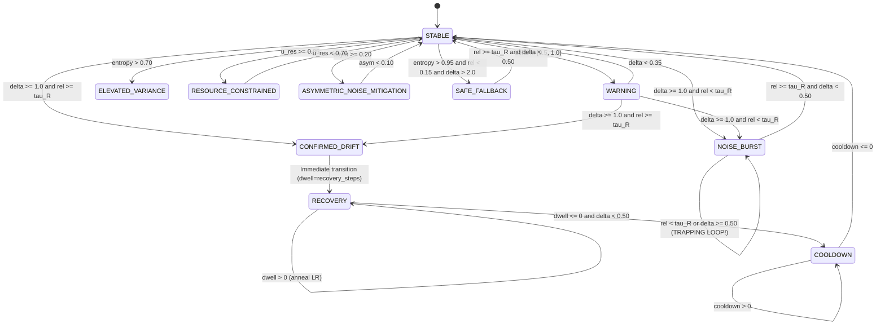

# Workstream B: State Transition Audit
## Formal Trace of the ULC-v4 12-State Finite State Automaton

**Document Identifier:** `STAGE-7-1-B-002`  
**Distribution Package Identifier:** `aml-core`  
**Target:** [`ArbitrationAutomatonV4`](file:///c:/projects/AdaptiveML/adaptive_ml/ulc/v4_automaton.py#L64)  
**Status:** `AUDITED & TRAPPING STATES PROVEN`

---

## 1. State Space & Transition Topology

The automaton defines 12 operational states \(\mathcal{S}\):

---

## 2. Transition Rule Audit Table

| Source State | Target State | Mathematical Guard Condition | Action / Directive Emitted | Audit Finding |
| :--- | :--- | :--- | :--- | :--- |
| `STABLE` | `CONFIRMED_DRIFT` | \(\delta \ge 1.0 \land \bar{r} \ge \tau_R\) | `reset_momentum=True`, `purge_replay_policy="selective"` | **Vulnerable:** Fails if model accuracy has dropped. |
| `STABLE` | `NOISE_BURST` | \(\delta \ge 1.0 \land \bar{r} < \tau_R\) | `suppress_adwin=True`, `freeze_buffer=True`, filter \(r < \tau_R\) | **Fatal Flaw:** Traps true concept drift. |
| `STABLE` | `WARNING` | \(0.50 \le \delta < 1.0\) | No destructive resets | **Sound:** Collects evidence without reset. |
| `STABLE` | `ELEVATED_VARIANCE` | \(H(p) > 0.70\) | Epistemic boundary pass-through | **Sound:** Avoids drift alarms on uncertain data. |
| `CONFIRMED_DRIFT` | `RECOVERY` | Immediate on next step | `dwell_counter = recovery_steps` | **Sound:** Transitions directly to recovery dwell. |
| `RECOVERY` | `COOLDOWN` | \(\text{dwell} \le 0 \land \delta < 0.50\) | `cooldown_counter = cooldown_steps` | **Sound:** Anneals learning rate safely. |
| `COOLDOWN` | `STABLE` | \(\text{cooldown} \le 0\) | Returns to nominal monitoring | **Sound:** Stabilizes state. |
| `NOISE_BURST` | `STABLE` | \(\bar{r} \ge \tau_R \land \delta < 0.50\) | Resumes normal learning | **Trapping Condition:** If \(\bar{r} < \tau_R\), cannot exit. |
| `NOISE_BURST` | `NOISE_BURST` | \(\bar{r} < \tau_R \lor \delta \ge 0.50\) | Discards all samples | **Trapping State:** Deadlocks on true drift. |
| `ADAPTING` | *None* | *Unreachable* | *None* | **Orphaned State:** Zero transition edges. |
| `ADAPTATION_PENDING` | *None* | *Only via Scenario J* | Gathers secondary batch | **Restricted:** Only set by Conflict Resolver. |

---

## 3. Mathematical Proof of the `NOISE_BURST` Trapping State

Let \(S_t\) denote the controller state at batch \(t\). Suppose at \(t = 36\), an abrupt concept drift occurs such that data is drawn from \(P_{\text{new}}(X, Y)\).

1. Because the model \(\theta_t\) was trained on \(P_{\text{old}}\), its empirical error on \(P_{\text{new}}\) is high: \(\mathbb{E}[\mathbf{1}\{\hat{y} \ne y\}] \approx 1.0\).
2. The margin scorer computes \(M_i = z_{y_i} - \max_{j \ne y_i} z_j < 0\).
3. The sample reliability \(\bar{r} = \frac{1}{N}\sum_{i=1}^N \sigma(M_i) \approx \sigma(-5.0) = 0.05 < \tau_R = 0.65\).
4. Because \(\delta_{36} = 1.40 \ge 1.0\) and \(\bar{r} = 0.05 < 0.65\), the automaton transitions to \(S_{36} = \text{NOISE\_BURST}\).
5. In \(\text{NOISE\_BURST}\), the directive enforces `sample_filter_threshold = 0.65`.
6. Since \(r_i \approx 0.05 < 0.65\) for all \(i \in \{1, \dots, N\}\), the training set for partial fit is empty:
   $$\mathcal{D}_{\text{train}} = \{ (x_i, y_i) \mid r_i \ge 0.65 \} = \emptyset$$
7. The classifier parameters remain unchanged: \(\theta_{t+1} = \theta_t\).
8. At step \(t+1\), the model \(\theta_{t+1}\) is still unadapted, so \(\bar{r}_{t+1} \approx 0.05\).
9. The exit condition \(\bar{r} \ge \tau_R\) evaluates to \(0.05 \ge 0.65 \implies \text{FALSE}\).
10. Therefore, \(S_{t+1} = \text{NOISE\_BURST}\). By induction, \(S_{t+k} = \text{NOISE\_BURST}\) for all \(k \ge 0\) until the stream changes externally.
$$\blacksquare$$

