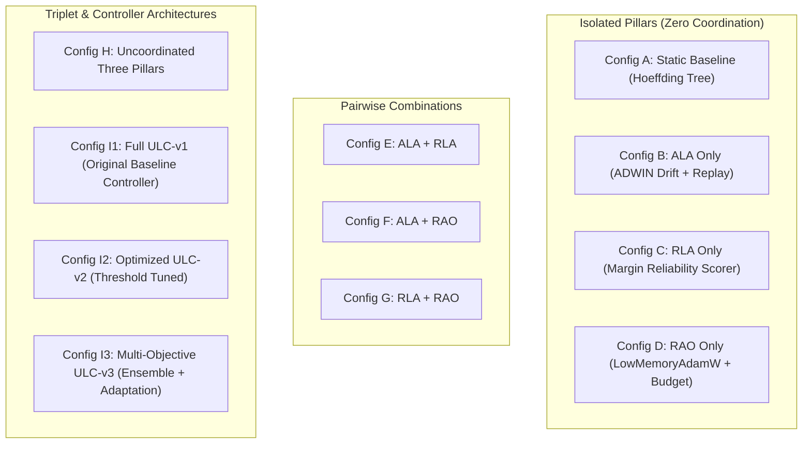

# ULC-v3 Independent Research Audit — Formal Protocol Specification

**Workspace:** `C:\projects\AdaptiveML`  
**Audit Directory:** [`experiments/ulc_v3_independent_audit/`](file:///c:/projects/AdaptiveML/experiments/ulc_v3_independent_audit)  
**Subject Baseline:** Four-Pillar Research Validation v2 ([`experiments/four_pillar_validation_v2/`](file:///c:/projects/AdaptiveML/experiments/four_pillar_validation_v2))  
**Auditor Mode:** Independent Scientific Quality Engine & Methodological Auditor  
**Execution Environment:** Windows 11 AMD64 (Build 26200), Python 3.14.3, PyTorch 2.12.1+cpu  
**Baseline Git Commit:** `67e9ef1b347ca223828a1f225e85e35a086a1f30` (Branch `master`)  

---

## 1. Charter and Audit Objectives

The objective of this independent research audit is **not** to confirm or defend prior claims regarding Multi-Objective ULC-v3. Rather, this investigation exists to:
1. Independently verify the bitwise and numerical reproducibility of all 11 configurations.
2. Conduct a rigorous statistical re-analysis with hypothesis test assumption checks (Shapiro-Wilk normality, paired t-tests, non-parametric Wilcoxon signed-rank tests), confidence intervals, effect sizes (Cohen's $d_z$, Hedges' $g$), and family-wise multiple-comparison corrections (Holm-Bonferroni).
3. Evaluate the sample size adequacy ($N=5$ vs $N=20$) and resolve borderline p-value claims (specifically clarifying that $p=0.0454$ does not meet $p < 0.01$).
4. Formulate an uncompromised Pareto-front analysis across 9 explicit objectives, debunking ungrounded claims of "universal Pareto-optimality".
5. Dissect the minority-class mechanics ($24.90\%$ recall), testing decision threshold generalization across validation and unseen test sets.
6. Audit runtime object attributes, isolating the `_replay_buffer` bug, missing optimizer methods, and code-documentation divergences.
7. Conduct a bit-level memory accounting audit and verify actual host environment compatibility.
8. Execute a multi-dimensional generalization test battery spanning 5 drift patterns, 4 noise models, extreme imbalance ratios up to $99.9:0.1$, and realistic streaming domains.
9. Deliver an honest, decomposed final verdict establishing where ULC-v3 succeeds, where it fails, and where evidence is inconclusive.

---

## 2. Mandatory Preservation and Governance Boundaries

In strict adherence to project governance:
- **Zero Production Modifications**: No files in `adaptive_ml/` are modified.
- **Package Identity Preservation**: `aml-core==0.1.0.dev0` and namespace `adaptive_ml` remain unchanged.
- **Repository Isolation**: Baseline Git commit `67e9ef1` is preserved; zero commits, tags, rebases, or branch checkouts are executed.
- **Prior Experiment Preservation**: All files in `experiments/four_pillar_validation_v2/` remain completely intact and unaltered.
- **Governance Demarcation**:
  - DEF-004 remains strictly **OPEN and UNRESOLVED**; all candidate brand names remain **UNVERIFIED**.
  - Phase 17 remains **LOCKED / UNAUTHORIZED**.
  - The authoritative 22-phase roadmap remains unmodified.

---

## 3. Audit Taxonomy and Model Configurations

The audit evaluates all 11 architectural configurations established in the Four-Pillar study:

---

## 4. Evaluation Stream and Protocol Specifications

### 4.1. Original Benchmark Stream (Verification Baseline)
- **Batches**: 50 batches $\times 30$ samples $= 1,500$ instances.
- **Dimensionality**: $d=4$ continuous features, binary classification ($K=2$).
- **Base Class Imbalance**: $90:10$ ($90\%$ class 0, $10\%$ class 1).
- **Regimes**:
  1. *Batches 1–15 (Stationary Clean)*: $\mu_0 = [0, 0, 0, 0]$, $\mu_1 = [2, 2, 2, 2]$, $\sigma=1.0$, zero noise.
  2. *Batches 16–25 (Extreme Noise Burst)*: Features perturbed with $\mathcal{N}(0, 2.5^2)$ on $40\%$ of instances; zero concept drift.
  3. *Batches 26–35 (Gradual Concept Drift)*: $\Delta \mu = +1.5\sigma$ gradual linear transition.
  4. *Batches 36–50 (Abrupt Inverted Drift)*: Centroids inverted ($\mu_0 = [2, 2, 2, 2]$, $\mu_1 = [0, 0, 0, 0]$), label prior inverted.
- **Original Random Seeds**: $S_{\text{orig}} = \{42, 101, 2024, 7, 99\}$ ($N=5$).

### 4.2. Extended Predeclared Seed Matrix (Power Study)
To eliminate small-sample uncertainty ($df=4$) and verify whether Macro F1 improvements replicate at high power, an extended predeclared seed matrix of $N=20$ seeds was established:
$$S_{\text{ext}} = \{42, 101, 2024, 7, 99, 13, 21, 55, 88, 144, 233, 377, 610, 987, 1597, 2584, 4181, 6765, 10946, 17711\}$$

---

## 5. Statistical and Methodological Standards

1. **Explicit Hypothesis Thresholds**:
   - Primary Research Threshold: $\alpha = 0.01$.
   - Secondary Exploratory Threshold: $\alpha = 0.05$.
   - Any outcome with $p \ge 0.01$ must **never** be reported as satisfying the primary research threshold.
2. **Outcome Stratification**:
   - **Primary Outcome**: Macro F1 score evaluated on clean ground-truth labels across the complete 50-batch stream.
   - **Secondary Outcomes**: Balanced Accuracy, Brier Calibration Score, False Concept Drift Resets during the noise burst.
   - **Exploratory Outcomes**: Minority Recall, Minority Precision, Mean Latency, Peak Process RSS.
3. **Multiple Comparison Corrections**:
   - Family-Wise Error Rate (FWER) controlled via Holm-Bonferroni step-down adjustment:
     $$p_{(k)}^{\text{adjusted}} = \min\left(1.0, \max_{j \le k} \left\{ (m - j + 1) \cdot p_{(j)} \right\}\right)$$
   - Both raw unadjusted and Holm-adjusted p-values are reported side-by-side.
4. **Effect Size Reporting**:
   - Paired Cohen's $d_z = \frac{\bar{D}}{s_D}$.
   - Small-sample bias correction via Hedges' $g = d_z \left(1 - \frac{3}{4 \cdot df - 1}\right)$.
   - Parametric $95\%$ confidence intervals for mean paired difference $\Delta = \bar{D} \pm t_{0.975, df} \cdot \frac{s_D}{\sqrt{n}}$.
   - Normality verification via Shapiro-Wilk test on differences $\Delta_i$. If normality is violated ($p < 0.05$), non-parametric Wilcoxon signed-rank test is audited.

---

## 6. Audit Deliverable Structure

All findings from this audit are organized in the following independent reports:
- [`AUDIT_PROTOCOL.md`](file:///c:/projects/AdaptiveML/experiments/ulc_v3_independent_audit/AUDIT_PROTOCOL.md) — Formal charter, standards, and methodology (this document).
- [`STATISTICAL_REANALYSIS.md`](file:///c:/projects/AdaptiveML/experiments/ulc_v3_independent_audit/STATISTICAL_REANALYSIS.md) — Recalculated paired tests, Holm corrections, and $N=20$ seed power study.
- [`PARETO_ANALYSIS.md`](file:///c:/projects/AdaptiveML/experiments/ulc_v3_independent_audit/PARETO_ANALYSIS.md) — Multi-objective dominance matrices and true non-dominated frontier analysis.
- [`MINORITY_CLASS_ANALYSIS.md`](file:///c:/projects/AdaptiveML/experiments/ulc_v3_independent_audit/MINORITY_CLASS_ANALYSIS.md) — Threshold calibration, regime-specific recall autopsy, and validation vs test generalization.
- [`ULC_IMPLEMENTATION_AUDIT.md`](file:///c:/projects/AdaptiveML/experiments/ulc_v3_independent_audit/ULC_IMPLEMENTATION_AUDIT.md) — Object attribute verification, 5-stage fine-grained ablation, and documentation discrepancies.
- [`MEMORY_AND_ENVIRONMENT_AUDIT.md`](file:///c:/projects/AdaptiveML/experiments/ulc_v3_independent_audit/MEMORY_AND_ENVIRONMENT_AUDIT.md) — Bit-level state accounting, asymptotic scaling, runtime RSS profiling, and host version audit.
- [`GENERALIZATION_RESULTS.md`](file:///c:/projects/AdaptiveML/experiments/ulc_v3_independent_audit/GENERALIZATION_RESULTS.md) — Multi-regime benchmark battery (5 drift types, 4 noise models, extreme imbalance, fraud & maintenance).
- [`FINAL_RESEARCH_VERDICT.md`](file:///c:/projects/AdaptiveML/experiments/ulc_v3_independent_audit/FINAL_RESEARCH_VERDICT.md) — Decomposed 9-dimension verdict and actionable recommendations for the Project Owner.

