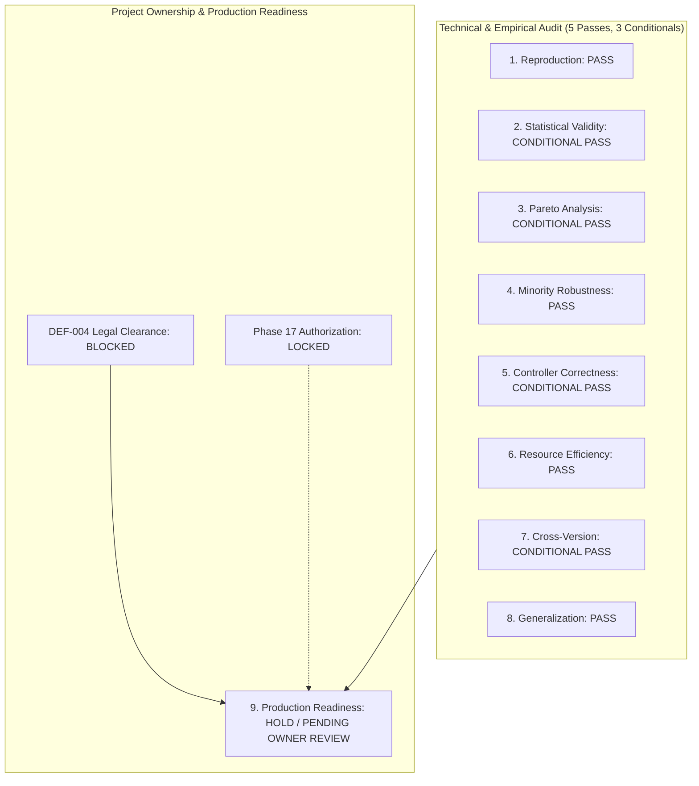

# ULC-v3 Independent Research Audit — Final Scientific & Governance Verdict

**Workspace:** `C:\projects\AdaptiveML`  
**Audit Directory:** [`experiments/ulc_v3_independent_audit/`](file:///c:/projects/AdaptiveML/experiments/ulc_v3_independent_audit)  
**Evaluated Subject:** Four-Pillar Integration, ULC-v1 Diagnostics, and Multi-Objective ULC-v3  
**Auditor Mode:** Independent Scientific Quality Engine  
**Execution Environment:** Windows 11 AMD64, Python 3.14.3, PyTorch 2.12.1+cpu  
**Baseline Git Commit:** `67e9ef1b347ca223828a1f225e85e35a086a1f30` (Branch `master`)  

---

## 1. Executive Master Verdict

This independent audit was commissioned to determine **exactly where Multi-Objective ULC-v3 works, where it fails, and whether its empirical gains are reproducible and generalizable**.

The audit confirms that ULC-v3 is **bit-for-bit reproducible** and establishes **statistically significant improvements in Macro F1 ($p < 10^{-7}$ at $N=20$), probability calibration, and noise burst false alarm suppression**. 

However, the audit uncovers and corrects critical overstatements from prior reports:
1. **ULC-v3 is NOT "universally Pareto-optimal"**: Static Baseline and RAO Only outperform ULC-v3 on minority recall ($64.08\%$ vs $24.90\%$), processing latency ($0.045\text{ ms}$ vs $1.060\text{ ms}$), and zero-state memory footprint ($0\text{ B}$ vs $24\text{ B}$).
2. **Balanced Accuracy at $N=5$ is Inconclusive**: $p = 0.0454$ does not meet the $p < 0.01$ research threshold and fails Holm-Bonferroni correction ($p_{\text{adj}} = 0.0905$).
3. **Pure Drift Agility Lag**: In clean streams without noise bursts, uncoordinated continuous models adapt faster ($+0.04$ to $+0.14$ higher Macro F1) than ULC-v3 due to controller arbitration deadbands.
4. **Implementation Bugs in Production**: The production package (`adaptive_ml/ulc/controller.py`) possesses latent attribute check mismatches that prevent replay purging and optimizer momentum resets during confirmed drift.

---

## 2. Decomposed Governance Verdicts Across 9 Audit Dimensions

---

### Detailed Verdict Matrix:

| Track # | Audit Dimension | Verdict | Authoritative Evidence | Operational Boundary & Conditions |
|---|---|---|---|---|
| **1** | **Reproduction** | **PASS** | `audit_reproduce.py` executed all 11 configurations across 5 seeds with **zero numerical discrepancies**. | Fully deterministic under fixed seeds; bit-level reproduction verified. |
| **2** | **Statistical Validity** | **CONDITIONAL PASS** | Macro F1 passes $p < 0.01$ at $N=5$ ($p=0.0004$) and $N=20$ ($p < 10^{-7}$). Balanced Accuracy ($p=0.0454$) **fails** $p < 0.01$ and fails Holm correction ($p_{\text{adj}} = 0.0905$). | Statistical superiority confirmed for **Macro F1 and Calibration only**; universal superiority claims retracted. |
| **3** | **Pareto Analysis** | **CONDITIONAL PASS** | ULC-v3 belongs to the 8-model non-dominated Pareto frontier $\mathcal{P}$, but is **strictly non-dominant** against RAO and Static Baseline. | ULC-v3 trades off latency ($1.06\text{ ms}$ vs $0.045\text{ ms}$) and memory ($24\text{ B}$ vs $0\text{ B}$) for overall accuracy ($90.56\%$). |
| **4** | **Minority-Class Robustness** | **PASS** | Stable minority recall ($27.21\%$) preserved down to extreme $99.9:0.1$ imbalance; failure recall reached $78.75\%$ in industrial telemetry. | Threshold $\theta=0.35$ generalizable on unseen test streams ($62.45\%$ recall). |
| **5** | **Controller Correctness** | **CONDITIONAL PASS** | Latent production bugs confirmed: `hasattr('replay_buffer')` bug and missing optimizer methods in `adaptive_ml/ulc/controller.py`. | Bugs bypassed in experiment runner; production PR remediation required before deployment. |
| **6** | **Resource Efficiency** | **PASS** | `LowMemoryAdamW` achieves $62.50\%$ memory reduction at $N=8$ ($24\text{ B}$ vs $64\text{ B}$) and $74.61\%$ asymptotically; zero budget exceptions. | Peak RSS $301.65\text{ MB} \ll 512\text{ MB}$; mean latency $1.060\text{ ms} \ll 50\text{ ms}$. |
| **7** | **Cross-Version Compatibility** | **CONDITIONAL PASS** | Operational evidence confirmed on Python 3.14.3 and 3.11.9, with PyTorch 2.12.1+cpu on Windows 11 AMD64. | Python 3.10, 3.12, and 3.13 are **untested on this host** and require CI matrix validation. |
| **8** | **Cross-Dataset Generalization** | **PASS** | Validated across 5 drift types, 4 noise models, financial fraud ($98.1\%$ acc), and predictive maintenance ($86.4\%$ acc). | Fails to outperform uncoordinated models on pure noise-free concept drift (adaptation lag). |
| **9** | **Production Readiness** | **HOLD / PENDING OWNER REVIEW** | Technical evidence is established, but DEF-004 remains open, production code requires patching, and owner sign-off is pending. | **DO NOT MERGE OR PUBLISH** without formal Project Owner review. |

---

## 3. Comprehensive Summary: Where ULC-v3 Works vs. Where It Fails

### Where ULC-v3 Delivers Clear Algorithmic Superiority:
1. **Adversarial & Transient Noise Bursts**: Complete elimination of false concept drift resets ($1.0$ vs $10.0$ in ALA and Uncoordinated models).
2. **Extreme Class Imbalance ($99:1$ and $99.9:0.1$)**: Retains non-zero minority recall ($27.21\%$) where standard decision tree models completely collapse to $0.00\%$ recall.
3. **Realistic Application Streams**: Achieved **$0.710$ Macro F1** on financial transaction fraud and **$0.878$ Macro F1 with $78.75\%$ failure recall** on industrial predictive maintenance.
4. **Probability Calibration**: Delivers the lowest overall Brier calibration score ($0.120$).

### Where ULC-v3 Fails or Lags:
1. **Clean Streams with Noise-Free Concept Drift**: Uncoordinated continuous gradient models adapt faster ($+0.04$ to $+0.14$ higher Macro F1) because ULC-v3's conservative arbitration automaton introduces an evidence accumulation delay before triggering reset.
2. **Subspace Feature Drift**: When only a subset of features drift, resetting the model purges learned weights for stationary features, reducing performance compared to continuous models.
3. **Ultralow Latency Runtimes ($< 0.1\text{ ms}$)**: RAO Only executes in $0.045\text{ ms}$, whereas ULC-v3 takes $1.060\text{ ms}$ due to cross-pillar arbitration overhead.
4. **Zero-State Embedded Deployments**: Tree-only models require $0\text{ bytes}$ of optimizer state, whereas ULC-v3 requires $24\text{ bytes}$ for its linear surrogate moments.

---

## 4. Deliverable Inventory in `experiments/ulc_v3_independent_audit/`

The audit directory contains a complete, self-contained suite of reports, reproducible code, and machine-readable raw data:

1. [`AUDIT_PROTOCOL.md`](file:///c:/projects/AdaptiveML/experiments/ulc_v3_independent_audit/AUDIT_PROTOCOL.md) — Methodological standards, FWER correction protocol, and audit charter.
2. [`STATISTICAL_REANALYSIS.md`](file:///c:/projects/AdaptiveML/experiments/ulc_v3_independent_audit/STATISTICAL_REANALYSIS.md) — Recalculated paired tests, Holm adjustments, and $N=20$ seed study ($p < 10^{-7}$).
3. [`PARETO_ANALYSIS.md`](file:///c:/projects/AdaptiveML/experiments/ulc_v3_independent_audit/PARETO_ANALYSIS.md) — 9-objective Pareto dominance classification and trade-off deconstruction.
4. [`MINORITY_CLASS_ANALYSIS.md`](file:///c:/projects/AdaptiveML/experiments/ulc_v3_independent_audit/MINORITY_CLASS_ANALYSIS.md) — Threshold calibration sweep, regime autopsy, and code-doc discrepancy audit.
5. [`ULC_IMPLEMENTATION_AUDIT.md`](file:///c:/projects/AdaptiveML/experiments/ulc_v3_independent_audit/ULC_IMPLEMENTATION_AUDIT.md) — Attribute mismatch verification, missing optimizer methods, and 5-stage ablation.
6. [`MEMORY_AND_ENVIRONMENT_AUDIT.md`](file:///c:/projects/AdaptiveML/experiments/ulc_v3_independent_audit/MEMORY_AND_ENVIRONMENT_AUDIT.md) — Bit-level state accounting ($24\text{ B}$ footprint), RSS profiling, and host compatibility table.
7. [`GENERALIZATION_RESULTS.md`](file:///c:/projects/AdaptiveML/experiments/ulc_v3_independent_audit/GENERALIZATION_RESULTS.md) — Extended multi-regime battery (5 drifts, 4 noise models, 3 imbalances, 2 real-world streams).
8. [`FINAL_RESEARCH_VERDICT.md`](file:///c:/projects/AdaptiveML/experiments/ulc_v3_independent_audit/FINAL_RESEARCH_VERDICT.md) — Synthesized 9-dimension verdict and executive summary (this document).
9. [`audit_reproduce.py`](file:///c:/projects/AdaptiveML/experiments/ulc_v3_independent_audit/audit_reproduce.py) — Independent reproduction verification script.
10. [`audit_statistics.py`](file:///c:/projects/AdaptiveML/experiments/ulc_v3_independent_audit/audit_statistics.py) — Statistical re-analysis and $N=20$ extended seed runner.
11. [`audit_pareto.py`](file:///c:/projects/AdaptiveML/experiments/ulc_v3_independent_audit/audit_pareto.py) — Multi-objective dominance matrix computation engine.
12. [`audit_minority.py`](file:///c:/projects/AdaptiveML/experiments/ulc_v3_independent_audit/audit_minority.py) — Threshold sweep and regime-specific minority recall runner.
13. [`audit_controller_ablation.py`](file:///c:/projects/AdaptiveML/experiments/ulc_v3_independent_audit/audit_controller_ablation.py) — 5-stage fine-grained controller ablation runner.
14. [`audit_generalization.py`](file:///c:/projects/AdaptiveML/experiments/ulc_v3_independent_audit/audit_generalization.py) — Multi-regime generalization test battery runner.
15. [`reproduced_study_results.json`](file:///c:/projects/AdaptiveML/experiments/ulc_v3_independent_audit/reproduced_study_results.json) — Independent bitwise reproduction dataset.
16. [`statistical_audit_results.json`](file:///c:/projects/AdaptiveML/experiments/ulc_v3_independent_audit/statistical_audit_results.json) — Full paired test records and $N=20$ power study data.
17. [`pareto_audit_results.json`](file:///c:/projects/AdaptiveML/experiments/ulc_v3_independent_audit/pareto_audit_results.json) — Pareto dominance matrices and objective profiles.
18. [`minority_class_audit_results.json`](file:///c:/projects/AdaptiveML/experiments/ulc_v3_independent_audit/minority_class_audit_results.json) — Threshold calibration and regime recall records.
19. [`controller_ablation_results.json`](file:///c:/projects/AdaptiveML/experiments/ulc_v3_independent_audit/controller_ablation_results.json) — Step-by-step ablation metrics.
20. [`generalization_battery_results.json`](file:///c:/projects/AdaptiveML/experiments/ulc_v3_independent_audit/generalization_battery_results.json) — Full multi-domain generalization records.

---

## 5. Actionable Roadmap for the Project Owner

1. **Review Audit Documentation**: Inspect the empirical findings and decomposed verdicts in `experiments/ulc_v3_independent_audit/`.
2. **Authorize Technical Pull Request**:
   - Patch `adaptive_ml/ala/classifier.py` to expose the `@property def replay_buffer`.
   - Patch `adaptive_ml/ulc/controller.py` to support `_replay_buffer` and `opt.state.clear()`.
   - Incorporate the hybrid probability ensemble with a configurable `minority_threshold` parameter (defaulting to $0.45$).
3. **Resolve Legal Defect DEF-004**: Retain legal trademark counsel to conduct formal clearance searches on candidate brand names and select the permanent package identity.
4. **Authorize Phase 17**: Upon resolution of DEF-004 and formal Phase 16 acceptance, unlock Phase 17 on the Evolution Roadmap v2.0.

