# Generalization Benchmark Results & Cross-Regime Audit

**Audit Directory:** [`experiments/ulc_v3_independent_audit/`](file:///c:/projects/AdaptiveML/experiments/ulc_v3_independent_audit)  
**Reference Data:** [`generalization_battery_results.json`](file:///c:/projects/AdaptiveML/experiments/ulc_v3_independent_audit/generalization_battery_results.json)  
**Evaluation Scope:** 5 Drift Types, 4 Noise Models, 3 Severe Imbalance Ratios, and 2 Realistic Streaming Domains  

---

## 1. Executive Summary: Beyond the Single Synthetic Stream

A central limitation of the prior Four-Pillar Validation v2 study was its reliance on a single synthetic stream ($d=4$, $90:10$ imbalance, fixed 4-regime sequence).

To determine whether the observed performance of **Multi-Objective ULC-v3** reflects genuine algorithmic generalizability or domain-specific tuning, we executed an extensive **Generalization Benchmark Battery** across four challenging operational axes:
1. **Concept Drift Diversity**: Abrupt, Gradual, Incremental (continuous), Recurring (A $\to$ B $\to$ A), and Feature-Level (partial subspace drift).
2. **Label Noise Diversity**: Symmetric, Asymmetric, Instance-Dependent (boundary-localized), and Extreme Feature Noise Bursts.
3. **Severe Class Imbalance**: $90:10$ ($10\%$), $99:1$ ($1\%$), and $99.9:0.1$ ($0.1\%$).
4. **Realistic Application Streams**: Simulated Financial Transaction Fraud and Industrial Predictive Maintenance.

---

## 2. Concept Drift Diversity (Clean Streams Without Noise Bursts)

This experiment evaluates adaptation agility when concept drift occurs in isolation, without confounding observation noise.

| Drift Type | Static Baseline (Macro F1) | Uncoordinated Three Pillars (Macro F1) | Multi-Objective ULC-v3 (Macro F1) | Empirical Comparison & Findings |
|---|---|---|---|---|
| **Abrupt Drift** (Centroid Inversion) | $0.474$ | **$0.550$** | $0.509$ | Uncoordinated adapts $+0.041$ higher; ULC-v3 delayed by arbitration deadband. |
| **Gradual Drift** (20-Batch Transition) | $0.474$ | **$0.554$** | $0.492$ | Uncoordinated smoothly tracks centroid; ULC-v3 lags during transition. |
| **Incremental Drift** (Continuous Step) | $0.474$ | **$0.568$** | $0.499$ | Uncoordinated continuous gradient updates dominate discrete tree resets. |
| **Recurring Drift** (Concept A $\to$ B $\to$ A) | $0.474$ | **$0.527$** | $0.481$ | Replay buffer clearing removes prior concept A memory upon transition. |
| **Feature-Level Drift** (Subspace Drift) | $0.474$ | **$0.694$** | $0.555$ | Uncoordinated preserves stationary features $(f_2, f_3)$; tree reset loses them. |

> [!CAUTION]
> **Critical Negative Finding**: In pure concept drift environments with zero observation noise, **Uncoordinated Three Pillars outperforms Multi-Objective ULC-v3** by $+0.04$ to $+0.14$ Macro F1.
> 
> *Root Cause*: The controller's finite-state automaton is designed to be conservative to prevent false alarms during noise bursts. When noise is absent, this conservatism introduces an adaptation lag (requiring evidence accumulation before transitioning to `CONFIRMED_DRIFT`), whereas continuous gradient updates adapt immediately at every step.

---

## 3. Label Noise Diversity (Without Concept Drift)

This experiment evaluates noise robustness and false alarm suppression across four distinct noise models.

| Noise Model | Description / Parameters | Uncoordinated False Resets | ULC-v3 False Resets | ULC-v3 Macro F1 | Robustness Verdict |
|---|---|---|---|---|---|
| **Symmetric Noise** | $20\%$ uniform random label flipping | $0.0$ | **$0.0$** | $0.652$ | **ROBUST** |
| **Asymmetric Noise** | Class $1 \to 0$ ($p=0.30$), Class $0 \to 1$ ($p=0.05$) | $0.0$ | **$0.0$** | $0.658$ | **ROBUST** |
| **Instance-Dependent** | Boundary-localized flipping ($p \in [0.05, 0.50]$) | $0.0$ | **$0.0$** | $0.774$ | **HIGH ACCURACY** |
| **Feature Noise Burst** | $40\%$ feature perturbation across 10 batches | $10.0$ | **$0.0$** | $0.694$ | **100% SUPPRESSION** |

### Key Insight:
ULC-v3's noise-drift discrimination kernel ($\bar{r}_t < \gamma_{\text{noise}}$) successfully suppressed false drift alarms across all four noise models. In particular, during the $40\%$ feature noise burst, ULC-v3 completely eliminated the 10 false resets suffered by uncoordinated models.

---

## 4. Extreme Class Imbalance ($90:10$, $99:1$, $99.9:0.1$)

In production fraud and failure detection, minority classes frequently represent $< 1\%$ of all instances. We evaluated model retention across increasing orders of magnitude of class rarity:

```mermaid
xychart-beta
    title "Minority Recall across Imbalance Ratios (10% vs 1% vs 0.1%)"
    x-axis ["90:10 (10%)", "99:1 (1%)", "99.9:0.1 (0.1%)"]
    y-axis "Minority Recall (%)" 0 --> 35
    bar [0.0, 0.0, 0.0]
    bar [27.9, 27.2, 27.2]
```



| Imbalance Ratio | Minority Proportion | Static Baseline Recall (%) | Multi-Objective ULC-v3 Recall (%) | Multi-Objective ULC-v3 Macro F1 |
|---|---|---|---|---|
| **$90:10$** | $10.0\%$ | $0.00\%$ | **$27.89\%$** | $0.613$ |
| **$99:1$** | $1.0\%$ | $0.00\%$ | **$27.21\%$** | $0.589$ |
| **$99.9:0.1$** | $0.1\%$ (1 in 1000) | $0.00\%$ | **$27.21\%$** | $0.587$ |

### Imbalance Findings:
- **Baseline Starvation**: The Static Baseline tree classifier collapsed to $0.00\%$ minority recall across all three imbalance levels, predicting exclusively majority class.
- **ULC-v3 Invariance**: Multi-Objective ULC-v3 maintained a stable **$27.21\%$ minority recall** even at severe $99.9:0.1$ imbalance. The continuous cross-entropy gradients on the linear surrogate model actively prevented rare instances from being discarded.

---

## 5. Realistic Streaming Applications

### 5.1. Financial Transaction Fraud Stream
- **Characteristics**: $d=6$ transaction features, $98:2$ base imbalance, recurring fraud bursts in batches 15–20 and 35–40, inflation covariate drift on transaction amounts.
- **Empirical Results**:
  - Overall Accuracy: **$98.14\%$**
  - Macro F1: **$0.710$**
  - Minority Fraud Recall: **$32.16\%$**
  - Minority Fraud Precision: **$44.18\%$**
  - False Concept Resets: **$0.0$**

### 5.2. Industrial Predictive Maintenance Sensor Stream
- **Characteristics**: $d=5$ physical telemetry sensors (vibration, acoustics, temperature), continuous monotonic wear-and-tear degradation from normal to failure, severe sensor glitch noise bursts in batches 20–25.
- **Empirical Results**:
  - Overall Accuracy: **$86.42\%$**
  - Macro F1: **$0.878$**
  - Equipment Failure Recall: **$78.75\%$**
  - Equipment Failure Precision: **$82.14\%$**
  - Glitch False Resets: **$0.0$**

---

## 6. Synthesis: Where ULC-v3 Succeeds vs. Where It Fails

```
                               ┌─────────────────────────────────────────────────────────────┐
                               │                    WHERE ULC-v3 SUCCEEDS                    │
                               ├─────────────────────────────────────────────────────────────┤
                               │ 1. Environments with Co-occurring Drift and Noise Bursts    │
                               │ 2. Severe Class Imbalance (Preserves 27% recall at 0.1%)    │
                               │ 3. Realistic Industrial Telemetry (78.8% failure recall)    │
                               │ 4. Probability Calibration (Low Brier score 0.120)          │
                               └─────────────────────────────────────────────────────────────┘
                                                              │
                                                              ▼
                               ┌─────────────────────────────────────────────────────────────┐
                               │                     WHERE ULC-v3 FAILS                      │
                               ├─────────────────────────────────────────────────────────────┤
                               │ 1. Clean, Noise-Free Streams (Uncoordinated adapts faster)   │
                               │ 2. High-Frequency Realtime Streams (< 0.1ms budget)         │
                               │ 3. Zero-Footprint Embedded Runtimes (Requires 24B state)    │
                               │ 4. Subspace Feature Drift (Purging forgets stationary dims) │
                               └─────────────────────────────────────────────────────────────┘
```

### Final Generalization Verdict:
Multi-Objective ULC-v3 is **not a universal silver bullet** for all streaming scenarios. Its primary value proposition is **robustness against adversarial noise bursts and stability under heavy class imbalance**. For clean, stationary, or noise-free drifting streams, simpler uncoordinated gradient architectures provide superior adaptation agility.

