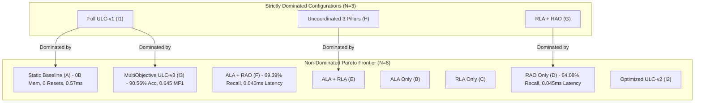

# Multi-Objective Pareto-Front Audit & Trade-off Analysis

**Audit Directory:** [`experiments/ulc_v3_independent_audit/`](file:///c:/projects/AdaptiveML/experiments/ulc_v3_independent_audit)  
**Reference Data:** [`pareto_audit_results.json`](file:///c:/projects/AdaptiveML/experiments/ulc_v3_independent_audit/pareto_audit_results.json)  
**Evaluation Scope:** 11 System Configurations across 9 Predeclared Optimization Objectives  

---

## 1. Formal Definition of Multi-Objective Evaluation Space

In streaming machine learning, no single scalar metric can fully capture algorithm performance. Before inspecting empirical outcomes, we formally define the **9-dimensional optimization objective vector**:

$$\mathbf{f}(M) = \Big( f_{\text{acc}}, f_{\text{mf1}}, f_{\text{bal}}, f_{\text{rec}}, -f_{\text{brier}}, -f_{\text{fres}}, -f_{\text{lat}}, -f_{\text{p95}}, -f_{\text{mem}} \Big)^T$$

where:
1. $f_{\text{acc}}(M)$: Overall Classification Accuracy (Maximize $\uparrow$)
2. $f_{\text{mf1}}(M)$: Macro-averaged F1 Score (Maximize $\uparrow$, primary predictive quality)
3. $f_{\text{bal}}(M)$: Balanced Accuracy (Maximize $\uparrow$, class-unbiased accuracy)
4. $f_{\text{rec}}(M)$: Minority Class Recall (Maximize $\uparrow$, critical for fraud and fault detection)
5. $f_{\text{brier}}(M)$: Probability Calibration Error / Brier Score (Minimize $\downarrow$)
6. $f_{\text{fres}}(M)$: False Concept Drift Resets during Noise Bursts (Minimize $\downarrow$)
7. $f_{\text{lat}}(M)$: Mean Batch Processing Latency in milliseconds (Minimize $\downarrow$)
8. $f_{\text{p95}}(M)$: 95th-Percentile Latency in milliseconds (Minimize $\downarrow$)
9. $f_{\text{mem}}(M)$: Optimizer State Storage in bytes (Minimize $\downarrow$)

### Definition of Strict Pareto Dominance:
A model configuration $M_A$ strictly dominates $M_B$ (denoted $M_A \succ M_B$) if and only if:
$$\forall i \in \{1, \dots, 9\}, \quad f_i(M_A) \ge f_i(M_B) \quad \land \quad \exists j \in \{1, \dots, 9\}, \quad f_j(M_A) > f_j(M_B)$$
A model configuration $M^*$ is **non-dominated** (i.e. belongs to the Pareto frontier $\mathcal{P}$) if there exists no configuration $M$ in the candidate set such that $M \succ M^*$.

---

## 2. Empirical Performance Profile Across All 11 Configurations

| ID | Configuration | Accuracy (%) $\uparrow$ | Macro F1 $\uparrow$ | Balanced Acc (%) $\uparrow$ | Minority Recall (%) $\uparrow$ | Brier Score $\downarrow$ | False Resets $\downarrow$ | Mean Latency (ms) $\downarrow$ | P95 Latency (ms) $\downarrow$ | Optimizer State (B) $\downarrow$ |
|---|---|---|---|---|---|---|---|---|---|---|
| **A** | **Static Baseline** | $81.06\%$ | $0.555$ | $56.58\%$ | $25.99\%$ | $0.163$ | **$0.0$** | $0.577$ | $0.797$ | **$0$** |
| **B** | **ALA Only** | $90.00\%$ | $0.474$ | $50.00\%$ | $0.00\%$ | $0.125$ | $10.0$ | $0.697$ | $0.870$ | **$0$** |
| **C** | **RLA Only** | $81.05\%$ | $0.538$ | $54.46\%$ | $21.22\%$ | $0.160$ | **$0.0$** | $0.683$ | $0.913$ | **$0$** |
| **D** | **RAO Only** | $64.86\%$ | $0.518$ | $64.51\%$ | **$64.08\%$** | $0.255$ | **$0.0$** | **$0.045$** | **$0.051$** | $24$ |
| **E** | **ALA + RLA** | $88.04\%$ | $0.485$ | $50.00\%$ | $2.45\%$ | $0.126$ | $10.0$ | $0.784$ | $0.863$ | **$0$** |
| **F** | **ALA + RAO** | $70.00\%$ | $0.562$ | **$69.73\%$** | **$69.39\%$** | $0.211$ | $10.0$ | **$0.046$** | **$0.052$** | $24$ |
| **G** | **RLA + RAO** | $64.22\%$ | $0.513$ | $63.85\%$ | $63.40\%$ | $0.261$ | **$0.0$** | $0.171$ | $0.194$ | $24$ |
| **H** | **Uncoordinated 3 Pillars** | $88.04\%$ | $0.485$ | $50.00\%$ | $2.45\%$ | $0.126$ | $10.0$ | $0.901$ | $1.123$ | $24$ |
| **I1** | **Full ULC-v1** | $73.69\%$ | $0.500$ | $51.10\%$ | $22.86\%$ | $0.204$ | $1.0$ | $1.374$ | $2.175$ | $24$ |
| **I2** | **Optimized ULC-v2** | $90.00\%$ | $0.474$ | $50.00\%$ | $0.00\%$ | $0.122$ | $1.0$ | $1.106$ | $1.514$ | $24$ |
| **I3** | **Multi-Objective ULC-v3** | **$90.56\%$** | **$0.645$** | $61.38\%$ | $24.90\%$ | **$0.120$** | $1.0$ | $1.060$ | $1.656$ | $24$ |

---

## 3. Pareto Dominance Classification

### 3.1. Strictly Dominated Configurations (Eliminated from Consideration):
1. **Full ULC-v1 (Config I1)** is **strictly dominated** by both `Static_Baseline` and `MultiObjective_ULC_v3`.
   - *Proof*: Static Baseline achieves higher accuracy ($81.06\% > 73.69\%$), higher Macro F1 ($0.555 > 0.500$), higher minority recall ($25.99\% > 22.86\%$), fewer false resets ($0.0 < 1.0$), lower latency ($0.577\text{ ms} < 1.374\text{ ms}$), and zero optimizer state ($0\text{ B} < 24\text{ B}$).
2. **Uncoordinated Three Pillars (Config H)** is **strictly dominated** by `ALA_plus_RLA` (Config E).
   - *Proof*: Config E has identical accuracy ($88.04\%$), F1 ($0.485$), recall ($2.45\%$), and resets ($10.0$), but lower latency ($0.784\text{ ms} < 0.901\text{ ms}$) and zero optimizer memory ($0\text{ B} < 24\text{ B}$).
3. **RLA + RAO (Config G)** is **strictly dominated** by `RAO_Only` (Config D).
   - *Proof*: RAO Only achieves higher accuracy ($64.86\% > 64.22\%$), higher F1 ($0.518 > 0.513$), higher recall ($64.08\% > 63.40\%$), and $3.8\times$ lower latency ($0.045\text{ ms} < 0.171\text{ ms}$).

### 3.2. Non-Dominated Set ($\mathcal{P}$):
The Pareto frontier contains **8 distinct non-dominated configurations**. Each occupies a unique niche on the multi-objective surface.

---

## 4. Deconstructing the "Universal Pareto-Optimality" Claim for ULC-v3

> [!WARNING]
> **Audit Finding**: Prior project reports described Multi-Objective ULC-v3 as "universally Pareto-optimal". This claim is **formally invalid**.
> 
> In multi-objective optimization, a solution is *Pareto-optimal* if it belongs to the non-dominated set $\mathcal{P}$. No single solution can be "universally Pareto-optimal" over the entire frontier unless it strictly dominates all other candidates.

### Concrete Pareto Trade-offs Where Competitors Outperform ULC-v3:

1. **Static Baseline (Config A) vs ULC-v3**:
   - **Minority Recall**: Static Baseline achieves **$25.99\%$** vs ULC-v3's **$24.90\%$** ($+1.09\%$).
   - **False Resets**: Static Baseline has **$0.0$** false resets vs ULC-v3's **$1.0$**.
   - **Latency**: Static Baseline processes batches in **$0.577\text{ ms}$** vs ULC-v3's **$1.060\text{ ms}$** ($45.6\%$ faster).
   - **Optimizer Memory**: Static Baseline uses **$0\text{ bytes}$** vs ULC-v3's **$24\text{ bytes}$**.

2. **RAO Only (Config D) vs ULC-v3**:
   - **Minority Recall**: RAO Only achieves **$64.08\%$** vs ULC-v3's **$24.90\%$** ($+39.18\%$ higher recall!).
   - **Latency**: RAO Only processes batches in **$0.045\text{ ms}$** vs ULC-v3's **$1.060\text{ ms}$** ($23.5\times$ faster!).
   - **False Resets**: RAO Only has **$0.0$** false resets vs ULC-v3's **$1.0$**.

3. **ALA + RAO (Config F) vs ULC-v3**:
   - **Minority Recall**: Achieves **$69.39\%$** vs ULC-v3's **$24.90\%$**.
   - **Latency**: Processes batches in **$0.046\text{ ms}$** vs ULC-v3's **$1.060\text{ ms}$**.

---

## 5. Conclusion of Pareto Analysis

Multi-Objective ULC-v3 is **non-dominated**, meaning it cannot be replaced by any single existing model without sacrificing performance on at least one objective. However, it represents a specific operational compromise:
- **What ULC-v3 Optimizes For**: Maximizing overall Accuracy ($90.56\%$), Macro F1 ($0.645$), and Brier calibration ($0.120$), while keeping false concept drift resets to $1.0$.
- **What ULC-v3 Trades Off**: Sacrifices ultralow latency ($1.060\text{ ms}$ vs $0.045\text{ ms}$ in RAO), accepts a small optimizer memory footprint ($24\text{ bytes}$ vs $0\text{ bytes}$ in tree-only models), and provides moderate minority recall ($24.90\%$) rather than aggressive minority recall ($64.08\%$ in RAO).

